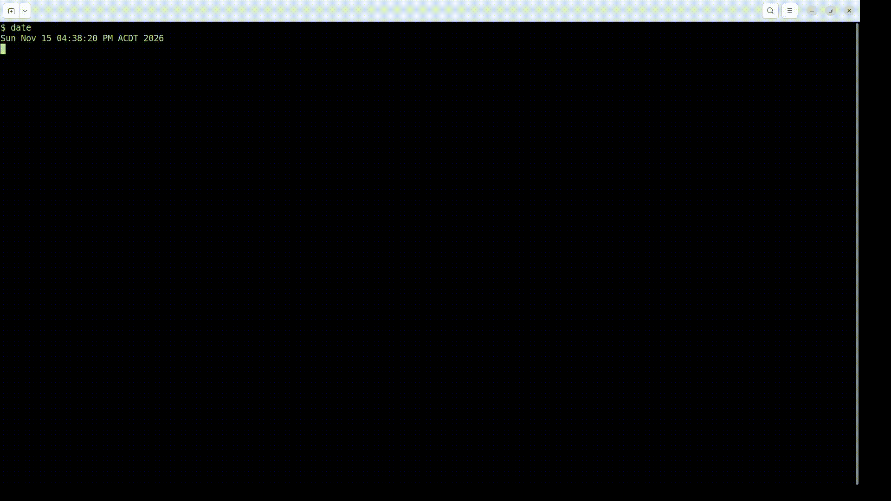

<p align="center"></p>
<p align="center"><em>time-travel for your Linux system</em></p>

# clifr — a Linux flight recorder (working prototype)

<p align="center"></p>

## What is clifr?

clifr (**command line flight recorder**) is a "black box" for Linux servers: a flight recorder that keeps a continuous record of what happens on the system, so you can go back later and see what the machine looked like at any moment in the past.

It comes in two parts:

- **`clifrd`**, the recorder. It runs as a background service and records non-stop:
  - which processes existed, with their CPU, memory and command line;
  - every process that started or exited, even if it lived for a few milliseconds;
  - every network connection: who opened it, to whom, and when;
  - open files, disks, mounts, network routes, kernel messages and the system-wide counters.

  It keeps the data in `/var/lib/clifr`, 72 hours by default. It uses the kernel's eBPF so short-lived events don't slip through, and it is light: about 2% of one CPU core on a busy server in our tests.
- **`clifr`**, the query tool. It rebuilds the output of the usual commands (`ps`, `top`, `ss`, `lsof`, `df`, `free`, `vmstat`, `ip`, `dmesg` and about 40 in total) **as they would have looked at a past moment**:

  ```sh
  clifr --at "2026-11-12 02:45" "ps aux"
  ```

  Times can be a date (`"2026-11-12 02:45"`), a time today (`"02:45"`) or relative (`"2 hours ago"`, `yesterday`). clifr never runs the command: it rebuilds the output from the recording.

**What it's for:** answering questions about something that already happened, when it is too late to look live. For example:

- What was using the memory before the OOM killer killed a process?
- Who connected to the database between 2 and 3 a.m.?
- What changed between before and after an update? (`clifr diff`)
- Did any traffic go through the VPN? (use case 13 of the [user guide](userguide.md#use-case-13-did-any-of-it-go-through-the-office-vpn))

**What it isn't:**

- a security audit system: it does not record file reads or writes, and root can stop it (optional sealing, `clifrd seal-setup`, makes changes to what it already recorded detectable);
- a monitoring system with alerts.

It complements those tools: Prometheus tells you *when* something happened, clifr tells you *what* happened.

**Status:** a working prototype, licensed AGPL-3.0, tested on Ubuntu 22.04 and 26.04, RHEL/Rocky 8 and Alma 9, including a 4-day soak test with a mixed server load; not yet run on a production server ([Status](#status)). Packages: the [0.1.0 pre-release](https://github.com/jlruedab/clifr/releases) ([release notes](RELEASE-NOTES.md)).

## What commands can I see with clifr?

clifr can rebuild **41 commands**: 35 are the usual Linux tools and 6 are clifr's own. `clifr help COMMAND` shows the options each one supports.

**Processes**

| Command | What it shows |
|---|---|
| `ps` | processes with their CPU, memory, state and command line |
| `top` | the system summary and the busiest processes |
| `pstree` | the process tree |
| `pidstat` | CPU, memory, disk and context switches per process |
| `systemd-cgls` | processes grouped by service (cgroups) |
| `systemctl list-units` | systemd's services and their state |

**Network**

| Command | What it shows |
|---|---|
| `ss`, `netstat` | TCP/UDP connections and which process had them open |
| `ip` | interfaces (`link`), addresses (`address`), routes (`route`), rules (`rule`), ARP neighbours (`neigh`) and namespaces (`netns`) |
| `nstat` | network protocol counters |
| `conntrack -S`, `-C` | the firewall's connection-tracking statistics |

**Files and disks**

| Command | What it shows |
|---|---|
| `lsof` | files and sockets each process had open |
| `df` | used and free space on each file system |
| `mount`, `findmnt` | the mounted file systems |
| `lsblk` | disks and partitions |
| `lslocks` | file locks |
| `swapon` | swap space |
| `iostat` | disk activity |
| `nfsstat`, `mountstats` | NFS statistics |

**Memory and CPU**

| Command | What it shows |
|---|---|
| `free` | used and free memory |
| `vmstat` | memory, CPU and swapping |
| `mpstat` | per-CPU usage |
| `uptime` | time since boot and load average |
| `slabtop` | the kernel's own memory |
| `numastat` | memory per NUMA node |
| `ipcs` | shared memory, semaphores and message queues |

**System**

| Command | What it shows |
|---|---|
| `date`, `hostname`, `uname` | date, host name and kernel version |
| `last reboot` | the machine's boots |
| `dmesg` | kernel messages |
| `lsmod` | loaded kernel modules |
| `sysctl` | kernel parameters |

**clifr's own**

| Command | What it shows |
|---|---|
| `events` | a timeline of process starts and exits, OOM kills and mounts |
| `life` | when each process started and ended, even if it lived for milliseconds |
| `oom` | the processes the OOM killer killed and what was using the memory |
| `pstore` | the kernel's own crash message (panic, oops) from a boot that crashed, when the machine saved it across the reboot (pstore) |
| `mounts` | the mount table and its changes |
| `containers` | containers (Docker, Podman, Kubernetes) and their processes |

**Commands for working with the recording**

- `clifr info`: what the recording covers;
- `clifr diff --at A --at B "COMMAND"`: what changed between two moments (`ps`, `ss`, `netstat`, `lsof`, `df`, `mount` and `findmnt`);
- `clifr verify`: compares the reconstruction with real tool output saved during recording;
- `clifr export TABLE`: the raw data as CSV;
- `clifr help`: the general help, or one command's with `clifr help COMMAND`.

Every command works at a moment or over a period:

```sh
clifr --at "2026-11-13 14:30" "ps aux"                              # at a moment
clifr --since "13:00" --until "14:00" --samples "top -b -n 1"       # over a period
```

An option clifr doesn't support is **rejected with an error** rather than quietly giving you something wrong.

## How expensive is clifr for the system?

Only the recorder costs anything all the time. `clifrd` uses some CPU, memory and disk continuously; `clifr` only runs while you query and is gone when it finishes.

Measured on the desktop where clifr is developed (Intel Core Ultra 7 155H, 22 logical CPUs, 61 GB of memory, Ubuntu 26.04, kernel 7.0, ordinary desktop use with about 510 processes), with the packaged service at its defaults (a sample every 30 s, 72 hours kept):

| Resource | clifrd | Share of the machine |
|---|---|---|
| CPU | **0.35% of one core** on average | 0.016% of the 22 cores |
| Memory (RSS) | **88 MiB on average**, 113 MiB at most | 0.14% of the memory |
| Disk | **about 20 MiB a day**; 71 MiB with the 72 hours full | 0.01% of the free disk |
| Disk writes | about 80 MB in 6 hours, 3.7 KB/s on average | |
| Network | **none**: no open ports, no connections | |

You can check every number on your own machine:

```sh
systemctl show clifrd -p ActiveEnterTimestamp -p CPUUsageNSec   # CPU time since the service started
ps -o rss,etime,time,args -C clifrd                              # memory now
sudo du -sh /var/lib/clifr                                       # disk
clifr export samples                                             # clifrd's own figures at every sample (CSV)
```

Here that was 79.4 s of CPU in 6 h 11 min (0.36% of one core, matching clifrd's own 0.353%). systemd's `MemoryCurrent` shows more (153 MiB, peak 201 MiB) because it counts the page cache of the files clifrd writes, which the kernel hands back as soon as anything else needs it. Each sample took 40 ms at the median and 170 ms at most; between samples nothing is lost, as process starts and exits and TCP state changes arrive straight away through eBPF.

**The ceiling.** The service ships with limits, so clifrd can't take resources away from what matters on the machine:

| Limit | Value | What it means |
|---|---|---|
| `CPUWeight=10` | low priority | when the CPU is busy, everything else goes first (the default is 100) |
| `CPUQuota=50%` | half a core | never more than half a core, even in bursts |
| `MemoryMax=768M` | 768 MiB | the kernel won't let it go past that |
| retention 72 h, 2 GB cap | | the recording never grows past 2 GB, however busy the machine |

clifrd also keeps an eye on itself: above 2% of one core over 5 minutes it walks open files less often, and above its memory guard (`--memory-guard`) it stops tracking the open files of processes with thousands of them and stores shorter command lines. It records these as guard events, which `clifr info` shows. The 72-hour figures on the desktop are a bit higher than the ones above (0.41% of a core, 759 MiB at most) because of an attack test that opened 2.5 million files on purpose; the guards brought clifrd's memory in use down from 686 to 131 MiB within minutes.

**On a busy server.** A desktop is a quiet machine. On the benchmark that imitates a busy server (80,000 PostgreSQL transactions a second, thousands of TCP connections, a constant stream of short-lived processes):

| | Desktop | Busy server (benchmark) |
|---|---|---|
| CPU | 0.35% of one core | 2.0% of one core |
| Memory | 88 MiB | about 290 MiB on average, 333 MiB at most |
| Disk | 20 MiB a day | capped at 2 GB |
| Effect on the application | | about 1 µs (1–2%) added PostgreSQL latency |

The details are in [Results](#results).

**In short:** on an ordinary desktop or server, clifr costs about a third of 1% of one core, about 100 MiB of memory and about 20 MiB of disk a day. Under heavy load it goes up to about 2% of a core and 300 MiB, and the service's limits stop it at half a core, 768 MiB and 2 GB.

## About this project

**Documentation:** [installation guide](install.md) (Debian/Ubuntu, RHEL/AlmaLinux/Rocky) ·
[user guide](userguide.md) (usage, querying from an AI agent, 13 use cases, Prometheus, configuration, architecture).
This README is the project's technical record: build, design, tests, benchmark results and limitations.

`clifrd` continuously records which processes existed, which TCP
connections and open files each one held, when short-lived processes started
and exited, and the system-wide counters, as Parquet files. The `clifr` CLI
then reconstructs `ps aux`, `top -b`, `ss -tanp`, `lsof -n -P`, `uptime`,
`vmstat`, `mpstat` and `iostat` (and more: `clifr help`) for a past moment or
time range, and lists process
lifetimes, OOM kills and mount changes.

Tools like sar, atop and PCP record metrics and process statistics, but not
the *links* between a process and its sockets and files over time. clifr
began as a proof of concept to answer two questions with evidence:

1. **Accuracy**: does the recording contain what really happened, and is the
   reconstructed output close to what the real commands showed?
2. **Cost**: how much CPU, memory and disk does recording take on a busy
   server, and does it measurably slow down the server's real workload?

The ground-truth test and the benchmark are the main deliverables; see
[Results](#results) and [Limitations](#limitations).

## Status

A working prototype: both questions above have answers backed by evidence,
and the recorder has what unattended use needs (systemd unit with limits,
CPU guard rail, retention and size caps, hourly compaction, crash recovery,
drop and missed-event counters, reconciliation with kernel dumps). It is
not yet shown to be viable for production:

1. **Two soak tests, no production server yet.** The first soak test ran the installed
   packages under the shipped unit for 7 days in ordinary desktop
   use, about 510 processes, not a server load: no restarts, 0.36% of one
   core, program memory steady at about 50 MiB (RSS 97 MiB on average, 222
   at most in a short burst; the cgroup's peak 365 MiB with page
   cache), 16 MiB of data kept per day, no drops (3 eBPF missed runs). It
   found two retention bugs, now fixed: the run's meta and mount table, and
   the values of idle processes and the usage of unchanging file systems,
   were written only once, so after 72 hours retention deleted them and
   `ss`, `lsof`, `df`, `findmnt`, `lsblk`, `uname` and the idle processes of
   `ps`, `top`, `pidstat` and `systemd-cgls` were wrong or empty. Everything
   else `clifr verify` checked matched to the end. Runs longer than their
   retention in the Rocky 8, Alma 9 and Ubuntu 22.04 VMs (`--retention 2h`;
   19 hours across a UTC day boundary, then two of about 4 hours,
   2026-11-11/12) found two more gaps in the oldest hour kept: the hourly
   copies were timed from the run's start, not by the UTC hours retention
   deletes, and `df` lost most file systems' usage.
   Both are fixed (d09b609): with the fixes every view is complete from the
   oldest hour's first minute, `clifr verify` passes, and the few minutes
   left of a deleted hour are no longer counted as recorded.
   The second soak test (2026-11-13 to 11-17, about 96 hours) ran the packages
   with the default 72-hour retention in the three VMs under a mixed server load
   (`bench/mixedload.sh`: PostgreSQL and nginx with persistent and short-lived
   connections, bursts of short processes, log rotation, held files, tmpfs
   mounts, an hourly 400 MiB process), about 5.6 million processes and 7.2
   million TCP connections in the 72 hours kept per VM. The host interrupted
   it once: a hypervisor started on the host stopped all three VMs for about 6
   hours, and their reset was an unclean stop that clifrd recovered from by
   itself. Otherwise: no restarts, no skipped samples, no dropped events,
   0.53–0.64% of one core, RSS 79–117 MiB on average (137 at most), 101–106
   MiB kept per day; retention deleted the oldest hours on time and every view
   was complete from the oldest hour's first minute; `clifr verify` passed
   all 68 checkpoints on each VM.
2. **Benchmarked on one machine** (Ubuntu 26.04, kernel 7.0, bare metal).
   The targets are tested in KVM virtual machines: Rocky Linux 8.10 (kernel
   4.18, cgroup v1), AlmaLinux 9.8 (5.14) and Ubuntu 22.04 (5.15) pass the
   installed packages under the shipped unit, `--test-ebpf` in all three
   modes (ring buffer and fentry/tp_btf; perf buffer and classic
   tracepoints; kprobes), the end-to-end test, the small ground truth, the
   sos plugin and the network features (`packaging/vm.sh`). Not measured
   there: cost (the benchmarks ran on one machine only). The proc
   connector fallback (process events without eBPF) passes the e2e test and
   the small ground truth (43/43) here and in the three VMs; OOM kills then
   come from the recorded kernel log. Untested: arm64 (its objects have never run).
3. **Synthetic load only**: pgbench and a load generator over loopback; no
   real server with many peers and containers.
4. **Known open issues**: see [Limitations](#limitations).
5. **Memory**: about 88 MiB on a desktop, about 285 MiB on average (335 at most)
   at the busy load, capped by the unit at 768 MiB. Accepted for the first
   release; on small machines it can be lowered by hand (see the user guide,
   [Memory: what to expect and how to use less](userguide.md#memory-what-to-expect-and-how-to-use-less)),
   and a measured low-memory profile is planned.
6. **Packages, but no repository.** The .deb and .rpm packages (x86_64),
   the bundle and the sos plugin are tested in containers and VMs (see
   [Build](#build) and the [installation guide](install.md)), under the
   AGPL-3.0 ([License](#license)). They are published as GitHub releases
   with signed checksums ([release notes](RELEASE-NOTES.md)); there is no
   apt or dnf repository yet, so updates are installed by hand.

To call it viable: a soak test longer than the retention with a realistic
mixed load (done, item 1), and a recording on a real server checked with
`clifr verify`.

## Build

To install from packages, see the [installation guide](install.md).

Two binaries, Go 1.25 or newer (go.mod pins toolchain go1.26.8, which an older
`go` downloads by itself):

    CGO_ENABLED=0 go build -o clifrd ./cmd/clifrd   # the recorder: static, pure Go
    go build -o clifr ./cmd/clifr                   # the CLI: DuckDB, needs cgo and g++

The recorder runs on the recorded server. The CLI may run anywhere the data
directory is readable or copied to.

Packages (x86_64): `packaging/build.sh` (needs docker; `DOCKER="sudo docker"`
if only root may use it) writes `clifr` and `clifrd` as .deb and .rpm into
`dist/`. clifr is built in a Rocky Linux 8 container with gcc-toolset-13, so
it needs only glibc 2.28 (built on a current distribution it would need its newer glibc, 2.43 on Ubuntu 26.04);
clifrd is static. The packages carry the man pages (generated from the
help texts), bash completion, the unit, the sysusers file, `/etc/clifr/clifrd.yml`
and the sos plugin. `packaging/test.sh [BUNDLE]` installs them with sos in
Ubuntu 22.04 and 24.04 and Rocky Linux 8 and 9 containers and checks them
(versions, files, the clifr group, the sos plugin, `clifrd doctor` on this
kernel, a query of BUNDLE, removal); the service itself is not run there.
The .deb enables and starts clifrd on install (Debian's convention), the
.rpm does not (presets: `systemctl enable --now clifrd`); purging the .deb
deletes the recording. Licenses: `AGPL-3.0-only` (clifrd also `GPL-2.0-only OR
BSD-2-Clause` for its eBPF programs, whose sources it ships); each package has
`LICENSE`, `LICENSING.md` and `THIRD_PARTY_NOTICES` (from what the binary links:
`packaging/notices.sh`; DuckDB's bundled libraries from
`packaging/notices/duckdb-<version>.txt`) in `/usr/share/doc/`.

Tested kernels (packages in KVM guests, 2026-10-20, `packaging/vm.sh`):
Rocky Linux 8.10 (4.18, SELinux enforcing), AlmaLinux 9.8 (5.14, enforcing),
Ubuntu 22.04.5 (5.15), and the development machine's 7.0: `--test-ebpf` 21/21 in all
three attach modes, e2e and the small ground truth pass (43/43), the service records
with no SELinux denials (clifrd runs unconfined: no policy module is needed).

Kernel: Linux with BTF at `/sys/kernel/btf/vmlinux` (RHEL 8.2+/9, Ubuntu
22.04+). The eBPF objects are committed and load unchanged on any such kernel
(CO-RE); clang is needed only after editing a `.bpf.c` file
(`go generate ./internal/bpfproc ./internal/bpftcp`; apt packages clang-18,
llvm-18, libbpf-dev).

Dependencies: `cilium/ebpf`, `parquet-go/parquet-go`, `duckdb/duckdb-go` (CLI
only), `godbus/dbus/v5` (pure Go: systemd's units), `golang.org/x/sys`.

## Recording

Every setting, the configuration file and the unit's limits are explained in the user guide's
[Configuration](userguide.md#6-configuration) section.

    sudo ./clifrd --data-dir /var/lib/clifr
    sudo ./clifrd --test-ebpf        # load the programs, trigger every event type, report

| Flag | Default | Meaning |
|---|---|---|
| `-C`, `--config` | /etc/clifr/clifrd.yml | settings file; a missing default file is not an error |
| `-D`, `--data-dir` | /var/lib/clifr | the Parquet data directory |
| `--interval` | 30s | sample processes (and, at least that often, the system-wide counters) |
| `--sys-interval` | 10s | system-wide counters (uptime, vmstat, mpstat, iostat, free), at most `--interval` |
| `--proc-io` | true | per-process I/O counters (`/proc/<pid>/io`), read when the process used CPU since its last sample and at every fd walk |
| `--fd-interval` | 120s | walk the processes' open files |
| `--keyframe-interval` | 5m | full socket dump: queues, UDP, check of the event stream |
| `--flush-interval` | 5m | write buffered rows to Parquet (a crash loses at most this much) |
| `--flush-rows` | 400000 | also write once this many rows are buffered |
| `--early-flush` | 30s | after an OOM kill, a kernel message that often comes before a crash (hung task, I/O or file-system error, crit level or worse) or SIGUSR1: write at the next sample if the last write is this old (0 = never early) |
| `--flush-bytes` | 16M | also write once the command lines and file names buffered add up to this (rows count alike, but any user can give every process 64 KiB of arguments; a flush needs about three times its data in memory while it writes); `0` = not by size |
| `--retention` / `--max-size` | 72h / 2G | delete old data; the oldest hours go first above the size cap (`0` = none) |
| `--gc-heap-target` | 256M | heap size up to which garbage is collected at Go's default rate (GOGC 100); above it more often, down to GOGC 50; `0` = always 50; `GOGC` or `GOMEMLIMIT` in the environment turn the tuning off |
| `--cpu-budget` | 2% | of one core over `--budget-window` (5m); above it the fd interval doubles (up to 1h) if the fd walks are at least a quarter of the recorder's CPU, and either way a guard event is recorded |
| `--events` | auto | process events: eBPF, else the kernel proc connector (OOM kills then from the kernel log), else none |
| `--tcp` | auto | TCP from eBPF events, else a socket dump every interval |
| `--fd-mode` | held | open files held across two walks and deleted files; `all` = every fd |
| `--verify-every` | off | also save the real tools' output at checkpoints, for `clifr verify` |
| `--bpf-stats` | off | measure the eBPF programs' own run time (shown by `clifr info`) |
| `--max-files-per-process` | 131072 | a process holding more open files is not tracked (any user can hold half a million; a `files_capped` guard event names it; its TCP connections still come from events); `0` = no limit |
| `--max-cmdline` | 64K | bytes of each command line stored; longer ones are cut (any user can start processes with megabytes of arguments) and counted as `cmdline_cut` in `clifr info`; `0` = all |
| `--memory-guard` | 384M | live Go heap above which the recorder sheds data rather than reach the unit's `MemoryMax`: command lines are cut to 4K and the open files of the processes holding the most are no longer tracked (half of all entries; again after `--budget-window` if still above); a `memory_shed` guard event says so, `memory_ok` when the heap is below 3/4 of it; `0` = off |
| `--event-budget-processes` | 4000 | process events (fork, exec) a second recorded in full, counted over 10 s windows; above it, without `/proc` reads and with the command line cut to 256 bytes. See [Event budget](#event-budget); `0` = no limit |
| `--event-budget-processes-max` | 10000 | process events a second recorded at all; above it only counted, by user and command, in an `events_shed` guard event; `0` = no limit |
| `--event-budget-cmdline` | 1M | command-line bytes a second recorded in full; above it cut to 256 bytes; `0` = no limit |
| `--event-budget-connections` | 5000 | new TCP connections a second recorded; above it only counted, by process and address, in an `events_shed` guard event; `0` = no limit |
| `--redact` | none | regular expression masked (as `***`) in command lines before they are stored; repeatable; with capture groups only the groups are masked |
| `--metrics` | off | serve Prometheus metrics at `ADDR/metrics` (e.g. `127.0.0.1:9100`; other addresses need TLS from `--metrics-tls-config`): Node Exporter's names for CPU, memory, load, disks, network interfaces, file systems and pressure, and `clifr_*` for the recorder itself; from the last sample (no file read per scrape). Under the systemd unit it also needs the drop-in `/usr/share/clifr/clifrd-metrics.conf`; if the port cannot be opened clifrd logs it and records without metrics |
| `--metrics-tls-config` | none | TLS and basic authentication for `--metrics`, in Node Exporter's web configuration format (its `--web.config.file`: `tls_server_config`, `basic_auth_users`, `http_server_config.headers`); reloaded when the file or its certificates change |
| `--serve` | off | serve the recording's files to `clifr --host` on another machine at `ADDR` (e.g. `:8443`): every request needs a token (`clifrd token new`), and TLS with clifrd's own self-signed certificate (made at first start, its fingerprint logged; clifr pins it) except on a loopback address. Under the systemd unit it also needs the drop-in `/usr/share/clifr/clifrd-serve.conf`; if it cannot serve (no token, the port) clifrd logs it and records anyway |
| `--serve-tokens` | /etc/clifr/serve-tokens | the accepted tokens' SHA-256, one per line (`clifrd token new|list|revoke`); mode 600, owned by clifrd's user |
| `--serve-tls-dir` | DATA-DIR/serve-tls | clifrd's TLS key and certificate for `--serve` |
| `--serve-tls-config` | none | your own certificate for `--serve` instead of the self-signed one, in Node Exporter's web configuration format (its `tls_server_config`; may be the file of `--metrics-tls-config`): `clifr --host` checks it with `--tls-ca` or the system's CAs instead of pinning it |
| `--log-level` | info | error, warn, info or debug |
| `-v`, `--version` | | print the version and exit |
| `--duration`, `--proc-root`, `--pprof-dir` | | stop after a time; fixture tree for tests; the recorder's own profiles |

Settings can also be given in the configuration file; `deploy/clifrd.yml`
lists them with their defaults (`data_dir`, `retention`, `max_size`,
`log_level`, `intervals: process, system, files, keyframe, flush`,
`collectors: process_events, tcp, files, process_io`, `cpu_budget`,
`gc_heap_target`, `max_cmdline`, `max_files_per_process`, `memory_guard`,
`event_budget: processes, processes_max, cmdline_bytes, connections`, `redact`: a list of patterns; the example masks password
and token options, URL credentials and `key=value` secrets). A flag on the
command line overrides the file, and `CLIFR_DATA_DIR` its `data_dir`.
Unknown settings are rejected. `memory_limit` of the product spec is not
accepted: a Go memory limit near the live heap makes the collector run
continuously (11% of one core at 100,000 connections), so the soft setting
is `gc_heap_target` and the hard limit the unit's `MemoryMax`. clifrd does
set Go's memory limit to 80% of its cgroup's limit (614 MiB under the
shipped unit, logged at start; not with `GOGC` or `GOMEMLIMIT` in the
environment): far above the live heap, which the memory guard keeps near
384 MiB, it only stops uncollected garbage from reaching `MemoryMax` (an
attack took the recorder to 700 of 768 MiB without it, 595 with it; at the
busy load no difference, 2026-11-10).

What is recorded:

- **Processes**: pid and start time, ppid, uid, comm, command line, tty,
  executable; state, CPU time, RSS, VSZ, threads and I/O counters per
  sample, written only when they change. fork, exec and exit come from eBPF, so a process shorter
  than the interval is recorded with exact start and end, exit code and
  signal, up to the [event budget](#event-budget). OOM kills are recorded with the victim's RSS.
- **TCP connections**: every state change from eBPF (up to the [event budget](#event-budget)), with the owning process
  and fd, the direction, the application's close, time-wait start and end,
  retransmits and resets. A full socket dump every 5 minutes (keyframe) adds
  queues and UDP sockets and checks the event stream against the kernel.
- **Open files**: an fd is stored when two consecutive walks of its process
  see it; deleted files at once. A process whose fd count did not change is
  not read again, except on every fifth walk.
- **Mounts**: mount, unmount and remount events of the recorder's namespace,
  with mount and file-system options, device, root, position in mountinfo,
  loop backing file and libmount's userspace options.
- **File-system usage**: statfs of every mounted file system at each sample
  (in a goroutine of its own, so a hung network file system cannot stall the
  samples), written when it changed. A mount whose statfs does not return
  within 1 s is skipped until it does (guard events `statfs_stuck`,
  `statfs_ok`): the others are still measured, and `clifr df` keeps its last
  usage with a header line saying since when it has not answered.
- **System-wide counters**, every `--sys-interval` (10 s): `/proc/stat` (per CPU),
  `loadavg`, `meminfo`, the paging counters of `/proc/vmstat` and
  `/proc/diskstats`, as the kernel's raw cumulative values.
- **The recorder itself**: per sample its CPU, RSS, data size, phase
  durations and rows written; events and drops per source; guard-rail events.

Entities are stored as time ranges (first seen, last seen), not snapshots.
`/proc/*/environ` is never read. Nothing is sent over the network. Command
lines are masked with the `redact` patterns before they are stored (from
/proc, exec events and inherited ones alike; also the real tools' output
saved for `verify`); mount options and file names are not.

Guard rails: a sample that overruns the interval makes the next one skip
(recorded); a process vanishing mid-read is handled; SIGINT/SIGTERM close
every open row; after a crash, open rows end at the last sample before the
last flush.

### Event budget

Any user can start processes and open TCP connections as fast as the machine
allows. In a 4-CPU VM an unprivileged loop started 11,600 processes a second
(fork and exec of `/bin/true` with a 4 KB argument) and a second one opened 30,700
loopback connections a second. Without a limit, each of those events cost the recorder
a `/proc` read and a copy of its command line, held until the next sample and
then until the next flush: the recorder grew by 45 MiB a second, reached
its unit's `MemoryMax` (768M) within 20 seconds and was OOM-killed, again at every
restart, losing each time the minutes not yet written (2026-11-11). The
event budget bounds what such a flood costs. Above it, the recorder records
less detail about the flood and records the flood itself.

Events are counted in 10-second windows, so a burst (a parallel build
starting, a reconnect storm) is averaged rather than cut at its first
second. Within a window:

| | Recorded in full | Above it | Only counted |
|---|---|---|---|
| Process events (fork, exec) | the first 4,000 a second (`processes`), while their command lines add up to at most 1 MiB a second (`cmdline_bytes`) | up to 10,000 a second (`processes_max`): pid, parent, user, command name, times, exit status, the command line's first 256 bytes; no `/proc` reads (with the proc connector, which reports only pids: `stat` and `status` are read, and no command line) | above 10,000 a second |
| New TCP connections | the first 5,000 a second (`connections`), with every state change | (no middle tier) | above 5,000 a second |

- **What "only counted" keeps.** Each sample with events above a budget
  writes one `events_shed` guard event. It holds the counts in each tier,
  the budget, and the five users and commands (processes) or processes,
  ports and peers (TCP) that caused most of them. It is in
  `clifr events --type guard`, in `clifr info`'s guard events, and in
  `recorder_stats` as `process_events_lite`, `process_events_shed`,
  `process_events_dropped`, `tcp_conns_shed` and `tcp_conns_dropped`. The
  lists that would otherwise claim to be complete say they are not: `clifr
  events`, `life`, `ps` over a range, `ss --list` and the TCP range views
  print an `incomplete:` line naming the time span.
- **A process is kept or dropped whole.** The decision is made at its
  fork. The exec and exit of a process born while events were only counted
  are dropped too (for an hour), and the exec of a process recorded at
  its fork is kept, at worst cut. A process the budget dropped is still
  in every sample that sees it alive, so a long-lived one is not lost;
  only its exact start and its exit code are. A TCP connection is the same:
  its later events are dropped with it, and one still open at a keyframe
  is adopted from that dump. Listening sockets are always recorded.
- **Why these numbers.**
  - *4,000 process events a second (2,000 commands, a fork and an exec
    each):* eight times the heaviest benchmark profile ("extreme", 250
    processes a second). A full rebuild of this repository on the 22-CPU
    development machine (`go build -a`, empty cache, 11 s) peaked at 1,445
    forks a second, about 2,900 fork and exec events, and averaged 450:
    within the full budget even before the 10-second window averages it.
  - *10,000 a second at most:* this sets most of the recorder's memory
    during a flood. A process is three queued events of 264 bytes each,
    plus its command line. The events are applied every 5 seconds, and
    finished processes become rows that wait for the next write (at most
    `--flush-bytes` of command lines). The limit keeps that within the
    unit's memory with room for the rest (measured below); the memory rule
    that follows is the hard bound.
  - *1 MiB a second of command lines:* any user can pass 64 KiB of
    arguments to every process. 1 MiB a second is about 30 MB per
    sample interval. On the development desktop over 24 hours (45,658
    processes) command lines had a median of 73 bytes and a mean of 310;
    a tenth were over 1 KB (git, gcc's collect2 and ld, shell scripts).
    So on a busy build machine this is the limit reached first, at about
    1,000 such commands a second. Above it, those keep their first 256
    bytes: the program and usually its first options.
  - *5,000 new TCP connections a second:* twice the "extreme" profile.
    A connection is a 128-byte row plus about five 40-byte transitions.
    A busy load balancer or web server can legitimately exceed this; raise
    it there, together with `--max-size`.
- **Measured** (2026-11-11, VMs with 4 CPUs, the shipped unit; 3 minutes of
  each flood as an unprivileged user; the process flood gives every
  process a different 4 KB argument, so nothing compresses):

  | | Process flood | Recorder | TCP flood | Recorder |
  |---|---|---|---|---|
  | Before the budget, Alma 9, eBPF | 11,600/s | OOM-killed after 20 s, again at every restart | 30,700/s | OOM-killed twice |
  | Alma 9, eBPF | 8,700/s | 20% of one core, RSS at most 366 MiB | 30,000/s | 4–8%, RSS at most 548 MiB |
  | Rocky 8 (4.18, cgroup v1), eBPF | 6,200/s | 22%, RSS at most 360 MiB | 31,200/s | 4–5%, RSS at most 497 MiB |
  | Alma 9, proc connector | 8,200/s | 33%, RSS at most 652 MiB | 30,200/s | 6%, RSS at most 585 MiB |

  No restarts and no skipped samples in any run with the budget; one
  `events_shed` guard event per sample named user 1000's `flood` and
  `true`, or the process and port, as the senders. After each flood the
  recorder's CPU fell back to 0.1–0.3%. With the proc connector each event
  costs `/proc` reads, so a process flood takes the heap to the Go memory
  limit (614 MiB) and the memory guard takes over; the cgroup, counting
  page cache, reached 763 of 768 MiB, which the kernel reclaimed. That is
  the closest margin measured: prefer eBPF on machines where a user could
  flood.

  At the busy benchmark load nothing reaches the budget, and it costs
  nothing measurable. A/B under the shipped unit on the development machine
  (ab-budget-20261111-1312, 2 runs each, 600 s measured): before, 2.18 and
  2.51% of one core, RSS at most 368 and 363 MiB; with the budget, 2.23 and
  2.16%, 353 and 357 MiB. pgbench ran at 80,000 tps with p99 0.132 to 0.140 ms
  in all four runs; there were no `events_shed` events and no skipped samples.
- **Memory overrides the rates.** While the recorder's heap is above
  `memory_guard` (384 MiB), new processes and connections are only counted,
  whatever the rate (checked every 100 ms), and the `events_shed` event says
  how many were for that reason. The rates are estimates of memory; this rule
  is the bound. It held when the rates alone did not: with the rates only,
  a flood of processes with unique 4 KB arguments still took the recorder to its
  `MemoryMax`, where it stopped making progress without being killed.
- **Between samples.** Queued process events are applied every 5 seconds,
  as TCP events already were, and exited processes are handed to the store
  then. Applying a sample interval of a flood at once made the heap jump by
  hundreds of MB at every sample. At the first sample after a flood the
  recorder returns the freed memory to the system (Go would keep it: one
  test left the recorder at 536 MiB idle).
- **Backstops.** The process event queue is kept in chunks of 4,096
  events. A single slice of hundreds of thousands of events was copied into
  one twice its size at every growth, and the heap reached 1.2 GB with 300
  MB live. Both event queues are capped (500,000 events each); events a full
  queue refuses are counted in an `events_lost` guard event. The store
  writes early when the buffered command lines and file names reach
  `--flush-bytes` (16M), as it does at `--flush-rows`. A flush of unique
  command lines needs about three times their size while it encodes them.
- **Writing large hours.** Every Parquet file is written in row groups of
  at most about 32 MiB (estimated from the rows' strings). The Parquet
  library keeps a whole row group in memory until it writes it. Compacting
  a flood's hour as one row group (94 MB on disk of nearly random command
  lines) took the recorder past its `MemoryMax` five minutes after every
  start, when it tried again: an OOM loop. Now it compacts that
  hour within 116 MiB. Compaction also waits while events are above the
  budget or the heap is above half the memory guard, and tries again at
  the next write. In one test, compacting a flood's hour right as the
  flood ended was what crossed the limit. During a long flood, the hour's
  small files stay until it ends.
- **What the budget does not do.** It bounds memory and CPU, not disk. A
  flood that stays just under the budget still writes rows for every event,
  and `--max-size` (2G) then deletes the oldest hours to make room, so a
  long flood shortens the history kept. On Rocky 8, three minutes of the
  process flood wrote 41 MB of `processes` rows and three minutes of the
  TCP flood 12 MB of connections and transitions: sustained, about 830 MB
  and 230 MB an hour, so a process flood of two and a half hours would push
  everything older out of the default 2G. Size `max_size` for the event
  rates you expect, and alert on `events_shed` (it is a `clifr_guard_events`
  metric with `--metrics`).
- **Setting it.** Set it under `event_budget:` in `clifrd.yml` or with the
  `--event-budget-*` flags. `0` turns a limit off; the memory backstops
  stay.

### As a service

`deploy/clifrd.service` runs the recorder with Nice=10, the idle IO class,
CPUWeight=10, CPUQuota=50%, MemoryMax=768M, a read-only filesystem except its state
directory, only the capabilities it needs (listed in the unit; kernels
before 5.8 need CAP_SYS_ADMIN for eBPF) and a system-call filter (systemd's
`@system-service` set plus `bpf` and `perf_event_open`, all clifrd was seen to
use; a call outside it fails with EPERM):

    # or install the clifrd and clifr packages (see Build), then only the last two lines
    sudo install -m 0755 clifrd /usr/sbin/ && sudo install -m 0755 clifr /usr/bin/
    sudo install -D -m 0644 deploy/clifrd.yml /etc/clifr/clifrd.yml
    sudo install -D -m 0644 deploy/clifr-sysusers.conf /usr/lib/sysusers.d/clifr.conf && sudo systemd-sysusers
    sudo install -m 0644 deploy/clifrd.service /etc/systemd/system/
    sudo clifrd doctor            # what this system supports: the recording level
    sudo systemctl daemon-reload && sudo systemctl enable --now clifrd

The recording holds every user's command lines: the unit keeps it readable
by root and the `clifr` group only (directories 0750, files 0640); add an
administrator with `usermod -aG clifr NAME` to use `clifr` without root.
`clifrd doctor` loads the eBPF programs and closes them again, reads each
source once and prints what works and the resulting recording level (full,
reduced or sampling only); it records nothing.

MemoryMax is about 1.5 times the highest memory measured in the benchmark
(502 MiB with 100,000 connections). The CPU is limited by a low weight, not
a tight quota: the workload gets the CPU whenever both want it, and the 50%
quota only stops a runaway recorder (the recorder's own guard rail keeps its
average within a 2% budget). The unit had CPUQuota=5% until 2026-10-25. Its
work comes in bursts (fd walks, the hourly compaction: p95 over 5 s about 8%
of one core at the busy load), and 5% throttled them even on an idle
machine. At the busy load (`bench/results/units-20261025-1115`, 3 runs each)
it was throttled for 387–636 of 900 s, skipped samples and in one run
dropped 98,593 TCP events (4,755 connections repaired from keyframes);
with the current limits there were no drops or skipped samples, the same
CPU (1.94% of one core) and memory (277 / 321 MiB) as without limits, and
pgbench within noise.

## Querying

Task-oriented examples (a slow afternoon, suspicious activity, a crash, an OOM kill, high load
without CPU use...) are in the [user guide](userguide.md#4-use-cases).

`clifr` takes its own options and then the command to reconstruct, quoted,
in the real tool's syntax. `clifr help` lists the commands, `clifr help
COMMAND` the options each supports; any other option is rejected. The
resolved time and time zone and other informational lines go to stderr.

    clifr --at "02:45" "ps aux"
    clifr --at "02:45" "ps -ef"
    clifr --at "02:45" "ps -u postgres -o pid,rss,etime,args"
    clifr --since yesterday --until today "ps aux"
    clifr --at "02:45" "ps auxfwww"
    clifr --at "02:45" "pstree -lp"
    clifr --at "02:45" "top -b -n 1"
    clifr --at "02:45" "date --utc"
    clifr --at "02:45" findmnt
    clifr --at "02:45" "ss -s"
    clifr --at "02:45" "uname -a"
    clifr --at now "last -F reboot"
    clifr --at "02:45" "nstat -zas"
    clifr --at "02:45" "netstat -s"
    clifr --at "02:45" "ip -s -d link"
    clifr --at "02:45" "ip -o addr"
    clifr --at "02:45" "ip route show table all"
    clifr --at "02:45" "ip -6 rule list"
    clifr --at "02:45" "dmesg -T"
    clifr --at "02:45" "systemctl list-units --failed"
    clifr --since "02:00" --until "02:05" nstat
    clifr --at "02:45" "df -aliT -x autofs"
    clifr --since "02:00" --until "02:10" --samples "top -b -c -o %MEM"
    clifr --at "2026-10-12 13:28:34" "ss -tanp dport = :5432 and dst 10.0.0.0/24"
    clifr --at "13:28" "ss -ltn"
    clifr --since "2026-10-12 13:00" --until "2026-10-12 14:00" "ss -tanp"
    clifr --at "13:28" "netstat -tulpn"
    clifr --at "13:28" "lsof -p 4242"
    clifr --at "13:28" "lsof -a -i -u postgres"
    clifr --at "13:28" "free -h"
    clifr --at "13:28" "df -h"
    clifr --at "13:28" "mount -t ext4,xfs"
    clifr --since "1 hour ago" events
    clifr diff --at "14:00" --at "14:20" "ss -ltnp"
    clifr --since "2026-10-12" --until "2026-10-12 06:00" "life --name 'backup|rsync'"
    clifr --since "2 hours ago" oom
    clifr --at "13:28" mounts
    clifr --since "13:00" --until "13:10" "vmstat 60"
    clifr --since "13:00" --until "13:10" --samples -e 1m "iostat -x"
    clifr --at "13:28" "mpstat -P ALL"
    clifr --at "13:28" uptime
    clifr info
    clifr verify                 # needs a recording made with --verify-every (clifrd.yml: verify_every)
    clifr export tcp_conns       # one table as CSV

Options: `-a/--at TIME`, or `-S/--since TIME` with `-U/--until TIME`
(default now); `-T/--tz ZONE`; `-D/--data-dir DIR` (default
`/var/lib/clifr`), or `-H/--host HOST` with `--token TOKEN` (another host's
recording from its `clifrd --serve`; `--tls-fingerprint` pins its certificate
without a terminal, `--tls-ca FILE` checks a CA-signed one); `--style STYLE`; `-j/--json`;
for ranges `--summary` (default), `--changes`, `--samples`, `--list`
(ss, netstat), `-e/--every DUR`, `-n/--number N`. TIME is `YYYY-MM-DD HH:MM[:SS]`, `YYYY-MM-DD`, `HH:MM`
(today), `today`, `yesterday`, `now`, or relative (`-30m`, `2 hours ago`).
`CLIFR_SINCE`, `CLIFR_UNTIL`, `CLIFR_TZ` and `CLIFR_DATA_DIR` set defaults.
A command can also be given unquoted after clifr's options
(`clifr --at 13:28 ps aux`).

Tool versions differ between distributions, and some print the same data
differently. clifr prints as the recorded host's own tools do, so its output
agrees with them and with that host's sosreports: clifrd records the
distribution (`/etc/os-release`) and clifr picks the style of its tools.
Checked with `clifr verify` in VMs: RHEL 8 (`free`/`top` "used" as total -
free - buff/cache, `df` lists devtmpfs and squashfs, `lsof` without unix
socket state, `vmstat`'s since-boot rates per CPU-second, `iostat` in
sysstat 11's layout), RHEL 9 (`df` and `vmstat` as RHEL 8, the rest current)
and Ubuntu 22.04 (`free`/`top`, `lsof` and `vmstat` as RHEL 8). Other
distributions, and recordings made before 2026-10-21, get the current tools'
style. `--style rhel-8|rhel-9|ubuntu-22.04|current` (or `CLIFR_STYLE`)
chooses one; a line on stderr says when a style other than current is used.

- `ps aux`, or `-e`/`-p`/`-u`/`-C` with the default format, `-f` or
  `-o COLUMNS` (pid, ppid, uid, user, comm, args, cmd, rss, vsz, %cpu, %mem,
  c, ni, nlwp, s, stat, lstart, start, stime, etime, etimes, time, tty, f,
  pri, priority, rtprio, cls, psr, minflt, majflt, wchan, label;
  `KEY:WIDTH`, `KEY=HEADING`), with procps's headings, widths and overflow.
  Over a range (aux or -e): one row per command with first and last seen,
  runs, peak %CPU and RSS. `ps auxf` draws the process tree in COMMAND as
  procps does (init's children at the top level, kthreadd's tree first);
  `ps auxZ` adds the security label (SELinux context, AppArmor profile);
  `ps alx` is the BSD long format (F, PRI, NI, WCHAN). WCHAN is re-read
  when the process used CPU since the sample before, the label and cgroup
  when it is first sampled, at an exec and every fd walk (recorded since
  2026-10-22: `-` before). `--container CONTAINER` (clifr only; an id or
  its first 4+ digits, a name, a pod, NAMESPACE/POD/CONTAINER or an LXC
  name, as `ss -N` takes it) keeps one container's processes, by their
  recorded cgroup; alone it lists all of them, with `-p`/`-u`/`-C` those
  that also match. PIDs are the host's; processes only seen through
  exec/exit events have no cgroup and are left out. Needs `--at`,
  `--samples` or `--changes`.
- `pstree -p [-l] [-T] [-n] [-A|-U] [PID]`: psmisc's layout; threads are not
  recorded, so the tree is the one `-T` prints (`-p` is required: without it
  pstree merges identical subtrees). Over a range: one tree per sample with
  `--samples`.
- `date [-u|--utc] [-R]`: the moment asked for, in GNU date's C-locale
  format. `hostname [-s]`: the name at the last system sample (since
  schema 9; before, when the clifrd run started; `-f` is not recorded).
  `uname [-asnrvmpio]`:
  the kernel the run covering the moment recorded (since schema 3; `-p` and
  `-i` print the machine, as RHEL's and Debian's coreutils do). `last [-F]
  reboot`: the boots within the recording, newest "still running"; an
  earlier boot ends at its last recorded sample, where wtmp has the shutdown
  time or "crash"; boot times are the kernel's (wtmp's record is written a
  few seconds later, when systemd starts); logins are not recorded.
- `findmnt [-l]`: util-linux's tree (C locale: ASCII), TARGET SOURCE
  FSTYPE OPTIONS. The parent mount is not recorded: the tree uses the mount
  on the longest prefix of each path, which differs from findmnt only for a
  mount made under a path that was later mounted over.
- `pidstat [-u] [-r] [-d] [-w] [-h] [-l] [-p PIDS|ALL] [-C REGEX]
  [INTERVAL [COUNT]]`: sysstat 12's reports (without its first line, as
  mpstat). At T: since boot, over the uptime, as pidstat prints without an
  interval; over a range, between process samples. Only processes with
  activity unless named with `-p`; processes that started and ended
  between two samples are not in it. Recorded since 2026-10-22.
- `containers [-q] [--no-trunc]` (clifr only): the containers whose
  processes were seen, known by their cgroups (docker, podman, containerd,
  CRI-O; LXC, LXD and Incus by their name): id, name, runtime, start,
  processes and the earliest one; over a range first and last seen. Names
  since 2026-11-09: Docker's from its API's container list (read-only, on
  /var/run/docker.sock), rootful Podman's from its storage's list, Kubernetes
  pods' from the kubelet's /var/log/containers link names; never from a file
  that holds a container's environment. States and ports are not recorded; a
  container without processes is not seen.
- `systemd-cgls [-l] [-k]`: the process tree by control group, as
  systemd-cgls prints it without arguments (cgroups in cgroupfs order,
  delegated ones marked, command lines cut to `$COLUMNS` or 80 unless
  `-l`). A process's cgroup is read when it is first sampled and at every
  fd walk. As the recorded systemd prints it: 239 (RHEL 8) and 249
  (Ubuntu 22.04) "Control group /:", 252 (RHEL 9) also each cgroup's id
  and `user.*`/`trusted.*` attributes. Recorded since 2026-10-22. Under
  the shipped unit clifrd cannot read `trusted.*` attributes (that needs
  CAP_SYS_ADMIN); systemd writes `trusted.invocation_id` and
  `trusted.delegate` with the same values as their `user.*` copies, so clifr
  prints those from the copies (a header line says so); other `trusted.*`
  attributes (systemd-oomd's) are missing then.
- `top -b [-n 1] [-c] [-i] [-w COLUMNS] [-o FIELD] [-p PIDS] [-u USER]`:
  procps-ng 4's batch output. The summary comes from the system sample at or
  before T, the processes from the process sample at or before it, with
  %CPU over the interval since the sample before (top's own first screen
  covers a fraction of a second). Not recorded: the number of users (left
  out of the first line). Recordings before 2026-10-22 have no SHR (`-`)
  and no priority (PR is 20 + NI, never `rt`). Over a range: one report per sample with `--samples`
  (`-n` and `-d` as top's).
- `ss -s`: the counts of /proc/net/sockstat and sockstat6 at the system
  sample at or before T (recorded since schema 3), estab (ESTABLISHED and
  CLOSE-WAIT) from /proc/net/snmp (since schema 4; before, counted from the
  TCP records at T).
- `nstat -a [-z]` at a moment: every protocol counter of /proc/net/snmp,
  netstat and snmp6 since boot, as recorded at the system sample at or
  before T (clifrd writes a counter when it changes, and all of them every
  5 minutes; since schema 4). Over a range, `nstat [-z]` shows each
  counter's increase from the start to the end and its rate per second.
- `netstat -s [-t] [-u] [-w] [-6]`: the same counters in net-tools 2.10's
  sentences, sections and quirks (counters its tables miss print as
  "Name: value", only when not 0). Checked with `clifr verify` here and in
  the RHEL 8, RHEL 9 and Ubuntu 22.04 VMs: every line, 100%.
- `ip [-s [-s]] [-d] link [show] [[dev] NAME]`: the network interfaces at the
  system sample at or before T, in iproute2's layout (flags, state, MTU,
  qdisc, addresses, RX/TX counters, `-s -s` error counters, `-d`'s generic
  attributes, altnames). clifrd reads them over rtnetlink at each system
  sample (schema 5). Not reconstructed: the parameters of each interface
  type (`-d` prints "bridge", "bond", "vlan", ... without them), XDP
  programs, VF information. Checked: every interface 100% here (iproute2
  6.19) and in the VMs (6.2, 6.17, 5.15; only lo and one NIC there).
- `ip [-o] [-d] [-4|-6] address [show] [[dev] NAME]`: the interfaces as above
  (without what only `ip link` shows) and their addresses at T, lifetimes
  counted down to T. clifrd follows address changes as the kernel announces
  them (rtnetlink notifications) and writes all addresses at its start,
  every hour and after lost notifications, so a change is placed at the
  moment it happened, not at the next sample. With `-6` the interface lines
  are the kernel's IPv6 view, as iproute2 prints them.
- `ip [-4|-6] [-d] route [show] [table ID|all]` and `ip [-4|-6] rule
  [list]`: the routes and policy rules at T, in the kernel's order, as
  iproute2 prints them (types, gateways, tables, protocols, scopes, metrics,
  flags, route metrics, multipath nexthops; expiring routes counted down).
  clifrd keeps each route's and rule's netlink message as the kernel sent
  it, records every change as it is announced, and dumps the tables again
  about a second after changes (at most every 10 s; not above 50,000 routes)
  so the order is right within seconds. Table names other than local, main
  and default print as numbers (a host's /etc/iproute2/rt_tables is not
  recorded); MPLS and other encapsulations are recorded but not printed.
- `ip [-s [-s]] [-4|-6] neigh [show] [dev NAME]`: the neighbour (ARP and
  NDISC) table dumped at the system sample at or before T (since schema 9),
  in the kernel's order; `-s` timers counted on to T (a neighbour used
  after the sample shows its older time). `ip netns [list]`: /run/netns at
  that sample with each namespace's id. Ubuntu 22.04's iproute2 5.15 layout
  for recordings of it.
- `dmesg [-T] [-t] [-x]`: the kernel log. `--at T`: the records of the boot
  running at T that were still in the kernel's buffer, as dmesg would have
  printed them; a range: the records written in it. clifrd reads
  `/dev/kmsg` as the kernel writes it (CAP_SYSLOG; the unit no longer sets
  `ProtectKernelLogs`) and applies the `--redact` patterns to it. `-T`
  computes times from the boot time as the host's util-linux does (2.32,
  2.37 and 2.41 each differently). The buffer's oldest record is noted at
  most 10 s after records arrive, so right after a burst the oldest lines
  may still be listed although the kernel had dropped them.
- `systemctl [list-units] [-a] [--failed] [--state=S] [-t TYPE] [--plain]
  [--no-legend] [PATTERN...]`: systemd's loaded units at T. clifrd lists
  them over systemd's private socket (as systemctl does as root; else the
  system bus) at the start, hourly, and a fraction of a second after
  systemd signals a change (at most every second), so a unit that failed
  and was restarted within that second may be missed. Printed as the
  recorded host's systemd prints them (239 on RHEL 8, 249/252 on Ubuntu
  22.04 and RHEL 9, 258 and later), with `*` and `->` instead of `●` and
  `→` when clifr's locale is not UTF-8, as systemctl decides it.
- `swapon [--show[=COLUMNS]] [--bytes] [--noheadings] [--raw]` and
  `swapon --summary`: /proc/swaps at the last system sample (since schema
  9), as util-linux prints it (`--show` prints nothing without swap areas;
  UUID and LABEL are not recorded). `lsmod`: /proc/modules likewise, as
  kmod prints it, each module's users in the order sysfs lists them.
- `lsblk [-f] [-b] [-n]`: the block devices of /sys/block as clifrd last
  read them (after the kernel or udev reported a change, else every
  minute; since schema 9), as util-linux prints the tree: sorted by device
  number, partitions and holders (LVM, dm-crypt) below their devices, file
  systems from udev's database, mount points from the mount table at T,
  FSAVAIL and FSUSE% from the last statfs sample. RHEL 8's 2.32 shows one
  MOUNTPOINT and `-f` without FSVER, FSAVAIL and FSUSE%. `mount -l` adds
  the labels.
- `lslocks [-b] [-n]`: /proc/locks at the last system sample (since schema
  9), in lslocks' order, with each locked file's path and size as clifrd
  found them through the holder's fds, and an OFD lock's holder (util-linux
  2.41; older ones print -1 "(undefined)"); commands from the process
  sample. `ipcs [-q] [-m] [-s] [-u]`: /proc/sysvipc likewise; owners named
  by the users of the machine running clifr.
- `sysctl -a | NAME... [-n] [-N] [-e] [-r REGEX]`: /proc/sys as clifrd last
  read it (every minute; since schema 9), walked and printed as procps'
  sysctl -a does; counters that change all the time are as of that read.
- `slabtop -o` and `numastat [-m] [-n] [-c] [-z]`: /proc/slabinfo and the
  NUMA nodes' numastat, meminfo and huge pages as clifrd last read them
  (every minute; since schema 9), as procps (3.3 or 4.0) and numactl
  print them. Values move within that minute.
- `conntrack -S|-C`, `nfsstat [-s] [-c] [-o ...] [-l] [-m]` and `mountstats
  [-n|-r|-x|-R] [MOUNTPOINT...]`: ctnetlink's per-CPU counters (only while
  nf_conntrack_netlink is loaded: clifrd does not load modules),
  /proc/net/rpc/nfs and nfsd, and the NFS mounts of /proc/self/mountstats,
  as clifrd last read them (every minute; since schema 9), in the recorded
  host's conntrack-tools and nfs-utils layouts.
- `ss` needs `-t` and/or `-u`; `-a` all, `-l` listening only, otherwise
  connected sockets only (as ss); `-p` owners, `-n` numeric ports (without
  it, names from `/etc/services` of the machine running clifr), `-4`/`-6`.
  The host's network namespace, as ss on the host; `-N CONTAINER|PID` a
  container's (id prefix or LXC name, as `clifr containers` lists them) or a
  process's namespace instead (recorded since 2026-11-08).
  Filters: `dst IP[/len][:port]`, `src ...`, `dport = :N`, `sport = :N`,
  joined with `and`. With events, connections, states and owners at a moment
  are exact (queues come from the last keyframe); a range summarizes TCP
  connections by process (count, peak, resets, retransmits, states), and
  `--list` lists every connection instead (see Range views).
- `netstat -n -t|-u [-a|-l] [-p] [-W] [-4|-6]`: the same data as `ss` in
  net-tools' layout (`-n` is required: past host names cannot be looked up).
  Program names come from the recorded argv[0], by net-tools' rule
  (recordings before schema 2 approximate it from the command line).
- `lsof [-p PIDS] [-u USERS] [-c NAME] [-i] [-a]`: selections ORed, or
  ANDed with `-a`, as lsof does (`-n`, `-P` accepted).
- `free [-b|-k|-m|-g|-h] [-w] [-t]` at a moment; over a range with
  `--samples` or `-s SECONDS` (`-c COUNT`), one report per sample.
- `events` (clifr only): a timeline of process starts and exits, OOM kills,
  mounts, recorder gaps, skipped samples and guard events (`--name REGEX`,
  `--type KINDS`); exits known only from samples are marked `~`.
- `mount [-l] [-t TYPES]`: the mount table as util-linux prints it (mount and
  file-system options, autoclear loop devices by their backing file,
  `/run/mount/utab` options), in mountinfo order; exact. `-l`: the labels
  (since schema 9). Over a range: the changes.
- `df [-h] [-T] [-i] [-a] [-l] [-x TYPE] [-t TYPE] [PATH...]`: usage from
  the sample at or before T, as GNU df selects and prints it (dummy, empty,
  devtmpfs and squashfs file systems left out, a device mounted twice listed
  once, df's rounding and column widths; `-a` all of them, the dummies with
  zeros; `-l` no network file systems). FUSE mounts without `allow_other` cannot be measured by
  root and are left out. Over a range with `--samples`.
- `life` (clifr only) lists start, end, duration, pid, ppid, command, exit
  code or signal; `oom` the OOM kills with the largest processes; `mounts`
  the mount table at a moment or its changes over a range.
- `uptime`, `vmstat`, `mpstat`, `iostat`: at a moment the averages since
  boot, which is what the real tool prints without an interval; over a
  range one report for the range, or one per interval with `--samples` or
  an interval argument (`"vmstat 60"`, `"iostat -x 60 10"`). `mpstat -P
  ALL` or `-P 0,3`; `iostat -x` (extended), `-d` (devices only), `-p`
  (partitions).
- Range views: a range has no single moment, so by default (`--summary`)
  clifr summarizes it in one report: ps and lsof one row per object with
  first/last seen and peaks; ss and netstat one row per process (its TCP
  connections, peak, retransmits, resets and the states they ended in); the
  counters one report. `--list` (ss, netstat) prints every TCP connection of
  the range instead, one row each in the command's own columns, with Opened
  and Closed (`-` if still open at the end) in place of the queues (known
  only at keyframes) and State its last state in the range; from events, so
  connections shorter than a sample are there too (TCP only; the command's
  `-a`/`-l` selection applies to that state). `--samples` prints the full output at every sample
  (spacing `-e`, at most `-n`). `--changes` (ps, ss, netstat, lsof, df,
  mount) prints, between consecutive samples, the rows that appeared,
  disappeared or changed (ps: command, user, parent or terminal; sockets:
  state or owners; df: Use% or the file system), as tables in the command's
  own format; anything shorter than a sample interval is in `events`.
- On a terminal, output goes through a pager (`-I`; `--plain` prints, as
  when piped): one page per sample or comparison; PgDn/n and PgUp/p move
  between samples, Home/End to the first and last, `g` jumps to a time
  (`HH:MM` without a date: the one nearest the sample shown, so on its day),
  arrows, space and `b` scroll, `q` quits. One page that fits on the
  screen is just printed.
- `clifr diff --at A --at B "COMMAND"` (ps, ss, netstat, lsof, df, mount)
  compares the two moments the same way: appeared, gone, changed.
- `--json` writes JSON Lines, one object per row. Each starts with the times
  it describes, in Unix milliseconds: `ts_ms` (the moment, or the row's own
  time), `sample_ts_ms` (the sample its sampled values come from),
  `from_ms`/`to_ms` (the range, or a counter interval). Each ends with
  `sampled`, the names of its fields whose values come from a periodic
  sample (fd walk, keyframe, per-process or counter sample); the others are
  exact (events) or fixed for the object's life. `info` and `verify` write
  one object.

      {"ts_ms":1792380606000,"sample_ts_ms":1792380585319,"state":"ESTAB","recv_q":0,"send_q":0,
       "local":"192.168.1.12","lport":32800,"peer":"203.0.113.50","rport":443,"proto":"tcp",
       "inode":305975,"owners":[{"comm":"firefox","pid":12348,"fd":147}],"sampled":["recv_q","send_q"]}

- Query cost: clifr loads only the tables a query names, and the TCP tables
  and processes only around the time asked for. On a 6-hour recording of
  the busy load (978 MB, about 23 million connections; 2026-10-20,
  `longrec-20261020-0945`): `vmstat` 0.05 s and 93 MB, `ps aux` about
  0.1 s and 150 MB, `ss -tanp` 0.7–1.2 s and 0.5 GB, `lsof` 1.0–1.5 s and
  0.6 GB at any moment in it; `info` 0.4 s and 1.4 GB. A range costs in
  proportion to its length: 30 minutes of `ss -tan` (1.8 million
  connections) 5.2 s and 2.3 GB.
- `info` shows the recording range, samples and skips, rows per table, data
  size, recorder CPU and RSS, sample durations by phase, events and drops per
  source, guard-rail changes and the data kept per day recorded (finished hours
  only, time without samples left out).

### Bundles and sos report

`clifrd bundle` writes the recording, or what a window of it needs, as one
tar file to read on another machine; `clifr --data-dir FILE.tar` reads it
(unpacked into a temporary directory for the query):

    sudo clifrd bundle --last 6h -o /tmp/clifr.tar
    sudo clifrd bundle --since "2026-10-20 12:00" --until "2026-10-20 13:00" -o /tmp/clifr.tar
    clifr --data-dir /tmp/clifr.tar --at "2026-10-20 12:31" "ss -tanp"

- Data files are copied unchanged (the window's hours, whole), plus a
  lead-in for the state at the window's start (keyframe, samples), the
  values written only when they change, and `bundle.json` (the host's
  machine-id, boot id, time zone, versions, window, SHA-256 per file).
  Entity rows written after the window (processes and connections that
  closed later) are filtered to the ones that began by its end.
- Pure Go, safe while clifrd records. On the busy 6-hour recording: one
  hour in the middle 342 MB in 10 s (the filtering), the whole recording
  1.0 GB in 1 s; every output compared (44 moments, ranges, changes, diff)
  is identical to the same query on the recording.
- clifr refuses bundles of a newer layout, damaged files, paths outside
  the bundle and more data than the tar file itself holds (a sparse entry).
  `clifrd bundle -o FILE` also writes FILE.sha256 (`sha256sum -c`), and
  bundle.json now holds rows per file and table, the samples' span, interval
  and gaps, and the unclean stops, kernel crash records and full disks of the
  window; `clifr -D FILE verify --integrity` prints that and checks every file
  and page, reporting every damaged or missing file instead of the first.
  `clifrd bundle --split SIZE` cuts a bundle into parts (FILE.partN.tar,
  each a bundle with its own bundle.json and .sha256, a shared id, meta in
  part 1; a data file is never cut), which clifr reads together (`-D` once
  per part; missing parts are named). Queries on the parts of a 30-minute
  bundle cut into 8 MB parts gave the same `ps aux` as on the whole.
  `--salvage` reads a damaged or cut-short bundle without its bad files
  (named, with the times they cover); a recording directory is read without
  a file that is not a whole Parquet file (`pqstore.CheckFile`) or that
  DuckDB fails to read, with a warning, where one such file made every query
  of its table fail. DuckDB does not check Parquet's page CRCs: in a test of
  40 single changed bytes in one file, 14 failed the whole query and 2 gave
  wrong values silently. Every zstd page now carries its frame checksum, and
  the same test gave 35 files skipped with a warning, 5 with no effect on the
  query and no wrong values. clifrd logs every data file's SHA-256 as it
  writes it (`integrity/DAY.log`); `clifr verify --integrity` checks a
  recording or bundle against it (files without a logged sum are read page by
  page), without DuckDB: 1,842 files (61 MB) read whole in 1 s on the desktop.
- Sealing (`clifrd seal-setup`, off by default; design in
  [docs/sealing.md](docs/sealing.md)): after every flush clifrd seals the
  integrity log with an HMAC-SHA256 key that it then replaces by a one-way
  successor, so root gained later cannot alter, remove or reorder what was
  sealed before without `clifr verify --integrity --seal-key KEY` reporting
  it. The verification key is printed once and never stored on the host.
  Every file the store removes is logged and sealed too (compaction,
  retention with its period, size cap), a crash's unsealed lines are sealed
  "late" at the next start, a lost key file is noted and warned about, and
  bundles carry the logs so they verify anywhere. An hourly `seal anchor`
  journal line, where the journal is forwarded, shows a recording whose
  newest seals were cut off (`--seal-anchor`). Standard library only.
- A full disk once stopped clifrd (the flush error ended the recorder;
  systemd restarted it into the same error, losing the buffered minutes each
  time). A flush is now all or nothing (files staged, renamed into place
  when all are written: a partial failure used to write the tables that had
  succeeded twice on the retry), and on ENOSPC/EDQUOT clifrd deletes its
  oldest hours (never the newest two) and retries, else keeps recording
  into memory and retries every minute (guard events `disk_full`,
  `disk_ok`). Checked on a 3 MB tmpfs: no gap and no duplicate sample
  through a full disk.
  A bundle from another machine needs no root to read: open it as an
  ordinary user, not with sudo (its Parquet files are parsed by DuckDB).
- `deploy/sos/clifr.py` is a plugin for `sos report` (install it beside
  sos's plugins, `sos/report/plugins/`). It adds the bundle as
  `sos_commands/clifr/clifr-bundle.tar`, plus `clifrd --version`,
  `clifrd doctor` and `/etc/clifr`:

      sos report -o clifr                       # the last 6 hours
      sos report -o clifr -k clifr.window=24h   # or all
      sos report -o clifr -k clifr.start="2026-10-20 12:00" -k clifr.end="2026-10-20 13:00"

  Tested with sos 4.11.2 (Ubuntu's package, run from its files). xz
  hardly shrinks the Parquet files: plan the upload size (about 175 MB
  per hour at the busy load).

## Tests

    go test ./...                                                  # unit tests, /proc fixtures
    sudo env PATH=$PATH HOME=$HOME go test -tags e2e -count=1 ./test/e2e      # about 3 minutes: an incident, and a recorder restart
    sudo env PATH=$PATH HOME=$HOME go test -tags truth -count=1 -timeout 40m -v ./test/truth -scale small|full

The **ground-truth test** (`test/truth`; small about 4 minutes, full about 14)
runs the recorder with its defaults while a helper does things whose exact
outcome the test knows: 10,000 TCP connections of 50–200 ms, 5,000 processes
of under 100 ms with known arguments and exit codes, 500 connections aborted
by the server and 500 refused, an OOM kill in a cgroup, a tmpfs mounted,
remounted and unmounted, and a deleted file held open for 10 minutes. It then
asks the CLI and counts found against expected per check. Results go to
`bench/results/truth-<scale>-<time>/truth.md`.

## Benchmark

Everything runs unattended as root and writes CSV files plus machine
information under `bench/results/<name>/`. The scripts stop below 1.5 GB of
free disk and validate every run. Keep the machine otherwise idle.

1. **Setup** (once): installs PostgreSQL with pgbench and atop, and builds
   the tools into `bench/bin/`.
   `clifr verify` of the system-wide tools also needs the sysstat package.

       sudo bench/setup.sh

2. **Cost and impact matrix**: configurations A (workload only), B (clifr
   30s/120s, the default), C (10s/60s), D (60s/300s) and R1 (atop at 30 s),
   each 3 times in interleaved order, 2 minutes of warm-up and 15 minutes
   measured. About 4.5 hours.

       sudo bench/run.sh --profiles busy --rate 80000 --cpus 0-11

   The pgbench rate must be calibrated per machine: about a third of the
   read-only throughput measured with the busy load running. `--cpus` pins
   PostgreSQL and pgbench (here to the performance cores of a hybrid CPU).
   `bench/run.sh --smoke` is a 3-minute check of the harness.
   `--configs N1` runs Prometheus Node Exporter instead, for comparison
   (package `prometheus-node-exporter`; scraped every 15 s from outside its
   cgroup). `--configs U` runs B under the unit's CPU and memory limits
   (read from `deploy/clifrd.service`), `U2` under those of `--unit2 FILE`.

3. **Scaling** (about 2 hours): no workload; processes, open fds, TCP
   connections, process spawns and connection churn varied one at a time,
   with the CPU guard rail off and the eBPF programs' run time measured.

       sudo bench/scaling.sh

4. **Report**: one self-contained HTML page and a Markdown summary.

       mkdir -p bench/results/report
       go run ./bench/report -out bench/results/report bench/results/<matrix> bench/results/<scaling>

5. **Accuracy against the real tools** (20 minutes): record under load with
   checkpoints, then `clifr verify`. `bench/accuracy.sh --profile busy`.
6. **Real server** (optional): `bench/passive.sh start|status|stop` records
   for 24 h with no generated load, with the `[Service]` settings of
   `deploy/clifrd.service` (limits, capabilities, sandbox; read from the unit
   at start, `CAP_SYS_ADMIN` added before Linux 5.8). `start` prints the event
   sources the recorder got (eBPF or the fallbacks).

How it measures:

- **Load generator** (`bench/load`), profile `busy`: 2,000 long-lived
  processes holding 50,000 files, 20,000 concurrent TCP connections, 500 new
  connections and 50 new processes per second.
- **Workload**: pgbench, read-only at a fixed rate with the database in
  memory. The recorder's impact shows as added latency or as a shortfall
  from the target rate.
- **Isolation**: load, recorder (or atop), pgbench and PostgreSQL each run in
  their own cgroup; a sampler records their CPU, memory, IO and pressure
  every 5 s. The recorder runs with nice 10 and the idle IO class like the
  shipped unit, but without its CPU and memory caps, so the true cost is
  measured. The 2% guard rail is on in the matrix and off in the scaling runs.
- **Statistics**: means over repeats with 95% confidence intervals
  (t-distribution); differences against the baseline with Welch's interval.

## Results

Machine: Intel Core Ultra 7 155H (22 logical CPUs, bare metal), 61 GB RAM,
NVMe, Ubuntu 26.04, kernel 7.0, PostgreSQL 18. The numbers are from one
machine and one synthetic load; the full reports are generated under
`bench/results/` (not committed).

### Accuracy

Ground truth at full scale (2026-10-10, `truth-full-20261010-1602`): **0 of
41 checks differ.**

| Scenario | Result |
|---|---|
| 10,000 TCP connections of 50–200 ms | both ends found with owner, peer and direction; durations within 20 ms (p99 error 1 ms); no connection recorded that did not exist |
| 5,000 processes of under 100 ms | all found with pid, full command line and exit code; durations within 20 ms (p99 error 10 ms); none recorded twice |
| 500 server aborts, 500 refused connects | every reset attributed to the right end |
| OOM kill | recorded with time, command and RSS at the kill |
| Mount, remount, unmount | 5 of 5 changes in order, within 1 ms |
| Deleted file held 10 minutes | listed at three moments, gone after release; first seen 110 s after it was deleted (open files are sampled) |
| Event stream | 0 of 186,988 events dropped; keyframe checks found no connection missed or kept too long |

System-wide tools (2026-10-12, a 25 s recording with 4 checkpoints on the
idle machine): `uptime`, `vmstat`, `mpstat -P ALL` (92 rows) and `iostat -dx`
(232 rows) all matched the real tools' output within 1% or 0.02.

`free`, `ps -ef` and `netstat -tanp` (2026-10-19, a 150 s recording with 5
checkpoints on the test machine with a desktop session): `free` 10 of 10
rows within 2%, `ps -ef` 2,644 of 2,644 rows exact, `netstat -tanp` all 218
rows matched; 84 differed in PID/Program, all of Chrome processes, which
rewrite their whole command line, and 3 in State, as `ss` shows. Since
schema 2 the recording keeps where argv[0] ends: in a 70 s recording with 3
checkpoints `netstat -tanp` matched 154 of 154 rows, 99.35% exact (one
sampled Send-Q).

`top -b -n 1 -w 512` (2026-10-21, a 2-minute recording with 4 checkpoints
on the test machine): 2,102 of 2,102 process rows matched, 83.7% exact in
USER, PR, NI, VIRT, RES, S, TIME+ and COMMAND. PR differed in 304 rows, all
real-time or other non-default scheduling (`rt`, -51, -2: not recorded);
RES and TIME+ in about 25 each (top ran about 350 ms after the sample);
the task counts and memory lines matched. In a second such recording
`pstree -lpT` placed 836 of 836 processes under the right parent in the
right order, and `ps auxfwww` drew the same tree prefix for 2,094 of 2,094.
In a third (4 checkpoints), `findmnt` matched 376 of 376 lines exactly and
`df -al -x autofs` 372 of 372 rows; `pstree -lpT` had the right parent and
name for 863 of 866 processes (the 3: a Firefox process that renamed itself
after the sample; names are recorded at start and exec).

Against the real tools at the busy load (2026-10-13,
`accuracy-busy-20261013-2044`): 20 minutes, the real commands captured at 10
checkpoints and compared with the reconstruction for the same moment.

| Tool | Rows in the real output | Matched | Only on one side, started or ended while the real command ran (missing / extra) | Only on one side, not explained (missing / extra) |
|---|---|---|---|---|
| `ps aux` | 25,158 | 99.92% | 20 / 26 | 0 / 0 |
| `ss -tanp` | 697,048 | 99.54% | 3,180 / 2,352 | 2 / 2 |
| `lsof -n -P` | 1,099,499 | 100.00% | 0 / 525 | 1 / 52 |

- The real `ss` finished about 1.3 s after the sample and the real `lsof`
  about 2.3 s after it, with 500 connections opening and closing per second.
  A row counts as explained when the recording shows the process, socket or
  fd starting or ending in that gap.
- `ss`, not explained: TIME-WAIT sockets that the real `ss` prints with a
  device suffix (`addr%wlp...`), which clifr does not have for them.
- `lsof`, not explained (not investigated further): mostly pidfds of the
  load generator and timerfds of desktop processes.
- Fields of matched rows that did not change in the gap: `ps` 99.40% exact
  (RSS, state and CPU time move between the sample and the command), `ss`
  99.99%, `lsof` 99.94%.
- System-wide tools at the same checkpoints: `vmstat` 10 of 10, `mpstat`
  230 of 230 and `iostat` 570 of 570 rows within tolerance; `uptime` 9 of 10
  (one load average off by more than 0.05).
- The recorder dropped no event. With the captures it used 387 MiB on
  average (510 MiB at most), against 327 MiB without them.

An earlier run the same day (`accuracy-busy-20261013-1833`) had 21 / 21
unexplained `ss` rows and 17 / 65 `lsof` rows. It led to three fixes: the
IPV6_V6ONLY flag is recorded (dual-stack listeners), `clifr verify` checks
the held-fd table for files that changed in the gap, and the real `lsof` is
captured without per-thread rows (1.2 million lines and 12 s per checkpoint
before, which also took the recorder to 947 MiB).

### Cost at the busy load

Three runs of 15 minutes each (2026-11-19, `busy-20261119-2017`, commit
`d12d425`, browsers closed). The 2026-10-23 batch (`report-20261023-2100`,
commit `a1657bd`, after step 4 of phase 8) is in brackets.

| Metric | clifr, default (B) | atop 30 s |
|---|---:|---:|
| CPU, % of one core | 2.03 ± 0.02 (1.90) | 0.57 ± 0.04 |
| CPU, % of the machine | 0.09 (0.09) | 0.03 |
| Memory (anonymous), average | 290 MiB (287) | 26 MiB |
| Memory (anonymous), max | 333 MiB (335) | 33 MiB |
| Data kept per day | 4.07 GiB (4.06) | 0.32 GiB |
| Written to disk per day | 11.5 GiB (11.5) | 0.74 GiB |

The aggressive configuration (10 s / 60 s) used 2.59% (2.94), the
conservative one (60 s / 300 s) 1.82% (1.69). The guard rail recorded two
`budget_exceeded` events in each default run and kept the fd interval at 2
minutes. The default configuration costs about 0.1 point more than on
2026-10-23: what came since (network namespaces, container names, the event
budget, the integrity log, pstore, mounts and users read on another machine)
adds small amounts that a profile cannot separate from noise. The TCP event
budget's filter was made cheaper before this batch (one decision per batch
of events: 2.11% against 2.09% in two runs each, `cpu-ab-20261119`).
Browsers open on the benchmark machine added 0.3–0.4 point (clifrd records
the whole machine), so the batches are run with them closed.

In 2026-10-23's batch, step 4 added
about 0.05 points: its reads at every system sample take about 0.3 ms
together, those once a minute about 15 ms (block devices 6.6, sysctl 5.4,
slabinfo 3 ms), which lengthens every other 30 s sample by that much (the
samples without an fd walk 71 against 57.5 ms median; with one 300 against
283 ms). Step 3's per-process reads made the samples with an fd walk about
45 ms longer (283 against 238 ms), the others about 2 ms.
Memory is about a third lower than in the 2026-10-17 batch: rows held in
memory are pointer-free and the heap target is 256M (see Limitations). What
phase 3 added (three times as many system-counter samples, `/proc/<pid>/io`
reads, statfs per mount) did not change the CPU measurably: a single run on
2026-10-17 without it also used 1.84%.

Impact on pgbench at 80,000 transactions per second, default configuration
against no recorder:

| Metric | No recorder | Difference | 95% interval |
|---|---:|---:|---|
| Transactions per second | 80,006 | −7 | −23 to +9, within noise |
| Latency average | 0.072 ms | +0.000 ms | −0.001 to +0.002, within noise |
| Latency p99 | 0.120 ms | +0.001 ms | −0.003 to +0.004, within noise |
| Latency p99.9 | 0.183 ms | −0.009 ms | −0.033 to +0.015, within noise |

The clifr configurations added up to about 1 µs to the average latency
and to p99 (under 1%), all within noise in this batch;
p99 was measurable for the default configuration on 2026-10-22 (+3 µs,
2.8%) and for all three on 2026-10-21 (+2 µs); atop added nothing
measurable. The machine's CPU use rose by 0.2–0.4 points (0.3–0.6 on 2026-10-23), about
4–9% of one core, more than the recorder's own 2.0%: most likely the eBPF programs, whose time is
charged to the processes they observe (not measured separately in these
runs). The 2026-10-19 and 2026-10-17 batches showed no measurable change,
but their no-recorder runs varied far more (average latency ±0.008 ms
against ±0.000 ms now), so a 1 µs effect was within their noise; clifr's
latency itself is lower than on 2026-10-19 (0.071 against 0.075 ms). In the
2026-10-12 batch the default configuration raised the average by 0.002 ms
and p99.9 by 0.121 ms, both measurable.

### Scaling

One dimension varied at a time, no workload, guard rail off, 7 minutes per
point. The budget is 2% of one core.

2026-10-23 (`scaling-20261023-2100`); the 2026-10-22 batch
(`scaling-20261022-1900`) is in brackets.

| Point | Recorder CPU | eBPF programs | Memory max |
|---|---:|---:|---:|
| Baseline (2,000 processes, 50,000 fds, 20,000 connections, 50 spawns/s) | 0.56–0.57% (0.51–0.53%) | 0.04% | 198–213 MiB (174–208) |
| 10,000 processes | 1.09% (1.07%) | 0.04% | 249 MiB (262) |
| 200,000 open files | 0.86% (0.81%) | 0.04% | 276 MiB (272) |
| 100,000 connections | 0.95% (0.97%) | 0.07% | 366 MiB (360) |
| 10 spawns/s | 0.53% (0.49%) | 0.03% | 233 MiB (222) |
| 200 spawns/s | 0.70% (0.64%) | 0.14% | 222 MiB (241) |
| 100 new connections/s | 1.12% (1.06%) | 0.22% | 255 MiB (259) |
| 500 new connections/s | 1.64% (1.58%) | 0.94% | 318 MiB (327) |

All 15 points fit the 2% budget, as in every batch since 2026-10-17 (1 of
15 on 2026-10-12). CPU is 0.00–0.06 points higher than on 2026-10-22 (step
4's reads); the samples without an fd walk are 15–17 ms longer at every
point (the once-a-minute reads); memory is the same within noise, and peak
memory 20–35% lower than on 2026-10-17.
The eBPF programs run inside the observed processes' own kernel paths, so
their time is charged to those processes and is not part of the recorder's
CPU figure.

### Compared with Prometheus Node Exporter

At the busy load: clifr from the matrix above (batch 1620, three runs) and
the 2026-10-17 batch (1133); Node Exporter 1.10.2 with the Debian package's default collectors,
scraped every 15 s (one run, `nodeexp-busy-20261016-1405`). Prometheus
itself was not run: its column is an estimate.

| | clifr, batch 1620 | clifr, batch 1133 | Node Exporter | Prometheus server (estimate) |
|---|---:|---:|---:|---:|
| CPU, % of one core | 1.84 | 2.14 | 1.36 | well under 1 |
| Memory (anonymous), average / max | 285 / 332 MiB | 429 / 488 MiB | 9.0 / 9.7 MiB | about 50–150 MiB |
| Data kept on the host | about 178 MB/h | about 178 MB/h | none | about 1–1.5 MB/h |
| Data kept at the default retention | about 2 GB (the 2G size cap; 72 h would be 13 GB) | about 13 GB (72 h) | none | about 0.35–0.5 GB (15 days) |
| Written to disk | about 538 MB/h | about 565 MB/h | none | about 5–10 MB/h |
| Network | none | none | 274 KB per scrape (about 66 MB/h uncompressed) | receives the scrapes |

Node Exporter's CPU comes mostly from slow collectors on the laptop-class benchmark
machine (`systemd`, `hwmon`, `powersupplyclass`, `thermal_zone`: about
200 ms per scrape); on a server it would likely be well under 1%. Its data
is kept by a Prometheus server, usually on another machine: about 3,100
series, so about 18 million samples per day at 15 s, at the 1–2 bytes per
sample Prometheus documents; its disk writes (write-ahead log, head chunks,
compaction) are a few times that. Its memory is a few KB per series plus
the server's own base.

The two do different jobs. Node Exporter reports system counters at each
scrape and keeps nothing between scrapes. clifr records every process,
connection and open file so that `ps`, `ss` and `lsof` can be answered for
any past moment. At this load that is about 1,000 connection ends and
5,000 TCP state changes per second, 50 process starts per second, and in
memory 2,554 processes, 7,306 sockets, 57,000 open fds and about 30,000
connections in time-wait. For the part both do, the system counters, clifr
keeps about 0.3 MB per day and spends about 0.2 ms per sample.

Estimated floor for clifr at this load, if every reduction we know of were
made (not measured):

| | Now | Best case in Go | Best case in Rust | Node Exporter |
|---|---:|---:|---:|---:|
| Memory (anonymous) | 285 MiB | about 60–100 MiB | about 30–50 MiB | 9 MiB |
| Data kept | 178 MB/h | about 55–90 MB/h | the same | none (Prometheus: about 1–1.5 MB/h) |
| Written to disk | 538 MB/h | close to the data kept | the same | none (Prometheus: about 5–10 MB/h) |

The tracked state alone is some 20–30 MB in compact form, and each
connection needs some 15–25 bytes on disk even with a tight encoding
(about 48 now, transitions included). Only recording less closes the gap:
at this load all connections are loopback from the load generator, and
without them clifr is near its idle figures (about 22 MB/h and 171 MiB in batch 1133).
The fair comparison for clifr is atop with process accounting or a
continuous eBPF tracer, not a metrics exporter.

## Limitations

- **The latest minutes cannot be queried**: clifrd keeps rows in memory
  and writes them every `--flush-interval` (5 minutes), so a moment after
  the last flush is refused ("after the end of the recording ... clifrd
  writes to disk every 5m0s"), like a moment in a gap of the recording.
  A shorter interval (`intervals.flush: 1m` in clifrd.yml) narrows that
  window and what a crash can lose, at a small cost. Measured on 2026-11-18
  (two 15-minute runs of each setting, `bench/run.sh` config B):
  - **Busy load:** no difference. `--flush-rows` already writes every 1–2
    minutes there.
  - **Light load:**
    - CPU: 1.05% against 0.98% of one core; p95 over 5 s 2.5% against 2.0%.
    - Disk writes: 1.25 GiB a day against 0.89 (+40%).
    - Data files in the current hour: 2.6 times as many (27% more bytes),
      until the hourly compaction merges them.
    - Memory peak: about 15 MiB lower.
    - pgbench latency: unchanged.

  The compaction of those extra files was not measured (the runs were
  shorter than an hour).
- **OOM victim's RSS on RHEL 8 and 9** comes from the SIGKILL the OOM
  killer sends just before (their `oom:mark_victim` tracepoint has no RSS
  fields): within 0.5% of the kernel's "Killed process" line in the VM
  runs; with the classic fallback programs (no `tp_btf`) it is unknown (0).
- **RHEL 8 misses about one time-wait start in 1000 connections** in some
  ground-truth runs: its TCP hooks are kprobes, which the kernel skips while
  another BPF program runs on that CPU. The recorder infers it: a close from
  FIN_WAIT2 or CLOSING without a reset means the kernel made a time-wait
  socket (`recorder_stats` source `tcp_time_wait_inferred`; state
  TIME_WAIT, corrected by the next keyframe). If a reset in FIN_WAIT2 was
  missed too, `ss` shows a time-wait socket that did not exist for up to
  60 s.

- **CPU is at the 2% budget at the busy load**: 2.03% of one core on
  average (2026-11-19; 1.84–1.94% in the batches of 2026-10-19 to 11-09),
  with two `budget_exceeded` events a run; an hourly
  compaction adds a burst of a few seconds. Every scaling point is within
  it. The guard rail lengthens the fd interval only when the fd walks are
  at least a quarter of the recorder's CPU (9–14% at the busy load), so it
  kept the interval at 2 minutes in every default run.
- **Memory**: 285 MiB on average (332 at most) at the
  busy load and up to 377 MiB with 100,000 connections (2026-10-19), down
  from 429 / 488 and 561 MiB: rows held in memory are pointer-free
  (fixed-size addresses, enums and interned names instead of strings and
  pointers), so the garbage collector does not scan them, and the heap
  target is 256M. Rows are buffered until
  the 5-minute flush. The shipped unit allows 768 MiB; above that the
  recorder is killed and restarted, losing the rows since the last flush.
  Since 2026-10-14 the recorder trades some memory for CPU: garbage is
  collected at Go's default rate while the heap is small
  (`--gc-heap-target`). In single runs this cost about 85–90 MiB more
  anonymous memory and saved about 0.5% of one core at the busy
  load. With the pointer-free rows the default target was lowered from
  384M to 256M (2026-10-18): in single runs about 45 MiB less at the busy
  load and 86 MiB less with 100,000 connections (348 MiB max), for under
  0.1% of one core; below 256 MiB of heap it makes no difference. A fixed Go memory limit (`GOMEMLIMIT`) is not a safe alternative:
  at 384 MiB it took the recorder to 11% of one core with 100,000
  connections, mostly collecting.
- **The unit's CPU limit is a low weight** (CPUWeight=10, CPUQuota=50%):
  on a machine whose CPUs are all busy the recorder gets a small share and
  may fall behind (its eBPF buffers then drop events, counted per source).
  The benchmark measured the weight only against the load generator and
  pgbench (PostgreSQL runs in another slice); a tight quota is worse:
  CPUQuota=5% dropped events at the busy load (see [As a service](#as-a-service)).
- **Open files are sampled.** A file opened and closed between two walks is
  never seen, and one is stored only at its second walk. Memory-mapped files,
  DEVICE and SIZE/OFF and per-thread rows are not recorded.
- **eBPF losses without a drop count**: the kernel does not run a tracing
  program on a CPU where one is already running. Paired programs and the
  keyframe check cover TCP state changes, exec and exit; a few missed runs
  were counted (up to 5 per run), none of which lost a connection in the
  checks.
- **Events can be lost on purpose.** Any user who forks, execs or connects
  faster than the recorder drains its buffers (4 MiB for process events, 8
  for TCP) makes it drop events, and a process too short-lived for any
  sample is then missing. Drops are counted per source and sample: a range
  query (`events`, `life`, `oom`, `ss --since`) whose window holds some says
  so in a `# events lost in this window` line. The eBPF maps that track
  socket owners and counters (131,072 sockets) and connects and accepts in
  progress (16,384 threads) evict their oldest entries when full; a user
  holding more makes other connections lose their owner until the next fd
  walk, or their reset and retransmit counts, without a count.
- **System-wide tools**: resolution is the sample interval, so `mpstat 1`
  cannot be reproduced. `uptime` has no user count. `vmstat`'s `r` and `b`
  are the values at the sample. On its since-boot line procps-ng 4.0.4
  prints a context-switch figure that is not per second; clifr prints the
  per-second rate. Interval output is not compared by `clifr verify`.
- **Dual-stack listeners in `ss`**: recordings made with a recorder older than
  2026-10-13 do not have the IPV6_V6ONLY flag, so a listener the real `ss` prints as `*:port`
  appears there as `[::]:port`. A listener's backlog (Send-Q) is 0 until
  the next keyframe, like the other queue values.
- **Namespaces**: TCP and UDP sockets of every network namespace since
  2026-11-08 (containers, pods; `ss -N`), the host's only before. In other
  namespaces queues come from `/proc/PID/net` at keyframes (sock_diag would
  need `setns`, i.e. CAP_SYS_ADMIN): a listener's Send-Q (backlog) is 0 and
  an IPv6-only listener shows as `[::]`, not `*`. Only the host's mount
  namespace (init's: under the shipped unit clifrd's own is a sandboxed
  copy) is recorded. Under the unit, `clifr verify`'s captures
  of mount, df, findmnt and lsblk run in that sandbox, so their comparisons
  are only meaningful when clifrd runs outside it. A user's FUSE mount
  without allow_other refuses statfs to root, so `df` leaves it out (as a
  root df does).
- **Zombie processes** disappear from `clifr ps` at their exit event, while
  `ps` lists them until they are reaped.
- **Command lines** are read at exec and at fd walks; a process that
  rewrites its title can show an older one.
- **Benchmark scope**: one machine, a synthetic load, a read-only workload
  with the database in memory. The impact on a disk-bound workload is not
  measured. PCP is not compared.
- **No encryption or access control beyond file permissions**: the data
  directory holds command lines and connection endpoints in plain Parquet
  files, readable by root and the `clifr` group (`/var/lib/clifr` is
  root:clifr 0750). Add only trusted administrators to the group, and use
  `--redact` for secrets in command lines. The network features are off
  by default: `--serve` needs a token for every request, `--metrics`
  listens only on loopback unless given TLS (basic auth optional), and
  both use TLS off loopback.

## License

Copyright © 2026 Jorge L. Rueda B.

clifr is licensed under the [GNU Affero General Public License v3.0](LICENSE)
(`AGPL-3.0-only`). The eBPF programs are `GPL-2.0-only OR BSD-2-Clause`, the
sos plugin `GPL-2.0-only`. See [LICENSING.md](LICENSING.md); contributions are
signed off under the [Developer Certificate of Origin](DCO)
([CONTRIBUTING.md](CONTRIBUTING.md)).
