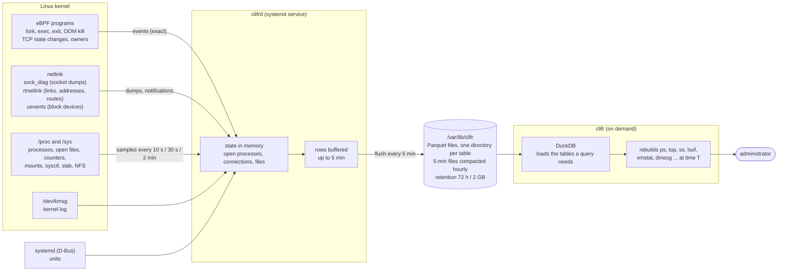
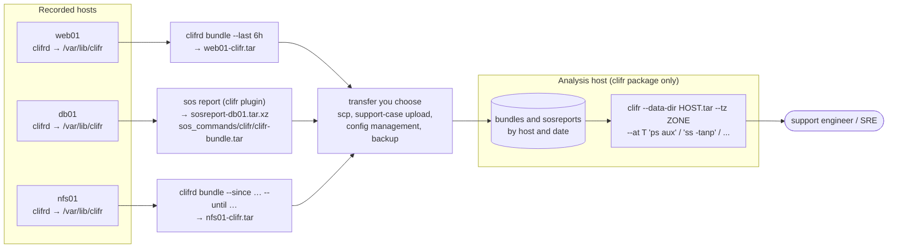

# clifr user guide

clifr is a flight recorder for Linux. The recorder, **clifrd**, runs as a service and keeps a record of what happened on the machine: which processes ran (even those lasting milliseconds), which TCP connections each one had, which files they held open, and the system's counters (CPU, memory, disk, network). The command-line tool, **clifr**, reads that record and shows you what `ps`, `top`, `ss`, `lsof`, `vmstat` and some 35 other tools *would have printed* at a past moment, in their own familiar format.

So when someone asks "what was going on at 03:12 last night?", you type the commands you already know and add the time:

```sh
clifr --at "03:12" "top -b -n 1"
clifr --at "03:12" "ss -tanp"
```

To install clifr, see the [installation guide](install.md).

## Contents

1. [Concepts](#1-concepts)
2. [Basic usage](#2-basic-usage): [browsing a window: clifr tui](#browsing-a-window-clifr-tui)
3. [Advanced usage](#3-advanced-usage): [using clifr from an AI agent](#using-clifr-from-an-ai-agent), [sealing](#sealing-showing-that-a-recording-was-not-altered)
4. [Use cases](#4-use-cases)
   1. [Review a performance issue from yesterday](#use-case-1-review-a-performance-issue-from-yesterday)
   2. [Cybersecurity: check for suspicious activity an hour ago](#use-case-2-cybersecurity-check-for-suspicious-activity-an-hour-ago)
   3. [A process crashed two days ago. Why?](#use-case-3-a-process-crashed-two-days-ago-why)
   4. [How much data did Chrome transmit?](#use-case-4-how-much-data-did-chrome-transmit)
   5. [An unauthorized record in the database: track the event](#use-case-5-an-unauthorized-record-in-the-database-track-the-event)
   6. [Trace back an AI assistant's activity](#use-case-6-trace-back-an-ai-assistants-activity)
   7. [Track down a past ssh session](#use-case-7-track-down-a-past-ssh-session)
   8. [Past process activity: clifr compared with audit](#use-case-8-past-process-activity-clifr-compared-with-audit)
   9. [Which processes used the microphone or camera?](#use-case-9-which-processes-used-the-microphone-or-camera)
   10. [The state of the system before a hard freeze or crash](#use-case-10-the-state-of-the-system-before-a-hard-freeze-or-crash)
   11. [The OOM killer killed nfsd: what was using the memory?](#use-case-11-the-oom-killer-killed-nfsd-what-was-using-the-memory)
   12. [High load average, but little CPU use and no disk wait](#use-case-12-high-load-average-but-little-cpu-use-and-no-disk-wait)
   13. [Did any of it go through the office VPN?](#use-case-13-did-any-of-it-go-through-the-office-vpn)
5. [Active monitoring with Prometheus](#5-active-monitoring-with-prometheus): [clifrd as a metrics source](#clifrd-as-a-metrics-source-metrics)
6. [Configuration](#6-configuration): [clifrd's file](#clifrd-the-configuration-file), [clifrd's options](#clifrd-command-line-options), [the systemd unit](#the-systemd-unit), [clifr's options](#clifr-command-line-options)
7. [Architecture](#7-architecture): [local](#local), [centralized analysis](#centralized-analysis), [data and security](#data-and-security)

The examples use a real recording of a desktop machine (Ubuntu 26.04, host `desktop01`) made on 4–6 November 2026; times are the machine's local time. On 5 November from 13:04 to 14:04 it ran a synthetic database benchmark (pgbench against PostgreSQL plus a TCP load generator), which several examples use as "the incident". Long lines are cut with `…`; user names, paths and public peer addresses are replaced by neutral ones (`alice`, documentation addresses such as 203.0.113.10).

## 1. Concepts

**Rebuilt, not run.** clifr never runs `ps` or `ss`. It rebuilds what they would have printed from the recording, column by column, as the version of the tool installed on the *recorded* host prints it (RHEL 8, RHEL 9 and Ubuntu 22.04 layouts are known; anything else gets the current upstream layout). Only options clifr can honour from recorded data are accepted; any other is rejected with a message, never silently ignored. `clifr help COMMAND` lists what each command supports.

**A moment or a range.**

- `--at TIME` asks for one moment: "the output of `ps aux` at 13:20".
- `--since TIME --until TIME` asks for a range: "what happened between 13:00 and 14:00". A range has no single moment, so clifr summarizes it by default (one row per process, connection owner or counter), or prints the full output at every sample (`--samples`), only what changed (`--changes`), or every TCP connection (`--list`). See [Range views](#range-views).

**Exact and sampled data.** Some things are recorded the instant they happen, from the kernel (eBPF): a process starting or exiting, a TCP connection changing state, an OOM kill, a mount, a kernel log message, a network address or route change. These are **exact**, to the millisecond, however short they were. Everything else is **sampled** at an interval:

| What | How often (default) |
|---|---|
| Per-process CPU, memory, state, I/O counters | every 30 s (`interval`) |
| System counters (CPU, memory, disk I/O, load, network counters, interfaces) | every 10 s (`sys-interval`) |
| Open files of each process | every 2 min (`fd-interval`); a file is recorded when two walks in a row see it |
| Socket queues and UDP sockets (full socket dump, "keyframe") | every 5 min |
| Block devices, sysctl, slabinfo, NUMA, NFS and conntrack statistics | every minute |
| systemd units | at start, hourly, and within a second of every change |

Every reconstruction says on stderr where its data come from, for example `reconstructed from sample at 13:19:48` or `connections, states and owners exact (events); Recv-Q/Send-Q from the keyframe at 13:16:18`.

**The most recent minutes are not on disk yet.** clifrd writes to disk every 5 minutes (`flush-interval`). Asking for a moment after the last write gives `... is after the end of the recording (last sample ...)`. Wait, or ask for an earlier time. For the same reason a crash or power loss loses up to the last 5 minutes (see [use case 10](#use-case-10-the-state-of-the-system-before-a-hard-freeze-or-crash)).

**How far back.** By default 72 hours, and never more than 2 GB of data (oldest hours deleted first). On a very busy server the 2 GB cap is reached in about 11 hours; check with `clifr info`. Both are configurable.

**Gaps.** While the machine is off or suspended or the service is stopped nothing is recorded. A moment in a gap is refused (`nothing was recorded at ...: no samples from ... to ... (clifrd was not running)`), and `clifr events --type gap` lists the gaps. Within a run, a moment between two samples is shown from the sample before it. But a moment after a run's last sample, before a reboot or restart, is refused even if the gap is short: `... is between two runs: clifrd's last sample was ..., the next ... (after a reboot)`.

**Who can read it.** The recording contains every user's command lines, so only root and members of the `clifr` group can read it (see [the installation guide](install.md#let-administrators-use-clifr-without-sudo)). Secrets in command lines can be masked before they are stored (`redact` patterns, see [Configuration](#6-configuration)).

## 2. Basic usage

The general form is:

```
clifr [TIME] [OPTIONS] "COMMAND [ARGS]"
```

The command and its arguments are quoted as one string, written exactly as you would type the real tool. Unquoted also works when there is nothing for the shell to interpret (`clifr --at 13:20 ps aux`).

### Time

```sh
clifr --at "2026-11-05 13:20:15" "ps aux"     # date and time
clifr --at "2026-11-05 13:20" "ps aux"        # seconds optional
clifr --at "13:20" "ps aux"                   # today
clifr --at "-30m" "ps aux"                    # 30 minutes ago
clifr --at "2 hours ago" "ps aux"
clifr --since yesterday --until today "ps aux"    # all of yesterday
clifr --since "1 hour ago" events             # --until defaults to now
```

Times are in the local time zone of the machine running clifr; `--tz ZONE` (or `CLIFR_TZ`) changes it, which matters when you read another host's recording. The first line on stderr always says how the time was understood, and the next which host the recording is of (its host name then, and machine-id), so a bundle or a directory of several hosts' data cannot be mistaken for another:

```
# time: at 2026-11-05 13:20:15 CET (UTC+01:00)
# host: web01 (machine-id 141c779d)
```

With `--host` the `# remote:` line names the host instead. A moment (`--at`) after the last sample on disk is an error (exit 1: `... is after the end of the recording (last sample 13:15:02): clifrd writes to disk every 5m0s ...`); a range that runs past it (`--since` without `--until` means until now) is answered up to that sample, with a warning:

```
# warning: the recording ends at 2026-11-05 13:15:02, 4m33s before the end of the range (2026-11-05 13:19:35): nothing later is in this answer. clifrd writes to disk every 5m0s, ...
```

clifrd keeps the newest samples in memory and writes them every flush interval (`intervals.flush`, 5 minutes by default), so the last minutes before now are not on disk yet: ask again after the next flush.

### What is recorded: `clifr info`

```console
$ clifr info
Host:             desktop01, machine-id …, boot …, time zone Europe/Berlin
Recorded by:      clifrd 0.1.0-20261105.6f30dcebea9e, schema 9
Recording:        2026-11-04 09:09:01 .. 2026-11-06 21:13:00 (60h4m0s)
Samples:          5666 (1388 with full fd walk), skipped: 0
Seen per sample:  548 processes, 145 sockets, 2434 fds per walk
DB size:          202.0 MiB on disk (about 103.4 MiB kept per day recorded)
Recorder CPU:     0.400% of one core (average)
Recorder RSS:     avg 93.9 MiB, max 394.5 MiB
…
```

`Recording:` is the range you can query. The rest of the output covers rows per table, how long samples took, events received and dropped, and the recorder's own guard-rail events.

### The everyday commands

```sh
clifr --at "2026-11-05 13:20" "ps aux"                 # all processes
clifr --at "2026-11-05 13:20" "ps auxf"                # as a tree
clifr --at "2026-11-05 13:20" "ps -u postgres -o pid,rss,etime,args"
clifr --at "2026-11-05 13:20" "top -b -n 1"            # top's batch screen
clifr --at "2026-11-05 13:20" "top -b -n 1 -o %MEM"    # sorted by memory
clifr --at "2026-11-05 13:20" "free -h"
clifr --at "2026-11-05 13:20" uptime
clifr --at "2026-11-05 13:20" w                        # who was logged in and what they ran
clifr --since "2026-11-05 08:00" --until "2026-11-05 13:20" last   # logins and logouts that morning
clifr --at "2026-11-05 13:20" "df -h"
clifr --at "2026-11-05 13:20" "ss -tanp"               # TCP connections with owners
clifr --at "2026-11-05 13:20" "ss -ltnp"               # listening TCP ports
clifr --at "2026-11-05 13:20" "netstat -tulpn"
clifr --at "2026-11-05 13:20" "lsof -p 106552"         # open files of one process
clifr --at "2026-11-05 13:20" "lsof -a -i -u postgres"
clifr --at "2026-11-05 13:20" "dmesg -T"               # the kernel log as it was then
clifr --at "2026-11-05 13:20" "systemctl list-units --failed"
clifr --at "2026-11-05 13:20" "ip -br addr"            # (fails: -br is not supported; see below)
```

The last line shows what happens with an option clifr cannot honour:

```console
$ clifr --at "2026-11-05 13:20" "ip -br addr"
clifr: ip: option -b is not supported for recorded data (see: clifr help ip)
```

`clifr help` lists every supported command, and `clifr help COMMAND` its options, notes on how exact each part is, and examples. The man page `man clifr` has the same text.

Supported commands: `ps`, `top`, `atop`, `iotop`, `htop`, `pstree`, `pidstat`, `lsof`, `ss`, `netstat`, `vmstat`, `mpstat`, `iostat`, `free`, `uptime`, `df`, `mount`, `findmnt`, `date`, `hostname`, `uname`, `who`, `w`, `last`, `nstat`, `ip` (link, address, route, rule, neigh, netns), `dmesg`, `systemctl`, `systemd-cgls`, `swapon`, `lsmod`, `lsblk`, `lslocks`, `ipcs`, `sysctl`, `slabtop`, `numastat`, `conntrack`, `nfsstat`, `mountstats`; and clifr's own `events`, `life`, `oom`, `mounts`, `containers`, `pstore`.

### Counters at a moment

`uptime`, `vmstat`, `mpstat`, `iostat` and `pidstat` without an interval print averages since boot, which is exactly what the real tools print without an interval. That is rarely what you want for a past incident. Ask for a range instead (next section):

```sh
clifr --since "2026-11-05 13:00" --until "2026-11-05 13:30" "vmstat 300"   # one line per 5 minutes
```

### Reading the output on a terminal

On a terminal, output goes through clifr's pager when it does not fit on the screen. With `--samples` it shows one page per sample: PgDn/`n` and PgUp/`p` move between samples, Home/End to the first and last, `g` jumps to a time, `q` quits. When output is piped (`| grep`, `| less`) or with `--plain`, it is simply printed.

### Browsing a window: `clifr tui`

When you do not yet know *which* moment to ask about, `clifr tui` shows a window of the recording in the terminal (the last hour by default, or `--since`/`--until`): CPU, memory, load and I/O pressure over time, the events that matter marked on a timeline, and below them one of the commands at a cursor you move through the samples.

```sh
clifr tui                                                  # the last hour
clifr --since "2026-11-05 12:30" --until "2026-11-05 14:30" tui
```

Here marks A and B are ten minutes apart and the `free` pane compares them (a screen from 24 November, the host renamed):

```
 clifr  desktop01  2026-11-24 18:50 – 19:50 ACDT   cursor 19:37:31  A 19:37:31  B 19:47:31
                                                                          ▼─────────────B
 CPU    ▁▁▁▁▁▁▁▁▁▁▁▁▁▁▁▁▁▁▁▁▁▁▁▁▁▁▁▁▁▁▁▁▁▁▁▁▁▁▁▁▁▁▁▁▁▁▁▁▁▁▁▁▁▁▁▁▁▁▁▁▁▁▁▁▁▁▁▁▁▁▁▁▁▁▁▁▁▁▁▁▁         1%
 MEM    ▁▁▁▁▁▁▁▁▁▁▁▁▁▁▁▁▁▁▁▁▁▁▁▁▁▁▁▁▁▁▁▁▁▁▁▁▁▁▁▁▁▁▁▁▁▁▁▁▁▁▁▁▁▁▁▁▁▁▁▁▁▁▁▁▁▁▁▁▁▁▂▂▂▂▂▂▂▂▂▂▂        11%
 LOAD   ▁▁▁▁▁▁▁▁▁▁▁▁▁▁▁▁▁▁▁▁▁▁▁▁▁▁▁▁▁▁▁▃▄▂▂▂▂▂▂▇▅▃▃▂▁▁▁▂▁▁▆▃▂▁▁▁▁▁▁▁▁▁▁▁▁▁▁▁▁▁▂▅▃▂▁▁▁▃▃▂▂       0.08
 PSI io ▁▁▁▁▁▁▁▁▁▁▁▁▁▁▁▁▁▁▁▁▁▁▁▁▁▁▁▁▁▁▁▁▁▁▁▁▁▁▁▁▁▁▁▁▁▁▁▁▁▁▁▁▁▁▁▁▁▁▁▁▁▁▁▁▁▁▁▁▁▁▁▁▁▁▁▁▁▁▁▁▁         0%
 events                                                                                  ┈┈┈┈
                     19:00         19:10         19:20         19:30         19:40
  top  ps  ss  lsof  free  vmstat  iostat  events  oom  df  mpstat ›   A → B (d: back, v: layout)
── A 2026-11-24 19:37:31 ─────────────────────── │ ── B 2026-11-24 19:47:31 ───────────────────────
               total        used        free     │                total        used        free
Mem:           62464        7043        9359     │ Mem:           62464       12278        4011
Swap:           8191           5        8186     │ Swap:           8191           5        8186
…
 ←→ sample  ⇧←→ minute  n/N event  space play  / filter  m mark A/B  d compare  tab pane  ↑↓ scroll
```

**The timeline.** Each column is a stretch of the window and shows its mean: CPU busy, memory used without the page cache, the 1-minute load (scaled to the window's highest) and the share of time some task waited for I/O (PSI). CPU, MEM and PSI are green, yellow from half, red from three quarters; LOAD is one color, as it is relative. The `▼` above the graphs is the cursor, its values at the right. The *events* row marks, in this order of precedence when several fall in one column:

| Mark | Meaning |
|---|---|
| `✕` | OOM kill |
| `▲` | a systemd unit failed |
| `↻` | boot |
| `↺` | a unit restarting (Restart=) |
| `●` `○` | login, logout |
| `░` | no samples (clifrd was not running, or the machine was off) |
| `┈` | not on disk yet: the window runs to now and clifrd writes every few minutes (flush interval) |

The line above the keys names the event nearest the cursor. `NO_COLOR` turns colors off.

**The pane** shows a command at the cursor's sample, as `clifr --at` prints it: `top`, `ps aux`, `ss -tanp`, `lsof -i`, `free -m`, `vmstat`, `iostat -x`, `events` (from a few before the cursor on, `▸` on the first at or after it), `oom` (every kill in the window, with the largest processes then), `df -h`, `mpstat -P ALL`, `iotop -b -o`, `pstree -p`, `dmesg -T` (opens at its end: the messages nearest the cursor), `w`, `containers`, `systemctl list-units --type=service`. When the names do not fit, the tab row shows those around the current one, with `‹ ›` where more are hidden.

**Keys** (`?` shows them in the pane):

| Key | What it does |
|---|---|
| `←` `→` (`h` `l`) | one sample back, forward |
| `⇧←` `⇧→` (`H` `L`) | one minute |
| `Home` `End` | the window's first, last sample |
| `n` `N` | the next, previous event on the timeline: the sample before it (the state it hit), for a boot the first after |
| `space` | play: one sample after another, and pause; `+` `-` faster, slower (2 s to 100 ms a sample) |
| `Tab` `⇧Tab`, `1`–`9` `0` | the next, previous pane; the first ten panes |
| `↑` `↓` `PgUp` `PgDn` | scroll the pane |
| `/` | filter the pane: its header and the lines a regular expression matches, in any case (Go's [RE2 syntax](https://github.com/google/re2/wiki/Syntax): `postgres\|nginx`, `^root`, `:(80\|443)\b`); a bad pattern keeps the prompt open and says why; `/` then Enter on nothing removes it |
| `m` | mark the sample: A, then B (the later of the two is B), then A again; `M` clears them, `a` `b` go to them |
| `d` | compare A and B, and back to the cursor: for `ps`, `ss`, `lsof` and `df` what appeared, went and changed (as [`clifr diff`](#compare-two-moments-clifr-diff)), for `events` the events from A to B, for `oom` the kills from A to B, for the others the output at A and at B side by side |
| `v` | A and B side by side, or A above B (wide outputs such as `iostat -x` are cut in half the pane) |
| `q` `Esc` | quit |

A typical session: open the window around an incident, press `n` until the cursor is on the `✕` or the spike, look at `top` and `ps` there, `m` a quiet sample before it and `m` the bad one, then `d` in the `ps`, `ss` and `events` panes to see what started, connected and happened in between.

What it does not do: it reads the recording as it was when it started (restart it for newer samples), and each pane runs the command with fixed options; for other options or a range report, quit and use `clifr --at` or `--since`/`--until` with the command you need. It needs a terminal (not a pipe) and holds the window in memory: about 650 MiB for an hour on a desktop, 1.6 GB for three days.

## 3. Advanced usage

### Range views

| Option | What you get | Commands |
|---|---|---|
| `--summary` (default) | One report for the whole range. ps and lsof: one row per process or file with first and last seen and peaks. ss and netstat: one row per process with its number of TCP connections, peak, retransmits, resets and the states they ended in. Counters: one report for the range. | all range commands |
| `--list` | Every TCP connection that existed in the range, however short, one row each with its open and close time. | ss, netstat |
| `--changes` | Between consecutive samples, only what appeared, disappeared or changed. | ps, ss, netstat, lsof, df, mount |
| `--samples` | The full output at every sample. `-e 5m` spaces them, `-n 10` stops after ten. | most commands |

For counters an interval argument works as with the real tools: `"vmstat 60"`, `"iostat -x 300"`, `"mpstat -P ALL 60 5"`, `"pidstat -u 300"`.

Examples:

```sh
# Who opened TCP connections between 13:00 and 13:10, by process
clifr --since "2026-11-05 13:00" --until "2026-11-05 13:10" "ss -tanp"
# Every single connection in that window
clifr --since "2026-11-05 13:00" --until "2026-11-05 13:10" --list "ss -tnp"
# What changed in the process list, sample by sample
clifr --since "2026-11-05 13:00" --until "2026-11-05 13:10" --changes "ps aux"
# top every 5 minutes for an hour
clifr --since "2026-11-05 13:00" --until "2026-11-05 14:00" --samples -e 5m "top -b -n 1"
# CPU per core, one report per minute
clifr --since "2026-11-05 13:00" --until "2026-11-05 13:10" "mpstat -P ALL 60"
```

### Compare two moments: `clifr diff`

```console
$ clifr diff --at "2026-11-05 12:00" --at "2026-11-05 13:30" "ss -ltnp"
# ss, 2026-11-05 12:00:00 -> 2026-11-05 13:30:00: 6 appeared, 0 gone, 1 changed
## appeared
State  Recv-Q Send-Q Local Address:Port  Peer Address:Port Process
LISTEN 0      4096       127.0.0.1:30000      0.0.0.0:*    users:(("load",pid=108622,fd=3))
LISTEN 0      4096       127.0.0.1:30001      0.0.0.0:*    users:(("load",pid=108628,fd=3))
…
```

clifr rebuilds the command's output at both moments (the second must be later) and prints only the differences, in the command's own format:

- **appeared:** rows at the second moment that were not there at the first;
- **gone:** rows at the first moment that are no longer there at the second;
- **changed:** rows at both moments that changed in a way that matters, printed as they are at the second.

Values that move at every sample (CPU, memory, queue sizes) never count as a change, or every row would show. What a row is, and what counts as changed:

| Command | A row is | Changed when |
|---|---|---|
| `ps` | a process: its PID and start time (a reused PID is a new process) | its command line, user, parent or terminal changed |
| `ss`, `netstat` | a socket | its state or owning process changed |
| `lsof` | a process's file descriptor | it refers to another file |
| `df` | a mounted file system | its device or Use% changed |
| `mount`, `findmnt` | a mount | its type, source or options changed (e.g. remounted read-only) |

`diff` works with these 7 commands and any of their options; the others have no rows to compare (use `--since … --samples` for counters such as `vmstat` or `free`). Both moments must be in the recording: the last few minutes are not on disk yet. Filter noisy lists: on a desktop, a plain `ps -e` diff is mostly short-lived kernel workers, so compare `ps -u USER`, `-C NAME` or `-p PID` instead.

```bash
# Your own processes an hour ago against 10 minutes ago
clifr diff --at "1 hour ago" --at "10 minutes ago" "ps -u $USER -o pid,rss,etime,comm"
# Disks that filled up or were added since yesterday midnight
clifr diff --at yesterday --at today "df -h"
# Files a process opened or closed during the morning
clifr diff --at "08:00" --at "12:00" "lsof -p 1234"
# As JSON Lines: each row has "change" ("+", "-" or "~"), ts_ms (the second moment) and from_ms (the first)
clifr diff --at "1 hour ago" --at "10 minutes ago" --json "ss -tnp" | jq -c '{change, local, lport, peer, rport}'
```

`--changes` is the same comparison between every pair of consecutive samples over a range, not just two moments. `clifr help diff` prints this summary. Comparing a "good" and a "bad" moment is often the fastest way to see what is different.

### Timeline and lifetimes: `events`, `life`

`events` is a timeline of everything recorded as an event: process starts and exits, OOM kills, mounts, recorder gaps, skipped samples and the recorder's guard events:

```console
$ clifr --since "2026-11-06 20:00" --until "2026-11-06 20:05" events
TIME                     EVENT        PID DETAIL
2026-11-06 20:00:09.911  start     597232 ppid 1: sh -c ENABLED=false; [ -r /etc/default/sysstat ] && …
2026-11-06 20:00:09.931  start     597234 ppid 1: /usr/libexec/sysstat/sadc -F -L -S DISK 1 1 /var/log/sysstat
2026-11-06 20:00:09.933  exit      597232 0 after 22ms: sh -c ENABLED=false; …
2026-11-06 20:00:09.993  exit      597234 0 after 62ms: /usr/libexec/sysstat/sadc -F -L -S DISK 1 1 /var/log/sysstat
…
```

Filter it with `--name REGEX` (matched against the command line) and `--type start,exit,oom,mount,unmount,remount,gap,skipped,guard`.

A hung NFS server shows up there too: when statfs of a mount does not answer within a second, clifrd records a `statfs_stuck` guard event and stops asking until the call returns (`statfs_ok`). Meanwhile `clifr df` prints that file system's last usage with a line such as `# /mnt/nfs: statfs not answering since 2026-11-10 22:30:20 (hung server?); usage as of 2026-11-10 22:30:00`, where the real `df` would hang.

A clock corrected while clifrd runs shows up as a `clock_step` guard event, typically the first time synchronization after a boot, when clifrd has already started. The recorded times before it are on the old clock; clifr prints process start times as a tool run at the moment asked for would print them (on the corrected clock after the step), and in `life` on the clock of the moment each process started:

```
2026-11-21 10:58:50.906  guard          - clock_step: the clock moved +1.493 s (boot time 10:58:08.926 -> 10:58:10.419)
```

A flood of processes or connections shows up as `events_shed` guard events: above clifrd's [event budget](#clifrd-the-configuration-file), process events are recorded with less detail or only counted, and each event says how many, and from which users and commands. The lists that cover that time say so in a header line:

```console
$ clifr --since "2026-11-11 01:33" --until "2026-11-11 01:34" "events --type guard"
# 2 events 2026-11-11 01:33:00 .. 2026-11-11 01:34:00
# incomplete: process events (fork, exec) above clifrd's event budget were recorded without command lines or only counted (2026-11-11 01:33:03 .. 2026-11-11 01:34:33; clifr events --type guard says how many and from whom)
TIME                     EVENT        PID DETAIL
2026-11-11 01:33:03.545  guard          - events_shed: processes: 162741 only counted, 220711 without /proc reads, command lines cut to 256 bytes of 442928 process events (fork, exec) since 01:32:33 (budget: 4000/s in full, 1024 KiB/s of command lines, 10000/s at most); 16523 of those only counted because the recorder's heap was above the memory guard; most from: uid 1000 flood 244456, uid 1000 true 138957, uid 0 watch.sh 39
2026-11-11 01:33:33.545  guard          - events_shed: processes: 114545 only counted, 237981 without /proc reads, command lines cut to 256 bytes of 412002 process events (fork, exec) since 01:33:03 (budget: 4000/s in full, 1024 KiB/s of command lines, 10000/s at most); most from: uid 1000 flood 204509, uid 1000 true 147978, uid 0 watch.sh 39
```

That was a test: user 1000 ran a program (`flood`) that started `/bin/true` 8,700 times a second with a different 4 KB argument each time. The first numbers say how much was lost; "most from" says who did it (`flood` is the forks, `true` the execs; `watch.sh` was the test's own monitoring script, caught in the same seconds).

`life` lists each process's start, end, duration, pid, parent pid, exit code or signal, and command line:

```console
$ clifr --since "2026-11-04" "life --name '^sshd'"
START                   END                        DURATION     PID    PPID EXIT    SOURCE COMMAND
2026-11-04 09:09:00.496 >2026-11-04 20:30:30.386 >11h21m30s    3089       1 0       sample sshd: /usr/sbin/sshd -D [listener] …
```

When a signal ended a process, a `SENT BY` column says who sent it (recorded since 2026-11-20): `4321 (bash, root)` for a process, `the kernel` for a fault, a timer or resource limit, the terminal's ^C or the OOM killer, `itself` for `abort()` or `kill $$`. `events` puts the sender's command line after it. It is `-` when the sender is unknown: an older recording, a kernel without BTF tracing programs (`clifrd doctor` says which it uses), or clifrd on the proc connector fallback.

`SOURCE ebpf` means start and end are exact. `sample` means the process was seen only at samples (it was already running when the recording started, or the end was not observed), and `>t` means it ended after `t` and before the next sample.

### OOM kills and containers

```sh
clifr --since "2 days ago" oom              # every OOM kill, with the largest processes at the time
clifr --at "2026-11-05 13:20" containers    # containers whose processes were seen (by cgroup)
clifr --at "2026-11-05 13:20" "ps aux --container web1"   # one container's processes (host PIDs)
clifr --at "2026-11-05 13:20" "ss -tanp -N web1"   # a container's sockets (its name, id prefix, pod, or a PID)
```

Containers are listed with their names (since 2026-11-09): Docker's, Podman's, and a pod's container as `NAMESPACE/POD/CONTAINER`. clifrd asks Docker's API for its list of running containers (read-only; names, image and labels, never the environment), reads rootful Podman's container list and the names of the kubelet's links in `/var/log/containers`, every 5 minutes and when a new container appears. `--json` adds the image, pod, namespace and Compose project.

`ps --container` (not an option of the real ps) keeps one container's processes, picked by the cgroup recorded for each one; the container is named as for `ss -N`. It works with `aux`, `auxf`, `-e`, `-f`, `-o`, and with `-p`, `-u` or `-C` to narrow it further. PIDs are the host's, not the ones inside the container. A process seen only through its exec and exit events, between two samples, has no recorded cgroup and is not listed: `clifr events` shows those.

`ss` and `netstat` show the host's network namespace, as they do on the host. A container or pod usually has its own: its connections are recorded too (since 2026-11-08), and `ss -N` shows them. In those namespaces Recv-Q and Send-Q come from `/proc/PID/net` at each keyframe, so a listener's backlog shows as 0.

### JSON output for scripts

`--json` prints JSON Lines, one object per row, with the times in Unix milliseconds and a `sampled` list naming the fields that come from a periodic sample (the rest are exact):

```sh
clifr --json --at "2026-11-05 13:20" "ss -tanp" | jq -r 'select(.state=="ESTAB") | .owners[0].comm' | sort | uniq -c
clifr --json --since "2026-11-05 13:00" --until "2026-11-05 14:00" --list "ss -tnp" \
  | jq -r '.peer' | sort | uniq -c | sort -rn | head      # most-contacted peers
```

### Using clifr from an AI agent

An AI assistant or agent (Claude Code, Copilot CLI, a local LLM with a shell tool…) can investigate a past incident with clifr the way an administrator does: ask for a moment or a range, read the reconstruction, narrow down. What works for a person at a terminal does not always work for an agent, though. It cannot see a pager, it pays for every line of output it reads, and it tends to report a sampled value as if it were exact. This section is the contract for scripts and agents. At the end there is a block you can paste into the agent's instructions.

**1. Always `--json --plain`, and keep stderr.** `--json` prints JSON Lines on stdout. `--plain` makes sure the pager never starts, even when the agent's shell is a pseudo-terminal. stderr carries two kinds of lines, and the agent should read both:

- lines starting with `#` say how the request was understood and where the data come from: `# time: at 2026-11-05 12:20:00 UTC (UTC+00:00)`, `# host: web01 (machine-id 141c779d)` (check it is the host you meant), `# warning: the recording ends at ...` (the range runs past the data on disk: the answer stops there), `# ps at 2026-11-05 12:20:00, reconstructed from sample at 2026-11-05 12:19:48 (548 processes)`, `# events lost in this window (…): short-lived processes or connections may be missing`;
- lines starting with `clifr:` are errors.

**2. Exit codes.**

| Code | Meaning | What the agent should do |
|---|---|---|
| 0 | Success. Empty output means nothing matched. | Report "none found", not "no data". |
| 1 | Nothing recorded for that request: before the start or after the end of the recording, in a gap (`clifrd was not running`), or a source that was not there (`conntrack: nf_conntrack_netlink was not loaded`). | Do not retry with other options. Check the range with `clifr --json info` and the gaps with `events --type gap`, and say what is missing. |
| 2 | Usage error: unsupported command or option, bad time, a command that needs a range or an extra option (`events: needs a range`, `nstat: with --at add -a`, `pstree: add -p`). | Read the message (it usually names the fix) and `clifr help COMMAND`. Do not guess option variants. |

**3. Start with the recording, then the gaps.**

```sh
clifr --json --plain info | jq '{host: .host.hostname, tz: .host.timezone, from_ms, to_ms, samples}'
clifr --json --plain --tz UTC --since "2026-11-04 00:00" "events --type gap"
```

`from_ms`/`to_ms` is the range that can be queried. `host.timezone` is the recorded host's zone, which is what its logs and its users mean by "13:20".

**4. Times: pass UTC, read Unix milliseconds.** `--at`, `--since` and `--until` take `YYYY-MM-DD HH:MM[:SS]`, `YYYY-MM-DD`, `HH:MM`, `now`, `today`, `yesterday` and relative times (`-30m`, `2 hours ago`). They do not take ISO 8601 with a `T` or an offset, and they do not take epoch numbers. An agent should always add `--tz UTC` and convert the times it is given to UTC itself. Without `--tz`, times are read in the zone of the machine running clifr, which is not necessarily the recorded host's. Then it should check the `# time:` line on stderr. Every time in the JSON is Unix milliseconds (UTC). Text fields such as `time` or `start` follow `--tz`.

**5. Exact or sampled: say which.** Every JSON object ends with `sampled`, the names of its fields whose values come from a periodic sample. The other fields are exact (from kernel events) or fixed for the object's life. `sample_ts_ms` is the sample the values come from, often several seconds or minutes before `ts_ms` (the moment asked for): 2 minutes for open files, 5 minutes for socket queues. An agent should report a sampled value as "at the sample of 12:19:48", not as "at 12:20". A process that lived less than a sample interval is only in `events` and `life`, not in `ps` or `top`. Section [1. Concepts](#1-concepts) lists the intervals.

**6. Pick the view that answers the question.**

| Question | Command |
|---|---|
| What was running, and how big was it? | `--at T "ps aux"`, `--at T "top -b -n 1"` (one object, its rows in `procs`) |
| What started or exited, however briefly? | `--since A --until B "events --type start,exit --name REGEX"`, `"life --name REGEX"` |
| Who talked to whom over TCP? | `--since A --until B "ss -tanp"` (one row per process), `--list "ss -tnp"` (every connection) |
| What was listening? | `--at T "ss -ltnp"` |
| Who was logged in, from where? | `--at T "w"`, `--at T "who -a"`, `--since A --until B "last"` (logins with their logout) |
| CPU, memory, disk and load over time | `--since A --until B "vmstat 60"`, `"mpstat -P ALL 60"`, `"iostat -x 60"`, `"pidstat -u 300"` |
| What changed between a good and a bad moment? | `diff --at A --at B "ps aux"` (also ss, netstat, lsof, df, mount, findmnt; `change` is `+`, `-` or `~`) |
| OOM kills, kernel messages | `--since A "oom"`, `--at T "dmesg"` |
| Which processes did the disk I/O? | `--at T "iotop -b -P -o"`, `--since A --until B "iotop -b -P -o -d 60"` |
| Network, TCP errors and memory over a period, sar style | `--since A --until B "sar -n DEV -n TCP,ETCP -r -i 60"` |
| The whole system and its busiest processes on one screen | `--at T "atop"`, `--since A --until B "atop 60"`, `--at T "htop"` |

Without an interval, `vmstat`, `mpstat`, `iostat`, `pidstat` and `uptime` at `--at` print averages since boot (`"since_boot": true`), as the real tools do. For "what was the load like then", ask for a range.

**7. Narrow down in the command, then in jq.** At a busy moment `ss -tanp` returned 71,861 rows, `lsof -i` 40,100 rows (7 MB) and `top -b -n 1` one 686 KB object. Rows like those fill an agent's context and cost money. Filter with the tool's own options first: `ps -p PID`, `ps -u USER`, `ps -C NAME`, `lsof -p PID`, `lsof -u USER`, `lsof -c NAME`, `ss -l`, `ss` filters `sport`, `dport`, `src`, `dst` (`"ss -tnp dport = :443"`; `state` filters are not supported), `events --name/--type`, `life --name`, a shorter range. Then count before reading, and select fields with jq:

```sh
clifr --json --plain --tz UTC --at "2026-11-05 12:20" "ss -tanp" | wc -l
clifr --json --plain --tz UTC --at "2026-11-05 12:20" "ss -tanp" \
  | jq -r '.state' | sort | uniq -c                          # connections per state
clifr --json --plain --tz UTC --at "2026-11-05 12:20" "top -b -n 1" \
  | jq -c '.procs | sort_by(-.pcpu)[:10][] | {pid, comm, pcpu, res_kb}'
clifr --json --plain --tz UTC --since "2026-11-05 12:00" --until "2026-11-05 13:00" \
    "events --type start --name '^(curl|wget|ssh|scp) '" | jq -c '{ts_ms, pid, detail}'
```

In JSON every command writes all of its fields: `ps -o pid,rss` selects rows like `ps`, but not columns. Use jq for that.

**8. Commands whose JSON is not the tool's table.** Most commands write one object per printed row. These do not:

- `ip`: one object with the raw interface records (`links`) or the route lines (`lines`); `ipcs`, `numastat` and `nfsstat`: one object each.
- `sar`: one object per value line sar prints, with `ts_ms` (the record's time), `kind` (`record`, `Average`, `Summary`, or `restart` for a LINUX RESTART, with `cpus`), `report` (named by sar's option: `-u`, `-q`, `-r ALL`, `-n DEV`, `-n ETCP`…), `item` (the CPU, interface, device or file system; absent for whole-system reports) and `values`, keyed by sar's own column titles (`%user`, `rxkB/s`, `retrans/s`…). Headers are left out.
- `htop`: one object per screen: `cpus` (per CPU: `percent` and its `normal`, `nice`, `kernel`, `virt` parts), `mem` and `swap` (KiB), `tasks`, `load`, `uptime_s`, and `processes` exactly as the screen lists them (`-p`, `-u`, the sort key and `-t` applied; kernel threads left out; in tree view each has a `tree` field with the drawing).
- `iotop`: one object per screen (over a range the first is iotop's own first screen, all zeros, `from_ms` absent) with the totals per second and `processes` as shown (`-o`, `-p`, `-u` applied, in the screen's order): `read_bytes`, `write_bytes` over `seconds`, `blkio_delay_ns`.
- `atop`: one object per screen: `interval` (false: the screen since boot), `seconds`, `elapsed`, `view`, `system` (each line's `label`, `PRC`, `CPU`, `cpu`, `MEM`, `DSK`…, with its `fields` by atop's names) and `processes` (the view's columns: `PID`, `CPU`, `RDDSK`, `CMD`…). Values are strings as atop prints them (`"6.0G"`, `"22m12s"`, `"3%"`): convert them yourself.
- `mountstats`: no JSON output. Use the text output.

When in doubt, run the command once without `--json` and compare. For example:

```sh
clifr --json --plain --tz UTC --since "2026-11-05 12:00" --until "2026-11-05 13:00" "sar -n DEV -i 60" \
  | jq -c 'select(.kind=="record" and .item=="eth0") | {ts_ms, rx: .values["rxkB/s"], tx: .values["txkB/s"]}'
clifr --json --plain --tz UTC --at "2026-11-05 12:20" "iotop -b -P -o" \
  | jq -c '.processes[:5][] | {pid, command, write_bytes, seconds}'
clifr --json --plain --tz UTC --at "2026-11-05 12:20" "atop -m" \
  | jq -c '(.system[] | select(.label=="MEM") | .fields), .processes[:3][]'
```

**9. Access and privacy.** The recording holds every user's command lines and connections. Give the agent's user membership of the `clifr` group instead of sudo. `sudo` also drops the `CLIFR_*` variables (see [Environment variables](#environment-variables)). Anything clifr prints goes into the agent's context, and from there to its provider. If command lines on the host can contain secrets, set `redact` patterns in clifrd's configuration ([section 6](#6-configuration)), and give the agent a bundle of just the window in question (`clifrd bundle`, read with `--data-dir FILE.tar`; see [Another machine's recording](#another-machines-recording-bundles-and-sosreports)) instead of the whole recording. Use `clifr` itself or `clifr export TABLE` (CSV) to read the data. Do not read the Parquet files directly: their directories have hashed names and keep several versions of each row.

**Instructions to paste into an agent's configuration** (`CLAUDE.md`, `AGENTS.md`, a system prompt):

```text
This host runs clifr, a flight recorder. To see what ps, top, ss, lsof, vmstat, dmesg
and similar tools showed at a past time, run clifr instead of guessing:
  clifr --json --plain --tz UTC --at "YYYY-MM-DD HH:MM:SS" "COMMAND ARGS"
  clifr --json --plain --tz UTC --since "..." --until "..." "COMMAND ARGS"
- First run `clifr --json --plain info` (the recorded range in from_ms/to_ms and the
  host's time zone). Convert times to UTC yourself; ISO 8601 and epoch input are not accepted.
- stdout is JSON Lines; times are Unix ms. Read stderr: "#" lines say which sample the data
  come from and whether events were lost; "clifr:" lines are errors.
- Check the "# host:" (or "# remote:") line names the host you meant.
- Exit 1 = nothing recorded for that request (outside the range, a gap): say so, do not retry,
  except "after the end of the recording": the data are not flushed yet (every 5 min by
  default): retry after the next flush. A "# warning: the recording ends at" line on a range
  means the same for its last minutes.
  Exit 2 = unsupported option or bad time: read the message and `clifr help COMMAND`.
- Fields listed in "sampled" come from a periodic sample (at sample_ts_ms); others are exact.
  Say which when you report. Short-lived processes are only in "events" and "life".
- Narrow first (ps -p/-u/-C, lsof -p/-c, ss -l or sport/dport filters, events --name/--type,
  short ranges), count with `wc -l`, then select fields with jq. Never dump whole outputs.
- For counters over time use a range with an interval ("vmstat 60"); without one they are
  averages since boot.
- mountstats writes no JSON: use its text output (no --json). sar writes one object per value
  line (report, item, values by sar's column titles); atop's values are strings as printed.
```

### Raw tables

`clifr export TABLE` writes one recorded table as CSV, for spreadsheets or your own analysis. For example `clifr export tcp_conns` gives one row per TCP connection, with Unix-millisecond times:

```sh
clifr export tcp_conns > tcp_conns.csv
```

The tables and their columns are described in the project's `CLAUDE.md` ("Data model notes").

### Another machine's recording, bundles and sosreports

A recording is a directory of Parquet files and can be read anywhere clifr is installed. On the recorded host, `clifrd bundle` writes a window of it as one tar file:

```sh
sudo clifrd bundle --last 6h -o /tmp/web01-clifr.tar
sudo clifrd bundle --since "2026-11-05 13:00" --until "2026-11-05 14:00" -o /tmp/web01-clifr.tar
```

Next to it `clifrd bundle` writes `web01-clifr.tar.sha256`. Copy both; on the other side `sha256sum -c web01-clifr.tar.sha256` says whether the copy is whole, without clifr. `clifr --data-dir web01-clifr.tar verify --integrity` checks it in detail: what the bundle holds (host, window, samples and their gaps, events such as an unclean stop or a kernel crash record in the window), every file against its checksum, and every page:

```console
$ clifr --data-dir web01-clifr.tar verify --integrity
Bundle:       web01-clifr.tar
              written 2026-11-14 14:11:12 by clifrd 0.1.0 (bundle version 1)
Host:         web01, machine-id 141c779d, time zone Australia/Adelaide
Window:       2026-11-14 13:41:12 .. 2026-11-14 14:11:12
Samples:      54, 2026-11-14 13:41:19 .. 2026-11-14 14:07:49, every 30s; gaps: 0
Files:        511 listed, 511 match their SHA-256
Data files:   511, 23.3 MB, checked in 221ms
...
Damaged:      none
```

Where a file may not be larger than some size (a support portal, an e-mail attachment), cut the bundle into parts. Each part is a bundle of its own with its `.sha256`; a part that fails in transfer is sent again alone. clifr reads the parts together, and says which are missing if some are not given:

```sh
sudo clifrd bundle --last 6h --split 250M -o /tmp/web01-clifr.tar      # web01-clifr.part1.tar, .part2.tar, ...
clifr -D web01-clifr.part1.tar -D web01-clifr.part2.tar -D web01-clifr.part3.tar --at "13:20" "ps aux"
```

Copy it anywhere and read it with `--data-dir` (no root needed for a file you own). Use the recorded host's time zone with `--tz` when you compare with its logs:

```sh
clifr --data-dir web01-clifr.tar info
clifr --data-dir web01-clifr.tar --tz Europe/Berlin --at "2026-11-05 13:20" "ps aux"
```

In a sosreport made with the clifr plugin the bundle is `sos_commands/clifr/clifr-bundle.tar`:

```sh
clifr --data-dir sosreport-web01-2026-11-05/sos_commands/clifr/clifr-bundle.tar info
```

A sosreport's own captures (`ps`, `ss`, `sos_commands/logs/journalctl_*`, `var/log/messages`, `var/log/secure`) show the moment the report was taken; the bundle lets you go back to the moment of the problem, with the same tools.

The last minutes before `clifrd bundle` may still be in memory (they are written every 5 minutes). To include them, ask clifrd to write first and wait for its next sample (30 s):

```sh
sudo systemctl kill -s USR1 clifrd && sleep 35 && sudo clifrd bundle --last 6h -o /tmp/web01-clifr.tar
```

**Damaged recordings and bundles.** clifr refuses a bundle whose files do not match their checksums, or that was cut short in transfer, and says so. Copy it again if you can. If you cannot, `--salvage` reads what is usable: the files with good checksums (or, when the copy stopped before the manifest at the end of the tar, the files that arrived whole, unverified), with a warning for each file left out and the times that lack its rows:

```console
$ clifr --data-dir web01-clifr.tar --salvage --at "13:06" "ps -e"
clifr: --salvage: no bundle.json (the bundle was cut short): the files that arrived whole are read, unverified
clifr: --salvage: left out data/4bbd53df/2026-11-14/02-36.parquet, damaged or missing (table kmsg): results lack its rows, from about 2026-11-14 13:00 to 2026-11-14 13:08
...
```

A recording directory with a damaged file (a disk error, a copy that stopped, a changed byte) is read without it, with a similar warning on standard error: `clifr: skipped damaged file ...`. Before, one such file made every query of its table fail. Each compressed page carries a checksum (files written since 2026-11-14), so a changed byte inside the data is found when the page is read rather than giving wrong values.

To check a whole recording (or a bundle) at any time:

```console
$ clifr verify --integrity
Data files:   1842, 61.2 MB, checked in 1.02s
              0 against the SHA-256 logged when written, 1842 read whole (written before the
              integrity log, or by an older clifrd)
Damaged:      none
```

clifrd logs the SHA-256 of every data file it writes (`/var/lib/clifr/integrity/DAY.log`, removed by retention with the data). `verify --integrity` compares each file with it, and reads files without a logged checksum (older ones, bundles) page by page instead. It names each damaged file, its table and the times it covers, and exits with status 1. A file that still reads but whose checksum changed may give wrong values: move it out of the data directory.

### Sealing: showing that a recording was not altered

The checksums above catch damage, not tampering: anyone with root can change a data file and its logged checksum. *Sealing* (off until you set it up) closes that gap for everything written before an intruder got in. After every flush (5 minutes) clifrd seals the integrity log with a key that it then replaces by the next one and overwrites; nobody can work back from a later key to an earlier one. Someone who becomes root at 14:00 can therefore change, delete or reorder nothing written before about 13:55 without `clifr verify --integrity --seal-key KEY` saying so. They can still stop clifrd, change what it records from then on, or delete the whole recording: sealing proves the recording was not changed after it was written, not that the host was clean when it was written.

**Set it up** once per host (installation guide: [Seal the recording](install.md#seal-the-recording-optional)):

```console
$ sudo clifrd seal-setup
clifrd: sealing set up for /var/lib/clifr
  host web01, machine-id 141c779dd5da4d67905e82b6f0ae5d02, 2026-11-16 14:06:49 ACDT
  key id 98d169b8; sealing starts at clifrd's next flush

The verification key follows. It is shown only now and is not stored here: copy it to
somewhere off this host, then clear this terminal's scrollback.

cs1-6f0c…(64 hex digits)
```

The printed line is the **verification key**. It is not kept on the host (that is the point): store it where the host's root cannot reach it, such as a password manager or the machine where you analyse recordings. Whoever holds it can also create seals, so treat it like a password. If it is lost, `sudo clifrd seal-setup --new` starts a new chain with a new key; the old part of the recording stays verifiable with the old key.

**Check a recording** (on the host, or a bundle anywhere):

```console
$ clifr verify --integrity --seal-key @web01.key
Data files:   69, 565 KB, checked in 2ms
              69 against the SHA-256 logged when written, 0 read whole (written before the
              integrity log, or by an older clifrd)
Damaged:      none
Seals:        5 verified, 2026-11-16 14:07:09 .. 2026-11-16 14:08:03, chain 98d169b8
              1 run starts, 1 clean stops
Sealed files: 69 match their sealed SHA-256, 2 removed by clifrd as sealed
Altered:      nothing found
```

`--seal-key` takes the key or `@FILE`; give it once per key if the recording has several chains. When something was changed after it was sealed the report says `ALTERED`, names each file or seal, and clifr exits with status 1:

```console
ALTERED:      1 finding(s): changed, removed or reordered after they were sealed
  7d1c6de1/2026-11-16/03-38.parquet: SHA-256 236ba85d095d..., sealed 9079a0c32dcb... (2026-11-16 03:38 UTC)
```

What the report tells apart:

- **Seals:** the chain checked with the key, its runs (a start and a clean stop each) and crashes. After a crash, the lines the crashed run wrote last were sealed when clifrd started again; anyone with root between the crash and the restart could have changed those.
- **Sealed files:** every data file against the checksum sealed for it, and every file clifrd removed (compaction, retention, the size cap) against its sealed removal. A file removed by "retention" before it was old enough, or missing with no removal at all, is a finding.
- **Not protected:** what was written after the last seal (the last minutes, sealed at the next flush), files without a log line (written before the integrity log existed, or not by clifrd), and any stretch where sealing stopped because its key file was lost. These are not proof of tampering, but they are not covered either.
- **Bundles:** `clifrd bundle` includes the integrity logs, so `clifr -D web01-clifr.tar verify --integrity --seal-key @web01.key` checks a bundle the same way, wherever it was copied. Files outside the bundle's window are counted as "not in the bundle".

**Anchors: the newest data.** A seal shows that what came before it is intact, but not that the seals after it still exist. An intruder could delete the last hour completely, data and seals, and what is left would still verify. Against that, clifrd writes one line per hour to the journal:

```text
clifrd: 2026/11/16 14:07:09 seal anchor 98d169b8/1:90084841602a78d3 (...)
```

On hosts whose journal or syslog is forwarded to another machine, that copy is out of the intruder's reach. Give the latest anchor from it to verify:

```sh
clifr verify --integrity --seal-key @web01.key --seal-anchor 98d169b8/1234:9f2c1a7e5b3d0c11
```

`reached` means the recording still contains that seal. Otherwise clifr says the seals after a point were removed, or that the chain was rewritten or restored from an older copy. Without a forwarded journal the anchor lines add nothing, since root can edit the local journal too.

**Reboots, backups and snapshots.** A reboot needs nothing: clifrd keeps sealing with the key in `/var/lib/clifr/integrity/seal.state`. A backup or VM snapshot, however, contains the key of its moment: whoever has it can forge seals from that moment on, and restoring it brings the old key back. Leave `integrity/seal.state` out of backups and snapshots, or accept that their age limits what sealing proves.

`clifr info` shows whether a recording is sealed (`Sealing: on, chain 98d169b8, last seal …`), and `LOST` when clifrd's key file disappeared or was damaged; then nothing new is sealed until `sudo clifrd seal-setup --new`.

### Querying another host directly: `--host`

Instead of copying bundles, clifr can query another host's recording over the network. The recorded host serves its files (`clifrd --serve`, off by default); clifr fetches only what the query needs, keeps it in a cache, and answers locally, exactly as with `--data-dir`.

**On the recorded host** (once):

```sh
sudo clifrd token new --comment "ops laptop"          # prints the token once: keep it
echo 'serve: ":8443"' | sudo tee -a /etc/clifr/clifrd.yml
sudo install -D -m 0644 /usr/share/clifr/clifrd-serve.conf /etc/systemd/system/clifrd.service.d/serve.conf
sudo systemctl daemon-reload && sudo systemctl restart clifrd
sudo firewall-cmd --permanent --add-port=8443/tcp && sudo firewall-cmd --reload   # RHEL family, if firewalld runs
journalctl -u clifrd -b | grep serve
```

The last line shows the address and the certificate's fingerprint: `serve: recording served at https://[::]:8443 (certificate SHA256:dYyozhtax5W4…; clifr --host pins it on first use)`. clifrd made that self-signed certificate at its first start (in `/var/lib/clifr/serve-tls/`) and keeps it; the token file `/etc/clifr/serve-tokens` holds only each token's SHA-256. `clifrd token list` shows the tokens' hashes and comments, `clifrd token revoke HASH` removes one at once, without a restart.

**On your machine:**

```sh
export CLIFR_TOKEN=clifr_...                           # better than --token: not in ps (or in clifr's own recording)
clifr --host web01 --at "2026-11-05 13:20" "ps aux"
```

The first time, clifr shows the server's fingerprint and asks whether to trust it. Compare it with the one in the server's journal; on `yes` it is kept in `~/.config/clifr/known_hosts`, and every later connection must present the same certificate. Without a terminal (a script, an AI agent) give it instead: `--tls-fingerprint SHA256:…` (or `CLIFR_TLS_FINGERPRINT`). If the certificate ever changes clifr refuses to connect and says so; if that was intended (clifrd's TLS directory was recreated, for example after `apt purge`), delete the host's line in `known_hosts`.

**With your own certificates instead.** If you have a CA, give `--serve` a certificate from it rather than the self-signed one, in the same Node Exporter format as the metrics' (`metrics_tls_config`). It can be the very same file:

```yaml
# /etc/clifr/clifrd.yml
serve: ":8443"
serve_tls_config: /etc/clifr/web-config.yml     # its tls_server_config: cert_file, key_file, ...
```

clifr then checks the certificate for the host name, like a browser, instead of pinning it: against `--tls-ca FILE` (or `CLIFR_TLS_CA`) if given, which then is the only CA accepted, else against the system's CAs (`/etc/ssl/certs`, where `update-ca-certificates` or `update-ca-trust` put an internal CA). Nothing is pinned and there is no question on first use; a renewed certificate is picked up by clifrd without a restart and accepted by clifr. A host whose certificate no CA vouches for is still pinned, as above. Only the certificate, key, TLS versions, ciphers and curves of the file are used: `--serve` always needs TLS 1.3 and authenticates with tokens, so the file's `basic_auth_users` and client-certificate settings apply to `/metrics` only. With `serve_tls_config` clifrd uses TLS on a loopback address too: give clifr `https://127.0.0.1:8443` then.

Each query fetches the files of its window (`--at`, `--since`/`--until`; `info` and `export` the whole recording) that are not in the cache yet (`~/.cache/clifr/MACHINE-ID/`, checked by SHA-256), so the first query of an incident takes the time to transfer the window and later ones are quick. A line on stderr says how much was fetched: `# remote: web01:8443 (web01, machine-id 141c779d): 395 files, 12 fetched (3.1 MB), 383 from the cache`. Cached files unused for two weeks are deleted.

Notes:

- `--host` is `HOST`, `HOST:PORT` or `https://HOST:PORT` (port 8443 by default). To a loopback address clifr uses plain HTTP, as clifrd serves it without `serve_tls_config` (useful through an SSH tunnel: `ssh -L 8443:127.0.0.1:8443 web01` with `serve: 127.0.0.1:8443` on the server).
- clifrd serves only the recording's data files, to token holders. It never serves the token file or its TLS key, and the sos plugin never collects the token file.
- With the metrics drop-in installed too, the serve drop-in's `IPAddressAllow=any` is what lets clients in; narrow it to your admin networks there. On cgroup v1 (RHEL 8 by default) systemd does not enforce these IP lists (it logs so): use the firewall.
- Serving is read-only and limited to four transfers at a time, at the recorder's low CPU and I/O priority.
- User names are the recorded host's (clifrd records its `/etc/passwd` names, uid and name only), here and in bundles. Recordings made before 2026-11-08 do not have them: clifr then names users with this machine's passwd and says so in a `# user names:` line.

### Output styles

clifr prints as the recorded host's tool versions do: RHEL 8's `free` computes "used" differently, RHEL 8's `top`, `df`, `vmstat`, `iostat` and `lsof` differ in details, and so on. That keeps clifr's output comparable with that host's sosreports and runbooks. `--style rhel-8|rhel-9|ubuntu-22.04|current` overrides it, and a line on stderr says when a non-current style is used.

### Environment variables

`CLIFR_DATA_DIR`, `CLIFR_TZ`, `CLIFR_STYLE`, `CLIFR_SINCE` and `CLIFR_UNTIL` set the defaults of the matching options. That is handy when you investigate one window with many commands:

```sh
export CLIFR_SINCE="2026-11-05 13:00" CLIFR_UNTIL="2026-11-05 13:30"
clifr vmstat
clifr "ss -tanp"
clifr "pidstat -u"
```

`sudo` drops these variables. Run clifr as a member of the `clifr` group, or pass them through: `sudo --preserve-env=CLIFR_SINCE,CLIFR_UNTIL clifr vmstat`.

## 4. Use cases

Each use case gives the question, the steps, what to look for, and what clifr cannot answer (and where to look instead). The commands use the example recording's dates; replace them with yours.

### Use case 1. Review a performance issue from yesterday

**Question.** Users said the application was slow yesterday between 13:00 and 14:00. What was the machine doing?

**Steps.**

1. Confirm the recording covers the window and nothing was lost:

   ```sh
   clifr info
   clifr --since "2026-11-05 12:30" --until "2026-11-05 14:30" "events --type gap,skipped,guard"
   ```

2. The overall picture, one line per 5 minutes (compare a quiet time before with the incident):

   ```console
   $ clifr --since "2026-11-05 12:30" --until "2026-11-05 14:00" "vmstat 300"
   procs -----------memory---------- ---swap-- -----io---- -system-- -------cpu-------
    r  b   swpd   free   buff  cache   si   so    bi    bo   in   cs us sy id wa st gu
    5  0      0 35227772 656124 12573652    0    0  2916   848 10536 34688  2  1 97  0  0  0
    6  0      0 34677756 659172 12662360    0    0     3   459 66267 341148 14  6 80  0  0  0
    …
   ```

   From 13:05 the context switches (`cs`) went from 35,000 to 341,000 per second and user CPU from 2% to 14%. Memory, swap and disk stayed calm. Each column is explained in `man vmstat`.

3. Which CPU, which disk:

   ```sh
   clifr --since "2026-11-05 13:00" --until "2026-11-05 14:00" "mpstat -P ALL 600"
   clifr --since "2026-11-05 13:00" --until "2026-11-05 14:00" "iostat -x 600"
   clifr --since "2026-11-05 13:00" --until "2026-11-05 14:00" "free -s 600"
   ```

4. Which processes. `pidstat` over the range gives each process's CPU use; sort on `%CPU`:

   ```console
   $ clifr --since "2026-11-05 13:00" --until "2026-11-05 13:30" "pidstat -u" | sort -k8 -nr | head -4
   13:29:48      113    115499   20.55   29.17    0.00    0.46   49.72     7  pgbench
   13:29:48      113    115509   12.63    2.69    0.00    0.16   15.33     5  postgres
   13:29:48      113    115510   12.62    2.68    0.00    0.16   15.30     3  postgres
   13:29:48      113    115508   12.61    2.69    0.00    0.16   15.30     0  postgres
   ```

   Memory (`pidstat -r`), disk I/O (`pidstat -d`) and context switches (`pidstat -w`) work the same way. `top` at a few moments shows the whole screen:

   ```sh
   clifr --since "2026-11-05 13:00" --until "2026-11-05 14:00" --samples -e 10m "top -b -n 1"
   ```

5. The whole picture per interval, as atop shows it. `atop INTERVAL` over a range prints the screen since boot at `--since`, then one screen per interval: the system's CPU, load, memory, disk and network over that interval, then the processes that were active in it (and those that exited, as `<name>`), the busiest first. This run is from another test with the same kind of load (pgbench with 8 clients for two minutes), trimmed to the lines that matter:

   ```console
   $ clifr --since "2026-11-21 21:05:40" --until "2026-11-21 21:06:40" "atop 60"
   …
   ATOP - Deimos   2026/11/21 21:06:40           -----------------7    1m0s elapsed
   PRC | sys    2m18s | user   5m52s | #proc    521 | #tidle   162 | #exit      4 |
   CPU | sys     227% | user    597% | irq       0% | idle   1356% | wait     20% |
   CPL | numcpu    22 | avg1    5.53 | avg5    2.26 | csw 46747660 | intr 4973950 |
   MEM | tot    61.0G | free   32.4G | avail  53.1G | cache  20.0G | slab    2.5G |
   …
   DSK |      nvme0n1 | busy     18% | read   27493 | write 454703 | avio 21.3 µs |
   …
       PID SYSCPU USRCPU BDELAY  VGROW  RGROW  RDDSK  WRDSK   CPU CMD
    427004 58.81s 22.77s  0.00s     0B     0B     0B     0B  142% pgbench
    427012  8.68s 39.42s  0.00s     0B 116.4M  31.1M 833.9M   84% postgres
    427010  8.78s 39.12s  0.00s     0B 115.5M  31.1M 856.4M   83% postgres
    …
   ```

   pgbench used 1.4 CPUs and each of its eight postgres backends most of one, out of 22 (`CPU` adds up all CPUs: 2200% here); the load average was rising (`avg1` 5.5 against `avg5` 2.3), and each backend wrote about 840 MB in the minute while the disk stayed 18% busy. The same screen in another view: `atop -d` sorts by disk transfer, `atop -m` by memory (sizes, growth, swap), `atop -s` shows scheduling (thread states, run-queue delay, context switches), `atop -v` parent, users and start times, `atop -c` the full command lines. At one moment, `clifr --at T atop` prints atop's first screen, the totals since boot. To see only who read and wrote the disk, per interval, `clifr --since A --until B "iotop -b -o -P -d 60"` prints iotop's batch output (each process's bytes read and written per second, with its I/O priority). For history in sar's own form, `clifr --since A --until B sar` (`-r` memory, `-q` load, `-n DEV` network; `-i 60` for one line a minute) prints what `sar -f` would have printed from a day's file. For the picture most people know, `clifr --at T htop` draws htop's screen at that moment (`-t` for the process tree, `-s PERCENT_MEM` to sort by memory).

   Each interval is the difference between two recorded samples, so choose INTERVAL as a multiple of the sample intervals (30 s for processes, 10 s for the system by default). A process that only woke up briefly, without using a full CPU tick, is not listed as active.

6. New network activity. The connection summary per process, and the change in listening ports:

   ```sh
   clifr --since "2026-11-05 13:00" --until "2026-11-05 14:00" "ss -tanp"
   clifr diff --at "2026-11-05 12:30" --at "2026-11-05 13:30" "ss -ltnp"
   clifr --since "2026-11-05 13:00" --until "2026-11-05 14:00" nstat
   ```

7. Anything the kernel complained about, and what started or stopped:

   ```sh
   clifr --since "2026-11-05 13:00" --until "2026-11-05 14:00" "dmesg -T"
   clifr --since "2026-11-05 12:55" --until "2026-11-05 13:10" "events --type start,exit"
   ```

**What to look for.** A process whose CPU, memory or I/O jumps at the start of the window; a new process or cron job starting just before; load (`r` in vmstat) above the number of CPUs; swap activity (`si`/`so`); disk `%util` near 100 or high `await` in `iostat -x`; retransmits in `ss`'s summary or `nstat`.

**What clifr cannot tell.** What happened inside the application (slow queries, locks, garbage collection): look at the application's logs for the same window (`journalctl -u SERVICE --since … --until …`; in a sosreport `sos_commands/logs/`, `var/log/`). Per-thread CPU is not recorded (processes only). Values are averaged over the sample interval (30 s for processes, 10 s for the system), so a spike of a second or two is smoothed out.

### Use case 2. Cybersecurity: check for suspicious activity an hour ago

**Question.** An alert fired for this host an hour ago, or you just have a bad feeling. What ran, and what talked to the network?

**Steps.**

1. Every process started in the window, with parents and exit codes. Short-lived commands (a `curl | sh`, a reverse shell that ran for a second) are in it because starts and exits are recorded as events:

   ```sh
   clifr --since "2026-11-05 13:00" --until "2026-11-05 14:00" life
   clifr --since "2026-11-05 13:00" --until "2026-11-05 14:00" "life --name 'curl|wget|nc |ncat|socat|base64|python.* -c|bash -i|/dev/tcp'"
   ```

2. The process tree at the moment, to see who started what (a shell under a web server or a database is a classic sign):

   ```sh
   clifr --at "2026-11-05 13:20" "ps auxf"
   clifr --at "2026-11-05 13:20" "pstree -lp"
   ```

3. Every TCP connection in the window, with owner and times, and the peers contacted most:

   ```sh
   clifr --since "2026-11-05 13:00" --until "2026-11-05 14:00" --list "ss -tnp"
   clifr --json --since "2026-11-05 13:00" --until "2026-11-05 14:00" --list "ss -tnp" \
     | jq -r '"\(.owners[0].comm // "-") \(.peer):\(.rport)"' | sort | uniq -c | sort -rn | head -20
   ```

4. New listening ports (a backdoor), new kernel modules (a rootkit), new or failed services, new mounts:

   ```sh
   clifr diff --at "2026-11-05 12:00" --at "2026-11-05 14:00" "ss -ltnp"
   clifr diff --at "2026-11-05 12:00" --at "2026-11-05 14:00" "ps aux"
   clifr --at "2026-11-05 12:00" lsmod > before.txt; clifr --at "2026-11-05 14:00" lsmod > after.txt; diff before.txt after.txt
   clifr --at "2026-11-05 14:00" "systemctl list-units -t service -a"
   clifr --since "2026-11-05 13:00" --until "2026-11-05 14:00" mounts
   ```

5. Files held open by suspicious processes, including deleted files (a binary that deleted itself after starting shows as `(deleted)`):

   ```sh
   clifr --at "2026-11-05 13:20" "lsof -p 108622"
   clifr --at "2026-11-05 13:20" lsof | grep -i deleted
   ```

6. The kernel log (segfaults of exploited services, module loads, firewall messages if logged by the kernel):

   ```sh
   clifr --since "2026-11-05 13:00" --until "2026-11-05 14:00" "dmesg -T"
   ```

**What to look for.** Shells or interpreters whose parent is a network service; processes running from `/tmp`, `/dev/shm` or a deleted executable; connections to unknown addresses on unusual ports, especially long-lived ones (command and control) or from processes that normally never connect out; a new listener; a new kernel module; a service unit you do not know.

**What clifr cannot tell.** How someone logged in (`last` and `w` show who, when and from where; see [use case 7](#use-case-7-track-down-a-past-ssh-session)), which files were read or written (only files *held open* across two 2-minute walks are recorded), UDP traffic between the 5-minute socket dumps (DNS tunnelling, for example), and the content of any traffic. An attacker with root can stop clifrd or delete its data; with [sealing](#sealing-showing-that-a-recording-was-not-altered) set up they cannot change what was recorded before they got in without `clifr verify --integrity --seal-key` showing it. A gap in `events --type gap` that nobody explains is itself a finding. For forensics-grade evidence use auditd (see [use case 8](#use-case-8-past-process-activity-clifr-compared-with-audit)) and send logs off the host.

### Use case 3. A process crashed two days ago. Why?

**Question.** A service died two days ago, and restarted or not. What happened to it?

**Steps.**

1. Find it and how it ended. `EXIT` shows the exit code, or the signal that killed it (`SIGSEGV`, `SIGABRT`, `SIGKILL`, `SIGBUS`…):

   ```console
   $ clifr --since "2026-11-04" --until "2026-11-05" "life --name 'myservice'"
   START                   END                        DURATION     PID    PPID EXIT    SOURCE COMMAND
   …
   $ clifr --since "2026-11-04" --until "2026-11-05" life | grep -E 'SIG(SEGV|ABRT|BUS|ILL|FPE|KILL)'
   ```

   An exit code other than 0 means the program chose to stop (read its log). `SIGSEGV`, `SIGBUS`, `SIGILL`, `SIGFPE` and `SIGABRT` are crashes (a core dump may exist: `coredumpctl list`). `SIGKILL` is sent by someone: the OOM killer (step 3), systemd after a stop timeout, an administrator or a script (`kill -9`). The `SENT BY` column names who: `1 (systemd, root)` is systemd (a stop, a restart, a timeout), another pid is a person's shell or a script (`events` shows its command line), `the kernel` with `OOM` in `EXIT` is the OOM killer.

2. The moments around the end, with the exact exit time from step 1:

   ```sh
   clifr --since "2026-11-04 20:25" --until "2026-11-04 20:31" "events"
   clifr --since "2026-11-04 20:25" --until "2026-11-04 20:31" "dmesg -T"
   clifr --at "2026-11-04 20:29" "top -b -n 1 -o %MEM"
   clifr --at "2026-11-04 20:29" "free -h"
   clifr --at "2026-11-04 20:29" "df -h"
   ```

   The kernel log shows segfaults (`myservice[1234]: segfault at …`), OOM kills, hung tasks and I/O errors. `events` shows who else started or exited at the same moment: a `kill` or `systemctl stop`, an upgrade script.

3. Was it the OOM killer?

   ```sh
   clifr --since "2026-11-04" --until "2026-11-05" oom
   ```

4. What it had open just before (database files, sockets, a full disk it was writing to):

   ```sh
   clifr --at "2026-11-04 20:29" "lsof -c myservice"
   clifr --at "2026-11-04 20:29" "ss -tanp" | grep myservice
   ```

5. Its unit's state, and whether systemd restarted it:

   ```sh
   clifr --at "2026-11-04 20:29" "systemctl list-units --failed"
   clifr --since "2026-11-04 20:25" --until "2026-11-04 20:40" "events --name myservice"
   ```

**What clifr cannot tell.** The program's own error message and its stack trace: read `journalctl -u myservice --since … --until …` (in a sosreport `sos_commands/logs/journalctl_*`, `var/log/messages`, `var/log/syslog`) and the core dump (`coredumpctl info PID`). clifr gives you the exact time and the cause of death to search for.

### Use case 4. How much data did Chrome transmit?

**Question.** How much data did Chrome send and receive this afternoon?

**Be aware first.** clifr records each TCP connection (endpoints, owner, times, retransmits, resets), not the bytes it carried. So clifr answers *with whom* Chrome talked and *when*, and gives the machine's total traffic, but not an exact byte count per process.

**Steps.**

1. Every connection Chrome had, with peers and times:

   ```console
   $ clifr --since "2026-11-06 20:00" --until "2026-11-06 21:00" --list "ss -tnp" | grep '"chrome"'
   ESTAB      192.168.1.12:54476    203.0.113.10:5228 2026-11-06 18:38:19 -                   users:(("chrome",pid=517087))
   ESTAB      192.168.1.12:43752    203.0.113.25:443  2026-11-06 18:40:58 -                   users:(("chrome",pid=517087))
   FIN-WAIT-2 192.168.1.12:43084    203.0.113.40:443  2026-11-06 20:29:39 2026-11-06 20:36:13 users:(("chrome",pid=517087))
   …
   $ clifr --since "2026-11-06 20:00" --until "2026-11-06 21:00" --list "ss -tnp" | grep -c '"chrome"'
   203
   ```

   (Chrome's network traffic goes through its "network service" process, here pid 517087.)

2. The machine's total traffic in the window, from the kernel's IP counters (the third column is the average per second):

   ```console
   $ clifr --since "2026-11-06 20:00" --until "2026-11-06 21:00" nstat | grep -E 'IpExt(In|Out)Octets'
   IpExtInOctets                   502164976       139490.3
   IpExtOutOctets                  14998824        4166.3
   ```

   That is about 502 MB received and 15 MB sent in the hour, by all processes. Per interface:

   ```sh
   clifr --at "2026-11-06 20:00" "ip -s link show wlp0s20f3"
   clifr --at "2026-11-06 21:00" "ip -s link show wlp0s20f3"     # subtract the RX/TX bytes
   ```

   If Chrome was the only thing using the network (a desktop in a browser session), the totals are a good estimate of Chrome's traffic.

3. An upper bound for one process. The kernel counts every byte a process reads or writes through system calls, network and files together (`rchar`/`wchar` in `/proc/PID/io`). clifr records these counters, and `clifr export proc_samples` includes them (`rchar`, `wchar`, cumulative since the process started; its `proc_id` is the `id` of `clifr export processes`, which has the pid). The difference between the first and last sample of Chrome's network-service process is an upper bound of its traffic.

**What clifr cannot tell.** Exact bytes per process or per connection. For that you need a tool that counts at the moment: `nethogs`, `iftop`, per-cgroup accounting with nftables, or an eBPF tool such as `bpftrace` on `tcp_sendmsg`/`tcp_cleanup_rbuf`. QUIC (HTTP/3 over UDP), which Chrome uses for many Google sites, appears only in the 5-minute UDP socket dumps.

### Use case 5. An unauthorized record in the database: track the event

**Question.** A row in a PostgreSQL table should not be there. Its `created_at` says `2026-11-05 13:20:15`. Who put it there?

**Steps.**

1. Pin down the moment as precisely as possible: the row's timestamp, the database's own log (`log_connections`, `log_statement`), or the transaction's commit timestamp if `track_commit_timestamp` is on.

2. Which clients were connected to the database at that moment. For TCP clients look at the server's port: the peer address and port identify the client (for a client on the same machine, the other end of the connection shows its process):

   ```sh
   clifr --at "2026-11-05 13:20:15" "ss -tnp sport = :5432"      # the server side: peers
   clifr --at "2026-11-05 13:20:15" "ss -tnp dport = :5432"      # clients on this host, with their process
   clifr --since "2026-11-05 13:15" --until "2026-11-05 13:21" --list "ss -tnp sport = :5432"
   ```

3. PostgreSQL names each backend process after its session: `postgres: VERSION/CLUSTER: USER DATABASE CLIENT STATE`. That tells you which database user, from which address, at which moment:

   ```console
   $ clifr --at "2026-11-05 13:20:15" "ps -C postgres -o pid,ppid,user,etime,args"
       PID    PPID USER         ELAPSED COMMAND
    106552       1 postgres       15:34 /usr/lib/postgresql/18/bin/postgres -D /var/lib/postgresql/18/main …
    115507  106552 postgres       13:26 postgres: 18/main: postgres sosvbench [local] idle
    115508  106552 postgres       13:26 postgres: 18/main: postgres sosvbench [local] idle
   …
   ```

   `[local]` is a client on the Unix socket of the same machine. A TCP client appears as `10.0.0.5(53022)`, the same address and port as in step 2. The last word (idle, INSERT…) is the state when the process was read, at a sample, not necessarily at 13:20:15.

4. For a local client, find the client program and who ran it. Its connection's owner (from step 2), or a client process that ran briefly around that moment:

   ```sh
   clifr --since "2026-11-05 13:15" --until "2026-11-05 13:21" "life --name 'psql|pg_dump|python|java|php'"
   clifr --at "2026-11-05 13:20:15" "ps auxf"
   ```

   `ps auxf` shows the client's parents: a cron job, a web application worker, an ssh session (then continue with [use case 7](#use-case-7-track-down-a-past-ssh-session)).

5. For a remote client, the same questions on that host (if it records with clifr too), using the peer port from step 2: `clifr --at "…" "ss -tnp dst DB_SERVER_IP and dport = :5432"`.

**What clifr cannot tell.** The SQL statement and the database user that executed it as the database sees it: that is in PostgreSQL's log (`log_statement = 'mod'`, `log_connections = on`) or an audit extension such as pgAudit. Connections over the Unix socket are not TCP, so they are not in `ss` (the backend process title still shows them). The same approach works for MySQL/MariaDB (port 3306) and others, but only PostgreSQL puts the user and client into the process title; for the others step 2 is what identifies the client.

### Use case 6. Trace back an AI assistant's activity

**Question.** An AI coding assistant (Claude Code, Copilot CLI, Cursor, Aider, a local agent…) ran on this machine with permission to execute commands. What did it actually run, and what did it connect to?

**Steps.**

1. Find the assistant's process and its pid, at a moment when it was running:

   ```console
   $ clifr --at "2026-11-06 21:10" "ps -eo pid,ppid,lstart,args" | grep -i claude
    604785  417549 Fri Nov  6 21:05:40 2026 claude --resume …
   ```

2. Its process tree at any moment shows what it is running right then:

   ```sh
   clifr --at "2026-11-06 21:10" "pstree -lp 604785"
   clifr --since "2026-11-06 21:06" --until "2026-11-06 21:20" --samples -e 5m "pstree -lp 604785"
   ```

3. Every command it ran, however short, with the exact time and exit code. The 7th column of `life` is the parent pid, so select the assistant's children:

   ```console
   $ clifr --since "2026-11-06 21:05" --until "2026-11-06 21:20" life | awk '$7 == 604785'
   2026-11-06 21:05:40.161 2026-11-06 21:05:40.165         4ms  604792  604785 2       ebpf   /bin/git -c core.askPass= …
   2026-11-06 21:05:40.191 2026-11-06 21:05:40.202        11ms  604794  604785 1       ebpf   git -c core.hooksPath=/dev/null … -C /home/alice/project …
   …
   ```

   Assistants usually run commands through a shell; search for the shell's pattern to see the commands themselves (Claude Code's shells source a "shell-snapshots" file):

   ```console
   $ clifr --since "2026-11-06 21:05" --until "2026-11-06 21:20" "life --name 'shell-snapshots'"
   START                   END                        DURATION     PID    PPID EXIT    SOURCE COMMAND
   2026-11-06 21:17:47.106 2026-11-06 21:19:16.672       1m30s  608831  604785 0       ebpf   /bin/bash -c source /home/…/.claude/shell-snapshots/snapshot-bash-….sh … && eval 'cd /home/alice/project; … sudo -n clifrd --config /dev/null … --duration 90s …'
   …
   $ clifr --since "2026-11-06 21:05" --until "2026-11-06 21:20" events | grep -E 'ppid (604785|608831):'
   ```

   Follow the parent pids down from the assistant to see everything its commands started in turn (`sudo`, compilers, test runs, package managers).

4. Its network connections: the API it talks to, and anything else (package downloads, web fetches, unexpected uploads):

   ```console
   $ clifr --at "2026-11-06 21:10" "ss -tnp" | grep '"claude"'
   ESTAB 0      0       192.168.1.12:34508    198.51.100.7:443  users:(("claude",pid=604785,fd=27))
   ESTAB 0      0       192.168.1.12:44732   198.51.100.30:443  users:(("claude",pid=604785,fd=14))
   …
   $ clifr --since "2026-11-06 21:05" --until "2026-11-06 21:20" --list "ss -tnp" | grep -E 'pid=(604785|608831)'
   ```

   Commands the assistant ran show up under their own names (`curl`, `git`, `pip`, `npm`), with their pids from step 3.

5. Files it held open for minutes (editors, databases, logs being written):

   ```sh
   clifr --at "2026-11-06 21:10" "lsof -p 604785"
   ```

**What to look for.** Commands you did not expect: `sudo`, `rm -rf`, `git push`, `curl … | sh`, credential files in a command line (`cat ~/.ssh/id_…`, `.env`), connections to hosts other than the assistant's API and your package mirrors.

**What clifr cannot tell.** Files the assistant read or changed by itself without running a command: the assistant's own transcript (for Claude Code, the session files under `~/.claude/projects/`) and `git diff` / `git log` show those. Command lines longer than 64 KB are cut, and the `redact` patterns mask secrets in them (see [Configuration](#6-configuration)).

### Use case 7. Track down a past ssh session

**Question.** Someone logged in over ssh yesterday evening. When, from where, and what did they do?

**Steps.**

1. The logins: who, from where, on which terminal, when they ended (recorded since 2026-11-20; older recordings list only boots):

   ```sh
   clifr --since "2026-11-05 18:00" --until "2026-11-05 23:00" last
   clifr --at "2026-11-05 19:30" w                   # who was on at 19:30, idle how long, running what
   ```

   ```console
   $ clifr --since "2026-11-05 18:00" --until "2026-11-05 23:00" last
   alice    pts/2        203.0.113.7      Thu Nov  5 19:12 - 21:40  (02:28)
   bob      pts/1        10.0.4.21        Thu Nov  5 18:31 - 18:33  (00:01)

   wtmp begins Mon Nov  2 09:00:12 2026
   ```

   `- crash` means the machine went down with the session open. The sshd processes below give the rest of the story, and also cover recordings from before logins were recorded.

2. The sshd processes of the session. Each connection gets its own sshd process whose title shows the user (`sshd: alice [priv]`, `sshd: alice@pts/2`, or `sshd-session` in OpenSSH 9.8 and later):

   ```sh
   clifr --since "2026-11-05 18:00" --until "2026-11-05 23:00" "life --name 'sshd(-session)?:'"
   ```

3. Where it came from: the TCP connection on port 22, with its open and close time and the peer address:

   ```sh
   clifr --since "2026-11-05 18:00" --until "2026-11-05 23:00" --list "ss -tnp sport = :22"
   ```

4. What they ran. At any moment during the session, the session's tree shows the shell and what runs in it; `life` and `events` show every command over the session, linked by `PPID` to the shell, including commands that lasted milliseconds:

   ```sh
   clifr --at "2026-11-05 19:30" "ps auxf"                     # find the session's sshd and shell pids, and its tty (pts/N)
   clifr --at "2026-11-05 19:30" "pstree -lp 4321"             # 4321: the session's sshd pid
   clifr --since "2026-11-05 19:00" --until "2026-11-05 20:00" --samples -e 5m "pstree -lp 4321"
   clifr --since "2026-11-05 19:00" --until "2026-11-05 20:00" life | awk '$7 == 4400'   # children of the shell (pid 4400)
   ```

   (The 7th column of `life` is the parent pid. Repeat the `awk` with each child's pid to go further down. Commands are recorded however short they were.)

5. What the session connected to from the host (lateral movement, downloads), and whether it used `sudo`:

   ```sh
   clifr --since "2026-11-05 19:00" --until "2026-11-05 20:00" --list "ss -tnp" | grep -v ':22 '
   clifr --since "2026-11-05 19:00" --until "2026-11-05 20:00" "life --name '^sudo'"
   ```

**What clifr cannot tell.** How the login was authenticated: the method, the key used, failed attempts (clifr records the session from utmp, not sshd's log). Use `journalctl -u ssh -u sshd`, `/var/log/auth.log` (Debian, Ubuntu) or `/var/log/secure` (RHEL); `last` and `lastlog` on the host; in a sosreport `var/log/secure`, `var/log/auth.log`, `sos_commands/logs/`. What was typed inside an interactive program (an editor, a database shell) is not recorded either; only processes are.

### Use case 8. Past process activity: clifr compared with audit

**Question.** You need to know what processes did in the past. Is clifr enough, or do you need the Linux audit system (auditd)?

They answer different questions, and on a server that matters they complement each other:

| | clifr | auditd |
|---|---|---|
| Set up in advance | Nothing to configure: everything is recorded from the start | Rules must exist *before* the event (e.g. `-a always,exit -F arch=b64 -S execve`) |
| Every process start and exit, with command line and exit code | Yes (eBPF), with parent and duration | Exec with `execve` rules; exit with `exit_group` rules; no durations |
| Process tree and state at any moment (`ps`, `top`) | Yes | No |
| TCP connections with owner, states, times | Yes, every connection | `connect`/`accept` syscalls only with rules; no states or close times |
| File access (opened, read, written, deleted) | Only files held open for minutes, and deleted files still open | Yes, per file or directory watched (`-w /etc/shadow -p wa`) |
| Who: login user across `sudo` and `su` | uid only (logins themselves: `last`, `w`, from utmp) | Yes: `auid` (the login user) follows the session through `sudo` |
| System counters (CPU, memory, disk, network) | Yes, every 10 s | No |
| Tamper protection | Optional [sealing](#sealing-showing-that-a-recording-was-not-altered): what was recorded before a compromise cannot be changed unnoticed; root can still stop clifrd or delete it | Immutable rules (`-e 2`), remote logging (audisp-remote) |
| Compliance (PCI-DSS, STIG, ISO 27001 evidence) | Not designed for it | The standard tool |
| Cost | About 0.4% of one core on a desktop, 2% on a busy server; about 20 MB to 2 GB of disk | Low with few rules; an `execve` rule on a busy server costs more and fills logs quickly |
| Query | The tools you know: `ps`, `ss`, `lsof`, `top`… at any moment | `ausearch`, `aureport` over event records |

**Example: same question both ways.** "What ran as root between 13:00 and 14:00?"

```sh
clifr --since "2026-11-05 13:00" --until "2026-11-05 14:00" --changes "ps -u root -o pid,ppid,etime,args"
clifr --since "2026-11-05 13:00" --until "2026-11-05 14:00" life        # every process, however short, with exit codes
# auditd (only if an execve rule existed then):
sudo ausearch -m EXECVE -ts 11/05/2026 13:00:00 -te 11/05/2026 14:00:00 -ui 0 -i
```

**Recommendation.** Use auditd for what it is made for: a tamper-resistant trail of who changed which sensitive file or setting, sent off the host. Use clifr to reconstruct what the system as a whole was doing (processes, connections, resources) around any moment, without having to predict the question.

### Use case 9. Which processes used the microphone or camera?

**Question.** Which processes accessed the microphone or the camera in the past day?

**How it works.** The microphone and camera are device files: sound devices under `/dev/snd/` (`pcmC0D0c` is a **c**apture device, i.e. a microphone; `pcmC0D0p` a **p**layback device), cameras `/dev/video0`, `/dev/video1`… clifr records a process's open files when two consecutive walks see them, every 2 minutes. So a device held open for about 2 minutes or more is recorded with the holder and the times.

**Steps.**

1. Every holder of a sound or video device over the day:

   ```console
   $ clifr --since "2026-11-06 18:00" --until "2026-11-06 21:00" lsof | grep -E '/dev/(snd/pcm|video)'
   2026-11-06 18:40:00 2026-11-06 18:56:00 pipewire     7946 alice             86u     CHR     1653 /dev/snd/pcmC0D0p
   2026-11-06 20:00:00 2026-11-06 20:32:00 pipewire     7946 alice             86u     CHR     1653 /dev/snd/pcmC0D0p
   ```

   The first two columns are first and last seen. Here the sound server PipeWire held the playback device twice (sound was playing). A capture device (`…c`) or `/dev/video*` in the list means the microphone or camera was open.

2. On a desktop the sound server (PipeWire, PulseAudio) holds the devices, and applications talk to it over Unix sockets. So find which applications were running and connected to it at those times:

   ```sh
   clifr --at "2026-11-06 18:45" "ps aux" | grep -iE 'zoom|teams|chrome|firefox|obs|discord|skype'
   clifr --at "2026-11-06 18:45" "lsof -p 7946"           # the sound server's own files
   ```

   A camera is usually opened by the application itself, so `/dev/video*` shows the real user.

**What clifr cannot tell.** Short accesses (under about 2 minutes) are missed. Which application recorded audio *through* the sound server is not visible in file holders: on GNOME and KDE the desktop's privacy indicator and portal logs know (`journalctl --user -u pipewire -u wireplumber`). For exact, every-access monitoring use auditd watches: `-w /dev/snd -p r` and `-w /dev/video0 -p r`.

### Use case 10. The state of the system before a hard freeze or crash

**Question.** The laptop froze hard (or the server crashed or lost power) and had to be reset. What was happening just before?

**Important.** clifrd writes to disk every 5 minutes. After a sudden reset the last minutes before the freeze are lost; with clean shutdowns nothing is lost. When the kernel warned first (an OOM kill, a hung task, an I/O or file-system error, a soft lockup), clifrd wrote early at the next sample (`early_flush`), so the minutes up to the warning are kept. If you are chasing freezes on a machine, lower the flush interval first (`intervals: flush: 1m` in `/etc/clifr/clifrd.yml`, then `systemctl restart clifrd`) at the cost of more, smaller files until the hourly compaction.

**Steps.**

1. Find the boot that ended and where its recording stops:

   ```console
   $ clifr --at "-10m" "last -F reboot"
   reboot   system boot  7.0.0-42-generic Thu Nov  5 09:22:41 2026   still running
   reboot   system boot  7.0.0-42-generic Wed Nov  4 09:08:53 2026 - Wed Nov  4 20:30:30 2026  (11:21)
   $ clifr --since "2026-11-04" "events --type gap"
   2026-11-04 20:30:30.386  gap            - no samples for 12h52m18s, until 2026-11-05 09:22:48
   ```

   The previous boot's recording ends at 20:30:30. When clifrd did not stop cleanly in that boot (the machine went down without a shutdown), `last` prints `- crash` instead of the end time (the real `last` has no record of the crash and would run that boot on to the next shutdown; the logins open then say `- crash` in both), and the next start of clifrd recorded an `unclean_stop` guard event that says so and when the last sample on disk was:

   ```console
   $ clifr --since "2026-11-05 09:00" "events --type guard"
   2026-11-05 09:22:48.120  guard          - unclean_stop: the previous run (started 2026-11-04 09:09:20 ACDT) ended without a clean stop: the system went down without a clean shutdown (a crash, a power loss or a reset); last sample on disk at 2026-11-04 20:30:30 ACDT (what came after it, up to 5m0s, was lost)
   ```

   If clifrd alone was killed (the system kept running), the event says that instead. Recordings made before clifrd wrote clean-stop markers have neither.

2. The state in the last minutes before that:

   ```sh
   clifr --at "2026-11-04 20:30" "top -b -n 1"
   clifr --at "2026-11-04 20:30" "free -h"
   clifr --since "2026-11-04 20:00" --until "2026-11-04 20:30:30" "vmstat 60"
   clifr --since "2026-11-04 20:00" --until "2026-11-04 20:30:30" --samples -e 5m "top -b -n 1 -o %MEM"
   clifr --at "2026-11-04 20:30" "df -h"
   ```

   Look for memory running out (free and available falling, swap rising, a process growing), a load climbing, a full disk.

3. The kernel's last words: hardware errors, GPU hangs, hung tasks, out-of-memory, file-system errors:

   ```sh
   clifr --since "2026-11-04 19:30" --until "2026-11-04 20:30:30" "dmesg -T"
   ```

   A kernel panic's own message is usually not there: it is written after clifrd's last write. When the machine has pstore (UEFI variables, or a RAM area reserved with `ramoops`), the kernel saves it across the reboot, and the first clifrd start of the next boot stores it (from `/sys/fs/pstore`, or `/var/lib/systemd/pstore` where `systemd-pstore.service` moves it) with a `pstore` guard event that quotes the panic line:

   ```console
   $ clifr --since "2026-11-05 09:00" "events --type guard"
   2026-11-05 09:22:48.130  guard          - pstore: kernel crash records of the previous boot (pstore, 1 files: dmesg-efi-173100000001001): Kernel panic - not syncing: ...; 412 lines stored (clifr pstore)
   $ clifr pstore
   == dmesg-efi-173100000001001, boot 3f2a9c1e, saved 2026-11-04 20:31:02: Kernel panic - not syncing: ...
   <6>[40102.311512] ...
   ```

   `clifr pstore` prints every record in the recording (with `--since`/`--until`, the ones saved in that range), each with the boot it ended and the line that says why. The kernel splits a long crash log into several records; they are listed in the order of the log, so the panic and its call trace come near the end.

   Whether a machine saves anything depends on its kernel and firmware. `cat /sys/module/pstore/parameters/backend` names the backend (`efi_pstore` or `efi` for UEFI variables, `ramoops`, `erst`); `(null)` means none. Tested with UEFI variables (2026-11-17, a forced panic in UEFI VMs):

   - **Ubuntu 22.04 and 26.04:** on by default.
   - **RHEL 8 and 9 (Rocky, Alma):** the kernel has it but leaves it off. Add the boot option `efi_pstore.pstore_disable=0` (`sudo grubby --update-kernel=ALL --args=efi_pstore.pstore_disable=0`, then reboot).
   - **With kdump running** (the RHEL default): kdump takes the panic before pstore runs, and nothing is saved. The boot option `crash_kexec_post_notifiers` lets the kernel save the pstore records first and then start kdump, so you get both.
   - **Machines that boot with legacy BIOS** have no UEFI variables; on servers the firmware's ACPI error store (`erst`) may serve instead.

   Compressed records (`.enc.z`, when the kernel could not decompress them) are named but not stored; read them with `systemd-pstore` or from `/sys/fs/pstore` on the machine.

4. What started or ended just before (a backup, an update, a game, a suspend attempt):

   ```sh
   clifr --since "2026-11-04 20:20" --until "2026-11-04 20:30:30" events
   ```

**What clifr cannot tell.** The last up to 5 minutes before a sudden reset (or 1 minute with `flush: 1m`), and anything the kernel did not manage to log. Look also at the previous boot's journal (`journalctl -b -1 -e`, if the journal is persistent), `/var/lib/systemd/pstore/` or `/sys/fs/pstore/` (the kernel's panic log saved in firmware memory), kdump's `/var/crash/` on servers, and the BMC/iLO/iDRAC event log for hardware faults. In a sosreport: `sos_commands/logs/journalctl_--list-boots`, `var/crash/`.

### Use case 11. The OOM killer killed nfsd: what was using the memory?

**Question.** The kernel's OOM killer killed the NFS server (or the NFS service died while memory was short). What was using the memory?

**Steps.**

1. The OOM kills, each with the victim and the largest processes at that moment:

   ```sh
   clifr --since "2 days ago" oom
   clifr --since "2 days ago" "oom --top 20"
   clifr --since "2 days ago" "events --type oom"
   ```

   The victim's RSS is the kernel's figure at the kill; the others' are from the last process sample before it. Without eBPF (the proc connector fallback, see `clifrd doctor`) clifr takes the kills from the kernel's "Killed process" lines in the recorded kernel log, and says so under each kill.

2. The memory picture leading up to it: was it processes (anonymous memory, `used`), page cache that could not be freed, or kernel memory?

   ```sh
   clifr --since "2026-11-05 12:00" --until "2026-11-05 13:30" --samples -e 10m "free -m"
   clifr --since "2026-11-05 12:00" --until "2026-11-05 13:30" "vmstat 300"
   clifr --since "2026-11-05 12:00" --until "2026-11-05 13:30" --samples -e 10m "top -b -n 1 -o %MEM"
   clifr --since "2026-11-05 12:00" --until "2026-11-05 13:30" "pidstat -r 600"
   ```

3. If `top`'s processes add up to much less than the memory in use, the memory was in the kernel. NFS servers in particular use kernel memory (nfsd threads are kernel threads, and their buffers, caches and the dentry/inode caches are in the slab):

   ```sh
   clifr --at "2026-11-05 13:20" "slabtop -o"
   clifr --at "2026-11-05 13:20" "numastat -m"
   clifr --at "2026-11-05 13:20" "sysctl vm.min_free_kbytes vm.overcommit_memory vm.swappiness"
   clifr --at "2026-11-05 13:20" "swapon --show"
   ```

4. NFS activity at the time (load on the server, clients):

   ```sh
   clifr --at "2026-11-05 13:20" "nfsstat -s"
   clifr --at "2026-11-05 13:20" "ss -tnp sport = :2049"
   ```

5. The kernel's OOM report (memory per zone, the process table it printed, the reason):

   ```sh
   clifr --since "2026-11-05 13:00" --until "2026-11-05 13:30" "dmesg -T" | grep -A40 -i 'invoked oom-killer'
   ```

**What clifr cannot tell.** Kernel memory per subsystem other than the slab caches and NUMA counters, and memory held by kernel threads (they have no RSS). Note that nfsd itself is a set of kernel threads, which the OOM killer does not kill; what is killed is a user-space process such as `rpc.mountd`, `rpcbind` or NFS-Ganesha, or a container's processes when its cgroup limit is reached (`oom` shows the victim either way). The kernel's full OOM report is in `dmesg` and the journal; in a sosreport `sos_commands/kernel/dmesg`, `var/log/messages`.

### Use case 12. High load average, but little CPU use and no disk wait

**Question.** The server sometimes shows an extremely high load average, yet the CPUs are mostly idle and `iowait` is near 0. What is going on?

**Background.** Linux's load average counts processes that are running or waiting for a CPU (`R`) **and** processes in uninterruptible sleep (`D`). A `D` process is waiting inside the kernel for something: usually disk I/O, but also an NFS or CIFS server that does not answer, a hung FUSE file system, a mutex inside a driver, or memory reclaim. A process stuck on a dead NFS server raises the load by one without using CPU or showing as disk wait. Hundreds of them give a load of hundreds on an idle machine.

**Steps.**

1. Find when it happened: the load over the day, and `r` (running) against `b` (blocked, D state) in vmstat:

   ```sh
   clifr --since "2026-11-05 09:30" --until "2026-11-05 15:00" --samples -e 10m uptime
   clifr --since "2026-11-05 13:00" --until "2026-11-05 14:00" "vmstat 60"
   ```

   A high `b` with idle CPU and no `wa` points to D-state processes.

2. Which processes were in D state, and where in the kernel they waited (`WCHAN`, the kernel function):

   ```console
   $ clifr --since "2026-11-05 13:00" --until "2026-11-05 13:02" --samples "ps -eo pid,stat,wchan:32,comm" | awk '$2 ~ /^D/'
     99152 D<   drm_atomic_helper_wa kworker/u92:2-rb_allocator
   ```

   The process state is sampled every 30 s, so a brief D state is caught only if a sample falls in it; a stuck process (the case that drives the load up) is in every sample. Group them by wait channel:

   ```sh
   clifr --since "2026-11-05 13:00" --until "2026-11-05 14:00" --samples -e 5m "ps -eo stat,wchan:32" | awk '$1 ~ /^D/ {print $2}' | sort | uniq -c | sort -rn
   ```

   Typical wait channels: `rpc_wait_bit_killable`, `nfs_*` (NFS server not answering), `folio_wait_bit`, `io_schedule` (block I/O), `fuse_*` (a FUSE file system), `mutex_lock` or `rwsem_*` (a lock inside the kernel).

3. If it is NFS: the mounts, their statistics, and whether the server answered:

   ```sh
   clifr --at "2026-11-05 13:20" "mount -t nfs,nfs4"
   clifr --at "2026-11-05 13:20" "mountstats"
   clifr --at "2026-11-05 13:00" "nfsstat -c" > before.txt; clifr --at "2026-11-05 14:00" "nfsstat -c" > after.txt; diff before.txt after.txt
   clifr --since "2026-11-05 13:00" --until "2026-11-05 14:00" "dmesg -T" | grep -iE 'nfs|not responding|hung_task'
   ```

   `nfs: server X not responding, still trying` in the kernel log and the `retrans` count growing between two moments of `nfsstat -c` (counters since boot) confirm it.

4. Other candidates: many runnable threads fighting for one lock show as high `r` with low CPU per process (look at `cs`, context switches, in vmstat, and `pidstat -w`); a hung disk shows in `iostat -x` as requests in flight with no completions; `df` that hangs on the real host is visible in clifr's `fs_samples` as missing values for that mount.

   ```sh
   clifr --since "2026-11-05 13:00" --until "2026-11-05 14:00" "pidstat -w 600"
   clifr --since "2026-11-05 13:00" --until "2026-11-05 14:00" "iostat -x 600"
   ```

**What clifr cannot tell.** The kernel stack of a stuck task (only its wait channel): for that the kernel's hung-task messages in `dmesg` (`INFO: task X blocked for more than 120 seconds` with a stack trace) or, live, `cat /proc/PID/stack` and `echo w > /proc/sysrq-trigger`. Threads are not recorded individually, so a process with one stuck thread among many shows the process's main thread state.

### Use case 13. Did any of it go through the office VPN?

**Question.** The laptop was connected to the office VPN all day. In the afternoon someone opened a private browser window, visited a file-sharing website and started a BitTorrent client, which downloaded a film, and forgot about it for hours. Did any of that traffic reach the other side of the VPN?

**Background.** A VPN does not have to carry all of a computer's traffic. The **routing table** decides, for each destination, whether traffic goes into the VPN (an interface such as `tun0`) or straight out of the normal connection (here the Wi-Fi, `wlp0s20f3`). It can be different for IPv4 and IPv6, the two kinds of Internet address. clifr records the routing table, every TCP connection with the local address it used, and the byte counters of every interface, so each part of the question can be checked.

This example comes from a real afternoon on the same desktop (13 November 2026); the VPN's and the office's addresses are replaced by neutral ones.

**Steps.**

1. Make sure the recording covers the afternoon:

   ```console
   $ clifr info
   Recording:        2026-11-10 16:27:59 .. 2026-11-13 17:12:19 (72h44m21s)
   ```

2. How the VPN was set up. This decides everything, so look at both kinds of address:

   ```console
   $ clifr --at "14:30" "ip route"
   default via 192.168.1.1 dev wlp0s20f3 proto dhcp src 192.168.1.12 metric 600
   10.20.30.0/24 via 100.64.0.1 dev tun0
   10.20.31.0/24 via 100.64.0.1 dev tun0
   …
   $ clifr --at "14:30" "ip -6 route"
   ::/1 via fd00:0:0:1::1 dev tun0 metric 1024 pref medium
   8000::/1 via fd00:0:0:1::1 dev tun0 metric 1024 pref medium
   …
   ```

   For IPv4 the VPN carried only the office's networks (`10.20.x`); everything else, the `default` route, went out over Wi-Fi. This is a **split tunnel**. For IPv6, `::/1` and `8000::/1` together cover every address, so **all IPv6 traffic was sent into the VPN**. Check that the tables did not change during the afternoon, for example every 30 minutes (identical output = no change):

   ```sh
   for t in 13:00 13:30 14:00 14:30 15:00 15:30 16:00; do echo "$t $(clifr --at $t 'ip route' 2>/dev/null | md5sum)"; done
   ```

3. When each thing happened. `life` lists processes with their start and end; the command line shows how each was started:

   ```console
   $ clifr --since "11:50" --until "17:00" life --name 'openvpn3-service-client|transmission'
   START                   END                        DURATION     PID    PPID EXIT    SOURCE COMMAND
   2026-11-13 11:52:19.723 2026-11-13 16:21:56.313    4h29m37s   13006       1 0       sample /usr/libexec/openvpn3-linux/openvpn3-service-client …
   2026-11-13 13:48:15.833 2026-11-13 16:21:39.322    2h33m23s   84906    8189 0       sample /bin/transmission-gtk magnet:?xt=urn:btih:…
   $ clifr --since "11:50" --until "17:00" life --name chrome | grep incognito
   2026-11-13 13:47:10.803 2026-11-13 13:47:10.869        66ms   84296    8189 0       ebpf   /usr/bin/google-chrome-stable --incognito
   ```

   The VPN was up from 11:52 to 16:21. A private (incognito) window was opened at 13:47:10, and a minute later the browser handed a magnet link to the BitTorrent client (Transmission, pid 84906), which ran until 16:21. Memory is often wrong about times; the recording is not.

4. Which way the BitTorrent client's connections went. Every TCP connection has a **local address**, and that address shows the way it went: `192.168.1.12` is the Wi-Fi, `100.64.0.2` and `fd00:0:0:1::2` belong to the VPN. `--list` gives every connection of a period; `--json` and `jq` count them:

   ```console
   $ clifr --since "13:45" --until "16:25" --list --json "ss -tanp" > conns.json
   $ jq -r 'select(any(.owners[]?; .pid==84906)) | .local' conns.json | sort | uniq -c
      3464 192.168.1.12
       356 [fd00:0:0:1::2]
   ```

   Most went over Wi-Fi, but 356 went into the VPN: the IPv6 trackers and peers.

5. Whether those 356 carried anything. A connection's state says how far it got: `SYN-SENT` is only the first step ("hello, can we talk?"), `ESTAB` (established) is where data flows:

   ```console
   $ jq -r 'select(.local|test("fd00:0:0:1:")) | select(any(.owners[]?; .pid==84906)) | .state' conns.json | sort | uniq -c
       356 SYN-SENT
   ```

   None was ever answered; each was given up after about 40 ms. The client's Wi-Fi connections, by contrast, reached `ESTAB`. Doing the same over the whole day for every program shows that **no IPv6 connection through this VPN ever worked** (3,223 attempts): the VPN accepts IPv6 and refuses it, so programs fall back to IPv4, which went over Wi-Fi.

   ```sh
   clifr --since "11:52" --until "16:22" --list --json "ss -tanp" | jq -r 'select(.local|test("fd00:0:0:1:|100\\.64\\.0\\.2")) | "\(.local) \(.state)"' | sort | uniq -c
   ```

6. The decisive check: how much the VPN carried. clifr records each interface's byte counters, so compare the VPN (`tun0`) with the Wi-Fi, ten minutes at a time:

   ```sh
   clifr --at "14:00" "ip -s link show tun0"
   clifr --at "14:10" "ip -s link show tun0"        # subtract the RX and TX bytes; the same for wlp0s20f3
   ```

   | 10 minutes to | VPN in | VPN out | Wi-Fi in |
   |---|---|---|---|
   | 13:40 (before) | 2.1 MB | 0.9 MB | 29 MB |
   | 13:50 | 0.1 MB | 0.1 MB | 257 MB |
   | 14:00 | 1.4 MB | 0.6 MB | 2,466 MB |
   | 14:10 | 0.03 MB | 0.02 MB | 2,710 MB |
   | 14:20 | 1.4 MB | 0.6 MB | 397 MB |

   The film, about 5.8 GB, came in over the Wi-Fi between 13:50 and 14:20; in the busiest ten minutes the VPN carried 34 KB, less than during ordinary work before. (The Wi-Fi figures include the VPN's own encrypted traffic, which is tiny here.)

7. The website. The same check for the browser's connections while the private window was open:

   ```sh
   jq -r 'select(.opened_ms >= 1794539820000 and .opened_ms < 1794540180000) | select(any(.owners[]?; .comm|test("chrome"))) | "\(.local) \(.state)"' conns.json | sort | uniq -c
   ```

   82 attempts went into the VPN (IPv6, all `SYN-SENT`, refused) and about 140 connections over Wi-Fi loaded the pages. (`opened_ms` is in Unix milliseconds: `date -d "2026-11-13 13:47" +%s000` gives it.)

**The answer.** No film and no BitTorrent or website data went through the VPN: everything that carried data used the Wi-Fi. But the BitTorrent client's 356 IPv6 connection attempts (306 to trackers on port 443) and the browser's 82 were sent into the VPN and refused there, so the VPN's servers may have seen and logged *attempts* to reach those addresses: no content, but the addresses and ports.

**What clifr cannot tell.**

- Website names. clifr records addresses, not the names looked up (DNS), and many sites share the same content-delivery addresses, so it cannot say which of the refused attempts belonged to the file-sharing site. Whether name lookups went to the office's DNS servers is in the VPN client's log: here `journalctl` showed `Failed adding DNS server: No DNS resolver configured`, so the VPN never took over name lookups and they went out through the normal connection.
- Individual UDP packets. The BitTorrent client also had an IPv6 UDP socket (`[::]:51413`, for peer discovery); clifr records the socket, not each packet. Some small discovery packets probably went into the VPN and were refused like the TCP attempts; step 6 bounds them to a few MB at most.
- What the VPN's servers logged. Only the VPN's administrators can say.
- Before sharing such an analysis, remove what identifies people and places: the VPN portal in the browser's command line, the VPN server's address, the magnet link (it identifies the exact film).

## 5. Active monitoring with Prometheus

clifr is not a monitoring system, and by default it opens no network port at all. Prometheus and clifr work well together, though, each doing its own part:

- **Prometheus tells you *when*.** Its alerts and graphs show the moment a metric went wrong: load, latency, memory, error rate.
- **clifr tells you *what*.** At that moment, which processes, connections, files and kernel messages explain it.

### clifrd as a metrics source (`metrics:`)

clifrd can also serve the system counters it reads anyway as Prometheus metrics, under **Node Exporter's metric names**, so existing dashboards and alert rules work unchanged. It is off by default. Without TLS it listens on loopback addresses only, for a Prometheus or an agent on the same machine; with TLS and authentication (Node Exporter's web configuration file, below) a Prometheus server on another machine scrapes it like any node_exporter.

1. Turn it on in `/etc/clifr/clifrd.yml`:

   ```yaml
   metrics: 127.0.0.1:9100
   ```

   (Use another port, such as 9101, if node_exporter already runs on 9100.)

2. Allow it in the service. The shipped unit lets clifrd open only netlink and Unix sockets; a drop-in adds TCP, limited to the loopback interface:

   ```sh
   sudo install -D -m 0644 /usr/share/clifr/clifrd-metrics.conf /etc/systemd/system/clifrd.service.d/metrics.conf
   sudo systemctl daemon-reload && sudo systemctl restart clifrd
   journalctl -u clifrd -b | grep metrics     # "metrics at http://127.0.0.1:9100/metrics"
   curl -s http://127.0.0.1:9100/metrics | head
   ```

   Without the drop-in clifrd logs `error: metrics: --metrics 127.0.0.1:9100: listen tcp 127.0.0.1:9100: socket: address family not supported by protocol (the systemd unit allows no TCP sockets: install its metrics drop-in); recording without them` and keeps recording: recording always comes first. A port already in use is handled the same way. An address that is not a loopback address, without TLS, is a configuration error, and clifrd does not start. On kernels with pressure stall information turned off (RHEL 8 by default, `psi=1` on the kernel command line turns it on) the `node_pressure_*` metrics are absent.

3. Scrape it from Prometheus like a node_exporter target:

   ```yaml
   scrape_configs:
     - job_name: clifrd
       static_configs:
         - targets: ["127.0.0.1:9100"]
   ```

**From another machine: TLS and authentication.** Give clifrd a web configuration file in Node Exporter's format (the same file as node_exporter's `--web.config.file`; an existing one works unchanged):

```yaml
# /etc/clifr/clifrd.yml
metrics: :9100                               # all interfaces; needs TLS
metrics_tls_config: /etc/clifr/web-config.yml
```

```yaml
# /etc/clifr/web-config.yml (mode 600; paths relative to this file)
tls_server_config:
  cert_file: web01.crt                       # from your CA
  key_file: web01.key
basic_auth_users:
  prometheus: $2y$10$...                     # htpasswd -nBC 10 "" | tr -d ':\n'
```

- Every key of the format is taken: `cert`/`key` inline, `client_ca_file` with `client_auth_type: RequireAndVerifyClientCert` and `client_allowed_sans` for client certificates, `min_version`, `max_version`, `cipher_suites`, `curve_preferences`, `http_server_config.headers`. A key clifrd does not know is an error, so a typo is not silently ignored.
- The file and the certificate files are checked at each connection and request, as Node Exporter does: a renewed certificate or a new password applies without a restart. An invalid file at start stops clifrd; an invalid edit later is logged and the previous settings kept.
- Without `tls_server_config` (only `basic_auth_users`, say) the address must still be loopback: passwords are not sent over a network in clear.
- In the systemd drop-in, uncomment `IPAddressAllow=` with the Prometheus server's address (it allows only loopback otherwise).
- On cgroup v1 systems (RHEL 8 by default) systemd cannot enforce the drop-ins' `IPAddressDeny=`/`IPAddressAllow=` and logs `... configures an IP firewall ..., but the local system does not support BPF/cgroup based firewalling`. clifrd's own rules still hold (no address but loopback without TLS; passwords or client certificates as configured), but limit who may connect with the firewall there (firewalld).

Prometheus then scrapes it with:

```yaml
scrape_configs:
  - job_name: clifrd
    scheme: https
    tls_config:
      ca_file: /etc/prometheus/ca.crt
    basic_auth:
      username: prometheus
      password_file: /etc/prometheus/clifrd.pass
    static_configs:
      - targets: ["web01.example.com:9100"]
```

What is served, with Node Exporter's names, types and labels (compared series by series with Node Exporter 1.10.2 on a test machine):

| Area | Metrics |
|---|---|
| CPU | `node_cpu_seconds_total{cpu,mode}`, `node_cpu_guest_seconds_total` |
| Load, processes | `node_load1/5/15`, `node_procs_running`, `node_procs_blocked`, `node_context_switches_total`, `node_forks_total`, `node_intr_total`, `node_boot_time_seconds` |
| Memory | `node_memory_*_bytes` (MemTotal, MemFree, MemAvailable, Buffers, Cached, Swap*, Active, Inactive, Dirty, Writeback, Shmem, Slab, SReclaimable), `node_vmstat_pg*`, `node_vmstat_pswp*` |
| Disks | `node_disk_*` (reads, writes, discards, flushes, bytes, times, I/O in progress), same devices as Node Exporter's default filter |
| Network | `node_network_{receive,transmit}_*_total`, `node_network_up`, `_mtu_bytes`, `_flags`, `_carrier_changes_total` and other interface properties |
| File systems | `node_filesystem_{size,free,avail}_bytes`, `_files`, `_files_free`, `_readonly` (Node Exporter's default mount and type filters) |
| Pressure | `node_pressure_{cpu,io,memory}_*_seconds_total` |
| clifrd itself | `clifr_build_info`, `clifr_sample_timestamp_seconds`, `clifr_recorder_cpu_seconds_total`, `clifr_recorder_resident_memory_bytes`, `clifr_data_bytes`, `clifr_events_total{source}`, `clifr_events_dropped_total{source}`, `clifr_guard_events_total{kind}` |

Values come from clifrd's last system sample (every 10 s, `intervals.system`), not read again at each scrape: a scrape costs about 1 ms. So they can be up to 10 s old (`clifr_system_sample_timestamp_seconds` says when they were read); a 15 s or longer scrape interval suits them. Not served, as clifrd does not record them: Node Exporter's `*_info` families (disk model and serial, interface addresses), link speed, duplex and carrier from sysfs, hardware sensors, `node_netstat_*`, `node_systemd_*` and the textfile collector. Command lines, connections and files are never served: they stay in the recording, for `clifr`.

### From an alert to clifr

An alert carries its start time (`startsAt`, in UTC). Put it straight into clifr, and give the window before it too. Put the commands in the alert's runbook:

```sh
# Alert "HostHighLoad" fired at 2026-11-05T02:50:00Z on web01
clifr --tz UTC --at "2026-11-05 02:50" "top -b -n 1"
clifr --tz UTC --since "2026-11-05 02:30" --until "2026-11-05 03:00" "vmstat 60"
clifr --tz UTC --since "2026-11-05 02:30" --until "2026-11-05 03:00" "pidstat -u 300"
clifr --tz UTC --since "2026-11-05 02:40" --until "2026-11-05 02:50" events
```

Typical pairings:

| Prometheus alert (node_exporter metric) | clifr commands at the alert's time |
|---|---|
| High load (`node_load1`) | `top -b -n 1`, `vmstat 60`, `ps -eo pid,stat,wchan:32,comm` ([use case 12](#use-case-12-high-load-average-but-little-cpu-use-and-no-disk-wait)) |
| Memory low (`node_memory_MemAvailable_bytes`), OOM kills (`node_vmstat_oom_kill`) | `oom`, `top -b -n 1 -o %MEM`, `free -m`, `slabtop -o` ([use case 11](#use-case-11-the-oom-killer-killed-nfsd-what-was-using-the-memory)) |
| Disk filling (`node_filesystem_avail_bytes`) | `df -h` at two moments, `lsof` and look for `(deleted)`, `life` for new writers |
| Disk latency (`node_disk_io_time_seconds_total`) | `iostat -x 60`, `pidstat -d 60` |
| Many TCP connections, retransmits (`node_netstat_Tcp_*`) | `ss -tanp` (summary per process), `--list "ss -tnp"`, `nstat` |
| Systemd unit failed (`node_systemd_unit_state`) | `systemctl list-units --failed`, `life --name UNIT`, `dmesg -T` |
| Host rebooted (`node_boot_time_seconds` changed) | `last -F reboot`, `events --type gap`, then [use case 10](#use-case-10-the-state-of-the-system-before-a-hard-freeze-or-crash) |

Time zones: Prometheus and Alertmanager work in UTC, so `--tz UTC` lets you paste their times unchanged. Without `--tz`, clifr reads and prints times in the local zone.

### Monitoring the recorder itself

The recording is only useful if it is there when you need it. Watch clifrd with Prometheus too. With `metrics:` turned on, the `clifr_*` metrics above already say it: alert when `time() - clifr_sample_timestamp_seconds > 120` (no recent sample), when `rate(clifr_events_dropped_total[10m]) > 0`, or when the target is down. Without it, as follows:

1. **Service up.** node_exporter's systemd collector (`--collector.systemd`) exports `node_systemd_unit_state{name="clifrd.service",state="active"}`.

2. **Recording healthy.** node_exporter's **textfile collector** reads `*.prom` files from a directory (`--collector.textfile.directory`, `/var/lib/prometheus/node-exporter` in Debian's and Ubuntu's package). A small script turns `clifr --json info` into such a file, and a systemd timer runs it every 5 minutes. clifr itself still opens no socket; node_exporter serves the file.

   `/usr/local/sbin/clifr-textfile.sh` (needs `jq`):

   ```sh
   #!/bin/sh
   # Write clifrd's health as Prometheus metrics for node_exporter's textfile
   # collector. Run as root or a member of the clifr group; needs jq.
   set -eu
   DIR=${1:-/var/lib/prometheus/node-exporter}
   tmp=$(mktemp "$DIR/.clifr.prom.XXXXXX")
   trap 'rm -f "$tmp"' EXIT
   now_ms=$(date +%s%3N)
   clifr --json info | jq -r --argjson now "$now_ms" '
     def m(name; help; type; value): "# HELP \(name) \(help)\n# TYPE \(name) \(type)\n\(name) \(value)";
     m("clifr_recording_end_seconds"; "Time of the last sample on disk (Unix seconds)"; "gauge"; .to_ms / 1000),
     m("clifr_recording_lag_seconds"; "Seconds since the last sample on disk"; "gauge"; ($now - .to_ms) / 1000),
     m("clifr_recording_start_seconds"; "Time of the oldest sample kept (Unix seconds)"; "gauge"; .from_ms / 1000),
     m("clifr_data_bytes"; "Size of the recording on disk"; "gauge"; .db_bytes),
     m("clifr_data_per_day_bytes"; "Data kept per day recorded (finished hours)"; "gauge"; (.est_disk_per_day_bytes // 0)),
     m("clifr_samples"; "Samples in the kept recording"; "gauge"; .samples),
     m("clifr_skipped_samples"; "Samples skipped in the kept recording (overruns)"; "gauge"; .skipped_samples),
     m("clifr_recorder_cpu_percent"; "Recorder CPU, percent of one core, average over the kept recording"; "gauge"; .recorder_cpu_pct_one_core),
     m("clifr_recorder_rss_max_bytes"; "Recorder peak RSS in the kept recording"; "gauge"; .recorder_rss_max_kb * 1024),
     "# HELP clifr_events Events received per source in the kept recording",
     "# TYPE clifr_events gauge",
     (.events_by_source | to_entries[] | "clifr_events{source=\"\(.key)\"} \(.value.events)"),
     "# HELP clifr_events_dropped Events lost per source in the kept recording",
     "# TYPE clifr_events_dropped gauge",
     (.events_by_source | to_entries[] | "clifr_events_dropped{source=\"\(.key)\"} \(.value.dropped)"),
     "# HELP clifr_guard_events Recorder guard-rail events per kind in the kept recording",
     "# TYPE clifr_guard_events gauge",
     ((.guard_events // {}) | to_entries[] | "clifr_guard_events{kind=\"\(.key)\"} \(.value)")
   ' > "$tmp"
   chmod 0644 "$tmp"
   mv "$tmp" "$DIR/clifr.prom"
   trap - EXIT
   ```

   `/etc/systemd/system/clifr-textfile.service` and `.timer`:

   ```ini
   # clifr-textfile.service
   [Unit]
   Description=Export clifrd health for node_exporter
   After=clifrd.service

   [Service]
   Type=oneshot
   ExecStart=/usr/local/sbin/clifr-textfile.sh
   Nice=10
   ```

   ```ini
   # clifr-textfile.timer
   [Unit]
   Description=Export clifrd health every 5 minutes

   [Timer]
   OnBootSec=6min
   OnUnitActiveSec=5min

   [Install]
   WantedBy=timers.target
   ```

   ```sh
   sudo install -m 0755 clifr-textfile.sh /usr/local/sbin/
   sudo systemctl daemon-reload && sudo systemctl enable --now clifr-textfile.timer
   cat /var/lib/prometheus/node-exporter/clifr.prom
   ```

   The result, as node_exporter serves it (tested with node_exporter 1.10's textfile collector, `node_textfile_scrape_error 0`):

   ```
   clifr_recording_lag_seconds 150.097
   clifr_data_bytes 211457748
   clifr_recorder_cpu_percent 0.4006
   clifr_events_dropped{source="tcp_state"} 58946
   clifr_guard_events{kind="budget_exceeded"} 7
   …
   ```

   The counts cover the data still kept, so they fall when retention deletes old hours. They are gauges, not counters. `clifr info` reads the whole recording: 0.3 s and little memory on a desktop, but up to about 1.4 GB of memory for a short moment on a very busy server with a 2 GB recording. There, run it every 15 minutes or less often.

3. **Alert rules** (Prometheus rule file):

   ```yaml
   groups:
     - name: clifr
       rules:
         - alert: ClifrdNotRunning
           expr: node_systemd_unit_state{name="clifrd.service",state="active"} != 1
           for: 10m
           annotations:
             summary: "clifrd is not running on {{ $labels.instance }}: nothing is being recorded"
         - alert: ClifrdNotWriting
           # Normal lag: up to one flush interval (5 min) plus the timer's 5 min.
           expr: clifr_recording_lag_seconds > 900
           for: 10m
           annotations:
             summary: "clifrd has written nothing for {{ $value | humanizeDuration }} on {{ $labels.instance }}"
         - alert: ClifrdLosingEvents
           expr: sum by (instance) (delta(clifr_events_dropped[1h])) > 0
           annotations:
             summary: "clifrd lost events in the last hour on {{ $labels.instance }} (event bursts above what it can buffer)"
         - alert: ClifrdShortRetention
           # Less than 24 h kept: the 2G size cap removes data early on this host.
           expr: time() - clifr_recording_start_seconds < 86400 and clifr_data_bytes > 1.8e9
           for: 1h
           annotations:
             summary: "clifr keeps less than a day on {{ $labels.instance }}: raise max_size or lower the load it records"
   ```

## 6. Configuration

### clifrd: the configuration file

clifrd reads `/etc/clifr/clifrd.yml` at start (`-C FILE` for another one). The shipped file lists every setting with its default, so removing a line changes nothing. After an edit, check it and restart:

```sh
sudo clifrd doctor | grep configuration     # "ok /etc/clifr/clifrd.yml valid", or the error
sudo systemctl restart clifrd
```

Sizes take K, M or G (powers of 1024), durations s, m or h. Unknown settings are rejected, so a typo is caught rather than ignored.

```yaml
data_dir: /var/lib/clifr
retention: 72h         # delete data older than this (0 = keep)
max_size: 2G           # the oldest hours are deleted above this (0 = no cap)
log_level: info        # error, warn, info, debug
```

- **`data_dir`**: where the recording is kept. The service's sandbox allows writing only to `/var/lib/clifr` (`StateDirectory=clifr`, `ProtectSystem=strict`). To put the recording elsewhere, mount a file system on `/var/lib/clifr`, or also add `ReadWritePaths=` in a drop-in (below).
- **`retention`** and **`max_size`**: whichever is reached first applies. Data is deleted in whole hours, oldest first. At about 20 MB per day on a desktop the 72 h limit applies; on a busy server (about 180 MB per hour) the 2 GB cap does, after about 11 hours. `clifr info` prints the data kept per day; choose `max_size` as that figure times the days you want to keep.
- **`log_level`**: what goes to the journal. `debug` is verbose, for a short investigation.

```yaml
intervals:
  process: 30s         # per-process CPU, memory, state and I/O; sockets (v1)
  system: 10s          # system counters (vmstat, mpstat, iostat, free, uptime), at most process
  files: 120s          # open-file walks (long-held files only); at least process
  keyframe: 300s       # full socket dump: queues, UDP, check of the TCP events
  flush: 5m            # write buffered rows (a crash loses at most this much)
  early_flush: 30s     # after an OOM kill or a kernel message that often comes
                       # before a crash (or SIGUSR1): write at the next sample if
                       # the last write is this old; 0 = never early
```

- **`process`**: how often each process's CPU, memory, state and I/O are read. Shorter catches shorter spikes in `top` and `pidstat`, at more CPU and disk. Process starts and exits are events and do not depend on it.
- **`system`**: the system-wide counters (`vmstat`, `mpstat`, `iostat`, `free`, `uptime`, `nstat`, interfaces). Cheap: about 0.2 ms per read. It cannot be longer than `process`.
- **`files`**: how often every process's open files are listed. A file is recorded when two walks in a row see it, so it must be held about twice this long. Shorter catches shorter-held files (devices, see [use case 9](#use-case-9-which-processes-used-the-microphone-or-camera)), and costs the most CPU of all settings on machines with many open files. The CPU guard rail (`cpu_budget`) lengthens it under load.
- **`keyframe`**: a full dump of all sockets: socket queues, UDP sockets, and a check that no TCP event was missed (corrected if one was).
- **`flush`**: how long data stays in memory before it is written. It is the most you lose in a crash, and how far behind real time clifr can query. `1m` for machines that freeze or crash ([use case 10](#use-case-10-the-state-of-the-system-before-a-hard-freeze-or-crash)), at the cost of more small files until the hourly compaction merges them.
- **`early_flush`**: many crashes give a warning first. After an OOM kill, a kernel message at crit level or worse (soft lockup, panic, fatal machine check), or an error that often comes before a hang (a hung task, an I/O error, a file-system error), clifrd writes at the next sample (within a process interval, 30 s) instead of waiting for `flush`, if its last write is at least this old. `sudo systemctl kill -s USR1 clifrd` asks for the same by hand, for example just before `clifrd bundle`. The journal says `pqstore: early flush: REASON`. `0` turns it off.

```yaml
collectors:
  process_events: auto # auto (eBPF, else the proc connector), ebpf, proc_connector, none
  tcp: auto            # auto (eBPF events and keyframes, else sampling), ebpf, sample
  files: held          # held (fds held across two walks, and deleted files) or all
  process_io: true     # per-process I/O counters, read when the process used CPU and at fd walks
```

Leave these on `auto` unless `clifrd doctor` suggests otherwise. `ebpf` makes clifrd fail at start instead of falling back, which is useful if you want to know when full recording is not possible. `files: all` records every open file at every walk (much more data); `process_io: false` saves a little CPU and loses `pidstat -d`.

```yaml
cpu_budget: 2%         # of one core over 5 minutes; above it the fd interval is
                       # lengthened when fd walks are a quarter of the cost or more
gc_heap_target: 256M   # heap up to which garbage is collected at Go's default rate
max_cmdline: 64K       # bytes of each command line stored; longer ones are cut
max_files_per_process: 131072 # a process holding more open files is not tracked
                       # (a guard event names it; its TCP connections still are)
memory_guard: 384M     # live heap above which data is shed (guard event) before
                       # the unit's MemoryMax (768M) is reached
event_budget:          # per second, counted over 10 s windows (0 = no limit)
  processes: 4000      # process events (fork, exec) recorded in full
  processes_max: 10000 # above `processes`: no /proc reads, command line cut to
                       # 256 bytes; above this: only counted (events_shed)
  cmdline_bytes: 1M    # command-line bytes recorded in full
  connections: 5000    # new TCP connections recorded; above it only counted
```

- **`cpu_budget`**: the recorder's own CPU target, averaged over 5 minutes. Above it, clifrd walks open files less often (doubling the interval, up to 1 hour) and records a `guard` event (`clifr events --type guard`). It never drops events to save CPU; only the event budget below does, and only during a flood.
- **`gc_heap_target`**: a memory/CPU trade-off of Go's garbage collector. Lower uses less memory and a little more CPU.
- **`max_cmdline`**: command lines longer than this are cut (any user can start a process with megabytes of arguments). `clifr info` lists the cuts as `cmdline_cut` when there were any. `0` stores them whole.
- **`max_files_per_process`**: any user can open half a million files in one process, and each tracked open file costs the recorder some 200 bytes of memory. A process holding more than this many is not tracked at all: a `files_capped` guard event (`clifr events --type guard`) and a journal warning name it, `clifr lsof` shows none of its files, and its TCP connections and their owners are still recorded (they come from kernel events). Raise it for a database that really keeps more files open. In a test, 8 processes holding 500,000 files each took the recorder to 761 MiB without it, 170 MiB with it.
- **`memory_guard`**: if the recorder's memory grows past this (a machine with far more processes, files or connections than usual), it stops tracking the open files of the processes holding the most and cuts command lines to 4 KB. It also checks during each open-file walk, so a single walk cannot overshoot, gives the freed memory back to the system at once, untracks only processes holding more than 1,000 files, and records at most 200,000 newly held files per walk (the rest on the next walks). As a last net clifrd sets the Go runtime's memory limit to 80% of the unit's `MemoryMax`, so uncollected garbage cannot reach it either. A `memory_shed` guard event and a journal warning say so. It is the step before the unit's hard limit, where the kernel would kill the recorder (it is restarted, losing up to 5 minutes).
- **`event_budget`**: any user can start processes or open connections as fast as the machine allows. In a test an unprivileged loop started 11,600 processes and another opened 30,700 connections a second. Without a budget, the recorder kept a copy of every one until it could write it and was killed by its memory limit within 20 seconds, again at every restart. With the budget, events are counted in 10-second windows:
  - **Recorded in full:** the first `processes` process events (forks and execs) a second, as long as their command lines add up to at most `cmdline_bytes` a second.
  - **Recorded with less detail:** the next ones up to `processes_max`. These keep who, when, parent and exit status, and the command line's first 256 bytes, with no `/proc` reads (with the proc connector fallback: no command line).
  - **Only counted:** the rest.
  - **TCP:** the first `connections` new connections a second are recorded; the rest are only counted.

  A process is kept or dropped whole, decided at its fork; a long-lived one is still seen by every sample. Each sample with events over the budget writes an `events_shed` guard event: how many were recorded fully, with less detail or only counted, and which users and commands (or processes and addresses) caused most of them. So the flood itself is on record, and `clifr events`, `life`, `ps` over a range and the `ss` range views print an `incomplete:` line for the time they cover. The defaults are 8 times the heaviest benchmark load for processes and twice it for connections. While the recorder's memory is above `memory_guard`, new processes and connections are only counted whatever the rate, so the budget cannot overrun the memory limit even when its rates are set high. Raise them on machines that really run more: a large parallel build with long compiler command lines reaches `cmdline_bytes` first, and a busy load balancer may open more than 5,000 connections a second (raise `max_size` with it). [README: Event budget](README.md#event-budget) has the measurements and the reasoning.

```yaml
redact:
  - '(?i)--?(?:password|passwd|pass|pwd|secret|token|api[-_]?key|access[-_]?key)[= ](\S+)'
  - '(?i)\b(?:password|passwd|pwd|secret|token)=(\S+)'
  - '://[^/\s:@]+:([^@\s]+)@'   # user:password@ in URLs
```

- **`redact`**: regular expressions (Go/RE2 syntax) whose matches in command lines are replaced by `***` *before* anything is stored. With a capture group, only the group is masked: `mysql --password=hunter2` becomes `mysql --password=***`. They apply to command lines from `/proc` and exec events and to the kernel log; they do not apply to file names or mount options. The shipped patterns are suggestions (clifrd's built-in default is none); add your own for the secrets your applications pass on the command line. The recording notes how many patterns were active, never the patterns themselves.

Test a pattern before deploying it, by running a short recording in a scratch directory:

```sh
sudo clifrd --data-dir /tmp/rtest --redact '(?i)--token[= ](\S+)' --flush-interval 1m --duration 2m &
sleep 5; sh -c 'sleep 30' --token=s3cret &
# after clifrd stops:
sudo clifr --data-dir /tmp/rtest --since "-3m" "life --name sleep"     # shows --token=***
```

### clifrd: command-line options

Options on the command line override the file. `CLIFR_DATA_DIR` in the environment overrides `data_dir`. The service runs `clifrd` without options, so everything comes from the file. Some options have no file setting; to use them under the service, override `ExecStart` in a drop-in (see [The systemd unit](#the-systemd-unit)).

| Option | File setting | Default | Meaning |
|---|---|---|---|
| `-C`, `--config FILE` | | `/etc/clifr/clifrd.yml` | Configuration file. A missing default file is not an error. |
| `-D`, `--data-dir DIR` | `data_dir` | `/var/lib/clifr` | Where the recording is kept. |
| `--retention DUR` | `retention` | `72h` | Delete data older than this (`0` = keep). |
| `--max-size SIZE` | `max_size` | `2G` | Size cap; the oldest hours go first (`0` = none). |
| `--interval DUR` | `intervals.process` | `30s` | Process samples. |
| `--sys-interval DUR` | `intervals.system` | `10s` | System counters. |
| `--fd-interval DUR` | `intervals.files` | `2m` | Open-file walks. |
| `--keyframe-interval DUR` | `intervals.keyframe` | `5m` | Full socket dumps. |
| `--flush-interval DUR` | `intervals.flush` | `5m` | Write to disk. |
| `--early-flush DUR` | `intervals.early_flush` | `30s` | Write at the next sample after an OOM kill, a serious kernel message or SIGUSR1, if the last write is this old (`0` = never). |
| `--flush-rows N` | | `400000` | Also write when this many rows are waiting (limits memory under heavy load). |
| `--flush-bytes SIZE` | | `16M` | Also write when the command lines and file names waiting add up to this. |
| `--events MODE` | `collectors.process_events` | `auto` | `ebpf`, `proc_connector`, `none`. |
| `--tcp MODE` | `collectors.tcp` | `auto` | `ebpf`, `sample`. |
| `--fd-mode MODE` | `collectors.files` | `held` | `all`. |
| `--fd-full-every N` | | `5` | Re-read even unchanged processes' open files on every Nth walk. |
| `--proc-io` | `collectors.process_io` | `true` | Per-process I/O counters. |
| `--cpu-budget PCT` | `cpu_budget` | `2%` | Recorder CPU target. |
| `--budget-window DUR` | | `5m` | Window the CPU budget is averaged over. |
| `--gc-heap-target SIZE` | `gc_heap_target` | `256M` | Garbage-collector tuning. |
| `--memory-guard SIZE` | `memory_guard` | `384M` | Shed data above this heap size (`0` = off). |
| `--max-cmdline SIZE` | `max_cmdline` | `64K` | Command-line length stored (`0` = all). |
| `--max-files-per-process N` | `max_files_per_process` | `131072` | A process holding more open files is not tracked (`0` = no limit). |
| `--event-budget-processes N` | `event_budget.processes` | `4000` | Process events (fork, exec) a second recorded in full. |
| `--event-budget-processes-max N` | `event_budget.processes_max` | `10000` | Process events a second recorded at all; the rest only counted. |
| `--event-budget-cmdline SIZE` | `event_budget.cmdline_bytes` | `1M` | Command-line bytes a second recorded in full. |
| `--event-budget-connections N` | `event_budget.connections` | `5000` | New TCP connections a second recorded; the rest only counted. |
| `--redact REGEX` | `redact` | none | Mask in command lines; repeatable. |
| `--log-level LEVEL` | `log_level` | `info` | `error`, `warn`, `info`, `debug`. |
| `--verify-every DUR` | `verify_every` | off | Also save the real tools' output this often, for `clifr verify` (testing accuracy; costs CPU: turn it off afterwards). Under the service the tools see its own mount namespace, so `df`, `mount`, `findmnt` and `lsblk` are not compared there. |
| `--bpf-stats` | | off | Measure the eBPF programs' own run time (shown by `clifr info`). |
| `--duration DUR` | | until stopped | Stop after this long (tests). |
| `-v`, `--version` | | | Print the version. |

Developer and test options: `--proc-root`, `--pprof-dir`, `--ebpf-force-perf`, `--ebpf-classic-fork`, `--ebpf-kprobes`. See `clifrd --help`.

Subcommands:

| Command | What it does |
|---|---|
| `clifrd doctor` | Checks what the system supports (kernel, BTF, privileges, eBPF, data directory, configuration file) and prints the recording level. Records nothing. |
| `clifrd --test-ebpf` | Loads the eBPF programs, triggers every event type, and reports which were seen (root; for testing a new kernel). |
| `clifrd bundle [--last DUR \| --since T [--until T]] -o FILE` | Writes the recording, or a window of it, as one tar file for another machine (`-o -` for standard output). Safe while clifrd is recording. |
| `clifrd seal-setup [--new]` | Starts [sealing](#sealing-showing-that-a-recording-was-not-altered) the recording: prints the verification key once (keep it off the host). `--new` starts a new chain when the key or its state file was lost. No restart needed. |

### The systemd unit

`clifrd.service` runs the recorder with limits so that it never competes with the real workload. Change them with a drop-in (`sudo systemctl edit clifrd`), never by editing the packaged file:

| Setting | Value | Why |
|---|---|---|
| `CPUWeight=10`, `Nice=10`, `IOSchedulingClass=idle` | | The workload gets the CPU and disk first whenever both want it. |
| `CPUQuota=50%` | | Only stops a runaway recorder; its own budget keeps it near 2%. |
| `MemoryMax=768M` | | Hard limit, about 1.5 times the most measured (502 MB with 100,000 connections). |
| `CapabilityBoundingSet=` | `CAP_SYS_PTRACE CAP_DAC_READ_SEARCH CAP_NET_ADMIN CAP_BPF CAP_PERFMON CAP_SYS_RESOURCE CAP_SYSLOG` | Only what it needs: read other processes' fds, the proc connector, eBPF, the kernel log. |
| `ProtectSystem=strict`, `ProtectHome=read-only` | | Read-only everywhere except `/var/lib/clifr`. |
| `RestrictAddressFamilies=AF_NETLINK AF_UNIX` | | No IP sockets: the recorder cannot send anything over the network. |
| `SystemCallFilter=` | `@system-service bpf perf_event_open` | Only the system calls a service needs, plus the two for eBPF; anything else fails with `EPERM` (`SystemCallErrorNumber=EPERM`). |
| `Group=clifr`, `UMask=0027`, `StateDirectoryMode=0750` | | The recording is readable by root and the `clifr` group only. |

Examples of drop-ins:

```ini
# A larger, longer recording on a busy server
[Service]
MemoryMax=1G
```

```ini
# A flag that has no setting in the file
[Service]
ExecStart=
ExecStart=/usr/sbin/clifrd --flush-rows 200000
```

### Memory: what to expect and how to use less

How much memory clifrd uses depends on how much the machine does: every running process, open connection and long-held file is tracked in memory, and new rows wait there until the next write to disk.

| Machine | Memory in use (measured) |
|---|---|
| A desktop | about 88 MiB |
| The busy-server benchmark (80,000 PostgreSQL transactions a second, thousands of connections) | about 285 MiB on average, 335 MiB at most |
| 100,000 open connections | up to about 500 MiB at the highest point measured |

Whatever happens, the unit's `MemoryMax=768M` is a hard limit, and `memory_guard` (384M) makes clifrd shed data before it gets there.

On a small VM where that is too much, these settings trade memory for something else:

| Setting | Effect | Cost |
|---|---|---|
| `gc_heap_target` lower (default `256M`) | The garbage collector runs earlier. Measured: 384M → 256M used about 45 MiB less on average at the busy load. | A little more CPU. |
| `intervals.flush` shorter (default `5m`) | Fewer rows wait in memory before being written. Also loses less in a crash. | More, smaller files until hourly compaction merges them. |
| `--flush-rows` lower (default 400,000; a flag only, see the drop-in above) | Lowers the peak under load. | More, smaller files. |
| `memory_guard` and `MemoryMax` lower, together | A tighter ceiling. Keep `memory_guard` about half of `MemoryMax`. | Above the guard, data is shed (a `memory_shed` guard event says so). |

Only the `gc_heap_target` change above has been measured. Lower values than the defaults work, but how much they save and what they cost in CPU has not been benchmarked yet; check with `clifr info` (`Recorder RSS`) and `systemctl status clifrd` after a day.

### clifr: command-line options

| Option | Meaning |
|---|---|
| `-a`, `--at TIME` | One moment. |
| `-S`, `--since TIME`, `-U`, `--until TIME` | A range (`--until` defaults to now). |
| `-T`, `--tz ZONE` | Time zone for the times you type and the times printed (default: local; e.g. `UTC`, `Europe/Madrid`). |
| `--summary`, `--list`, `--changes`, `--samples` | Range views ([section 3](#range-views)). |
| `-e`, `--every DUR` | Spacing of `--samples` (rounded up to the recording interval). |
| `-n`, `--number N` | Stop after N samples. |
| `-j`, `--json` | JSON Lines output. |
| `-I`, `--interactive` / `--plain` | Page through samples (default on a terminal) / just print (default when piped). |
| `-D`, `--data-dir DIR\|FILE.tar` | The recording: a directory, or a bundle (default `/var/lib/clifr`). |
| `--style STYLE` | Print as `rhel-8`, `rhel-9`, `ubuntu-22.04` or `current` tools do (default: the recorded host's). |
| `-v`, `--version`, `-h`, `--help` | |

Other commands: `clifr info`, `clifr diff --at A --at B "COMMAND"` (ps, ss, netstat, lsof, df, mount, findmnt; `clifr help diff`), `clifr verify` (compares real tool output saved with `--verify-every`, or `verify_every` in clifrd.yml, with the reconstruction), `clifr verify --integrity [--seal-key KEY|@FILE] [--seal-anchor ANCHOR]` (checks every data file, and with a key the [seals](#sealing-showing-that-a-recording-was-not-altered)), `clifr export TABLE` (CSV), `clifr help [COMMAND]`.

Environment: `CLIFR_DATA_DIR`, `CLIFR_TZ`, `CLIFR_STYLE`, `CLIFR_SINCE`, `CLIFR_UNTIL` set the defaults of the matching options.

## 7. Architecture

### Local

Everything happens on the recorded host. clifrd collects from the kernel and keeps the current state in memory: open processes, connections and files. It writes a row when something starts, ends or changes, not a full copy at every sample. clifr reads the files only when you ask.



In words:

1. **Collect.** The kernel reports process starts and exits, OOM kills and TCP state changes through eBPF as they happen. Everything else is read periodically from `/proc`, `/sys` and netlink: per-process values every 30 s, system counters every 10 s, open files every 2 minutes, a full socket dump every 5 minutes. Interface addresses, routes, mounts, systemd units, block devices and the kernel log are followed through notifications.
2. **Store.** clifrd keeps what is currently open in memory and writes rows every 5 minutes as Parquet files (a compressed column format), one directory per table. Each hour the 5-minute files are merged, and data older than the retention, or above the size cap, is deleted. The directory names are fixed hashes, the same on every host; read the data with clifr, not by file name.
3. **Query.** clifr loads only the tables and the time window a command needs into DuckDB, an embedded database, in memory, and rebuilds the tool's output for the moment or range asked.

Nothing leaves the host: clifrd cannot open IP sockets (the unit allows only netlink and Unix sockets).

### Centralized analysis

clifr can read any host's recording on another machine: a support workstation, an analysis server, or a sosreport processing system. The hosts do not send anything by themselves. You (or your tooling) take a bundle, the same way you take a sosreport today.



In words:

1. **On each host**, `clifrd bundle` writes a window of the recording (`--last 6h`, or `--since`/`--until` around an incident) as one tar file, with a manifest: host, machine id, time zone, versions, window, a SHA-256 checksum per file. Or `sos report` adds the same bundle to the sosreport. Bundling is safe while clifrd records.
2. **Transfer** with whatever you already use for sosreports and logs. A bundle is about 175 MB per hour of a very busy server, and a few MB per hour of a quiet one (Parquet files hardly compress further).
3. **On the analysis host** only the `clifr` package is needed. `clifr --data-dir FILE.tar` reads a bundle directly (no root needed, no unpacking by hand). It checks every file against the manifest's SHA-256 sums and refuses a damaged bundle (`--salvage` reads the rest, see [bundles](#another-machines-recording-bundles-and-sosreports)). The sums catch damage in transfer; they are not a signature. Use `--tz` with the recorded host's zone (shown by `clifr --data-dir FILE.tar info`) to line clifr up with that host's logs.

### Data and security

- The recording contains every user's command lines and the host's connections. Files are 0640, directories 0750, owned by root and the `clifr` group. Treat bundles and sosreports that contain them the same way.
- Secrets passed on command lines are masked before storage if a `redact` pattern matches them.
- clifrd never reads processes' environment variables (`/proc/PID/environ`), never sends data anywhere, and does not encrypt the recording (protect it with the file permissions, disk encryption, and how you transfer bundles).
- Root on the host can stop clifrd or change its files. With [sealing](#sealing-showing-that-a-recording-was-not-altered) (`clifrd seal-setup`) a change to what was recorded before the compromise is detected, given the verification key kept off the host; what is recorded after it is not protected. For evidence that must survive a compromised root, use auditd with remote logging ([use case 8](#use-case-8-past-process-activity-clifr-compared-with-audit)).
